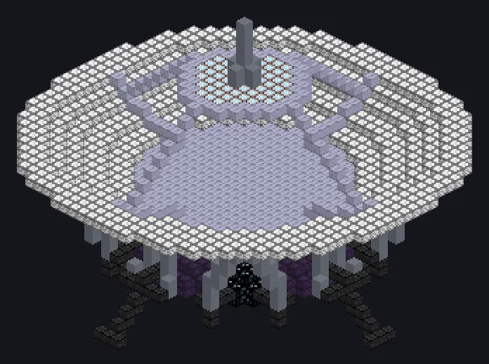

---
tags:
  - Catálogo de multiblocos
---

# Receptor de Sonda Espacial

<!-- Página gerada a partir do código do mod; a estrutura é a menor variante. -->

{ loading=lazy }

| | |
|---|---|
| **Tipos de receita** | Recepção de Sonda Espacial |
| **Tamanho** | 37 × 30 × 38 |
| **Blocos** | 2.853 |

## Descrição

Escuta o cosmos e engarrafa o que ouve. Capta partículas cósmicas com uma antena voltada para o céu aberto, longe de planetas.

- Tipo de Máquina: Receptor de Sonda Espacial
- Funciona em qualquer dimensão espacial do Ad Astra
- Overclock perfeito
- Para quando o céu acima da antena é coberto
- Precisa de um Computation Data Hatch

## Estrutura

| Bloco | Qtd. |
|---|---:|
| Invólucro Receptor Dyson | 816 |
| Carcaça Resistente a Alta Pressão | 446 |
| Invólucro Hipermecânico | 384 |
| Atomic Casing | 334 |
| Neutronium Frame | 317 |
| Carcaça de Planta Reforçada com Naquadah | 178 |
| Carcaça Anticongelante à Prova de Calor | 117 |
| Carcaça Estável de Neutrônio | 92 |
| High Power Casing | 57 |
| Heat Vent | 56 |
| Hipernúcleo | 28 |
| Tritanium Frame | 15 |
| Carcaça Ativa de Amprósio | 7 |
| Cleaning Maintenance Hatch | 1 |
| ULV Input Bus | 1 |
| Receptor de Sonda Espacial | 1 |
| ULV Output Hatch | 1 |
| Computation Data Reception Hatch | 1 |
| ULV Energy Hatch | 1 |

<small>Página gerada a partir do código do mod; a estrutura é a menor variante.</small>
