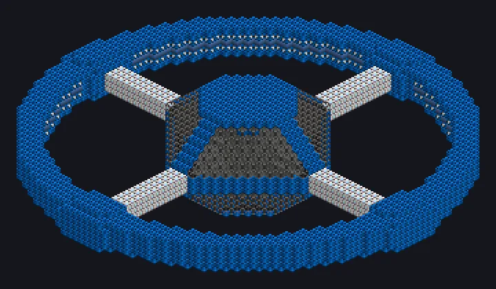

---
tags:
  - Catálogo de multiblocos
---

# Fábrica Estelar de Forja de Materiais Finais

<!-- Página gerada a partir do código do mod; a estrutura é a menor variante. -->

{ loading=lazy }

| | |
|---|---|
| **Tipos de receita** | Forja de Materiais Finais |
| **Tamanho** | 61 × 17 × 61 |
| **Blocos** | 6.149 |

## Descrição

Uma estrela numa caixa, forjando os últimos materiais. Forja materiais finais dentro de uma estrela contida, sem limite de paralelos.

- Tipo de Máquina: Forja de Materiais
- Thread Hatch: várias receitas ao mesmo tempo
- Aceita Laser Hatches
- Monta em qualquer direção
- Paralelos ilimitados

## Estrutura

| Bloco | Qtd. |
|---|---:|
| Carcaça Molecular | 2.957 |
| Carcaça de Contenção Estelar Final | 854 |
| Bobina Molecular | 780 |
| High Power Casing | 736 |
| Vidro de Campo de Força | 408 |
| Gerador de Campo de Contenção | 304 |
| Invólucro Oco | 105 |
| ULV Input Hatch | 1 |
| Fábrica Estelar de Forja de Materiais Finais | 1 |
| ULV Output Bus | 1 |
| ULV Input Bus | 1 |
| ULV Energy Hatch | 1 |

<small>Página gerada a partir do código do mod; a estrutura é a menor variante.</small>
