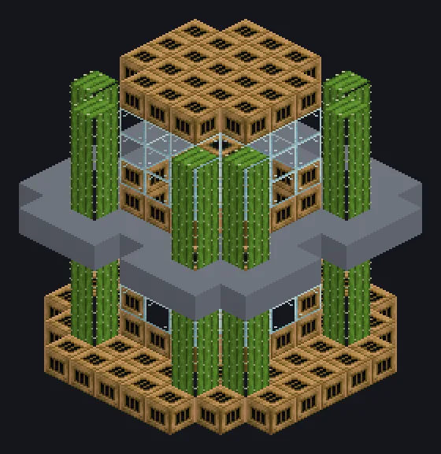

---
tags:
  - 蒸汽与原始
---

# 仙人掌奇观

<!-- 根据模组代码生成;所示结构为最小形态。 -->

*有沙漠，谁还需要锅炉？*

{ loading=lazy }

| | |
|---|---|
| **机器类型** | 蒸汽发电机 |
| **分类** | 蒸汽与原始 |
| **配方类型** | 仙人掌奇观 |
| **尺寸** | 9 × 11 × 9 |
| **方块数** | 341 |
| **来源** | GT: Not Leisure |

## 说明

燃烧仙人掌时代的碳燃料，将其价值以蒸汽返还。

- 煤炭/木炭：每个8,000 mB蒸汽
- 煤炭块：90,000 mB蒸汽
- 每1秒循环一个燃料
- 沙地上需要完全长成的仙人掌

## 结构

| 方块 | 数量 |
|---|---:|
| 青铜燃烧室 | 127 |
| Glass | 71 |
| Cactus | 64 |
| 青铜框架 | 44 |
| 青铜管道方块 | 18 |
| Sand | 16 |
| 仙人掌奇观 | 1 |

<small>根据模组代码生成；所示结构为最小形态。</small>
