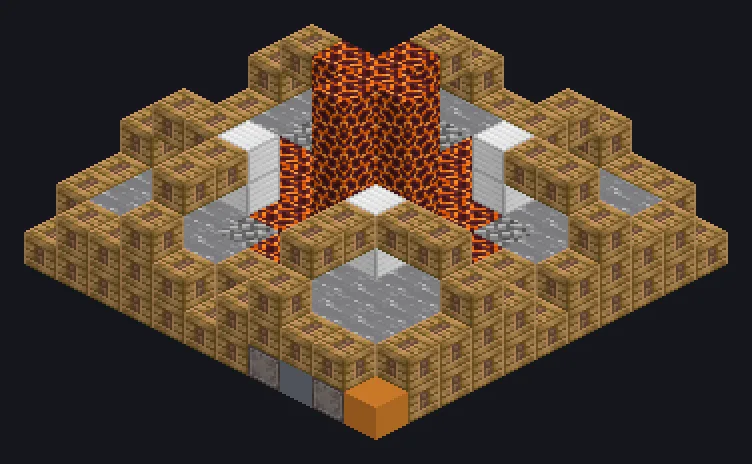

---
tags:
  - 蒸汽与原始
---

# 蒸汽圆石机

<!-- 根据模组代码生成;所示结构为最小形态。 -->

*无限圆石：最古老的把戏，如今工业化了。*

{ loading=lazy }

| | |
|---|---|
| **机器类型** | 碎岩机 |
| **分类** | 蒸汽与原始 |
| **配方类型** | 碎岩机 |
| **尺寸** | 11 × 6 × 11 |
| **方块数** | 284 |
| **来源** | GT: Not Leisure |

## 说明

一台高级蒸汽造石机，通过编程电路制造不同的石头。

- 电路选择石头类型
- 并行：默认16，可调至最高16

## 结构

| 方块 | 数量 |
|---|---:|
| 蒸汽机械方块 | 152 |
| Magma Block | 42 |
| Water | 40 |
| 青铜管道方块 | 25 |
| Cobblestone | 12 |
| Block of Iron | 8 |
| 蒸汽圆石机 | 1 |
| ULV输出总线 | 1 |
| 产出增幅蒸汽输出总线 | 1 |
| ULV输入总线 | 1 |
| 蒸汽输入仓 | 1 |

<small>根据模组代码生成；所示结构为最小形态。</small>
