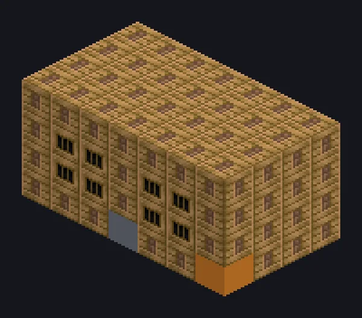

---
tags:
  - Vapor e primitivos
---

# Craqueador a Vapor

<!-- Gerada a partir do código do mod; a estrutura mostrada é a menor variante. -->

*Petroquímica, edição vitoriana.*

{ loading=lazy }

| | |
|---|---|
| **Tipo de máquina** | Craqueador |
| **Categoria** | Vapor e primitivos |
| **Tipos de receita** | Cracker |
| **Tamanho** | 7 × 4 × 4 |
| **Blocos** | 92 |
| **Origem** | GT: Not Leisure |

## Descrição

Um craqueador a vapor que quebra termicamente hidrocarbonetos sulfurosos com as receitas normais de craqueamento (circuitos 1-3).

- Alta pressão dobra os paralelos
- Paralelos: 8 bronze / 16 aço

## Estrutura

| Bloco | Qtd. |
|---|---:|
| Steam Machine Casing | 73 |
| Bronze Firebox Casing | 16 |
| Cleaning Maintenance Hatch | 1 |
| Craqueador a Vapor | 1 |
| Hatch de Entrada de Vapor Wireless | 1 |

<small>Gerada a partir do código do mod; a estrutura mostrada é a menor variante.</small>
