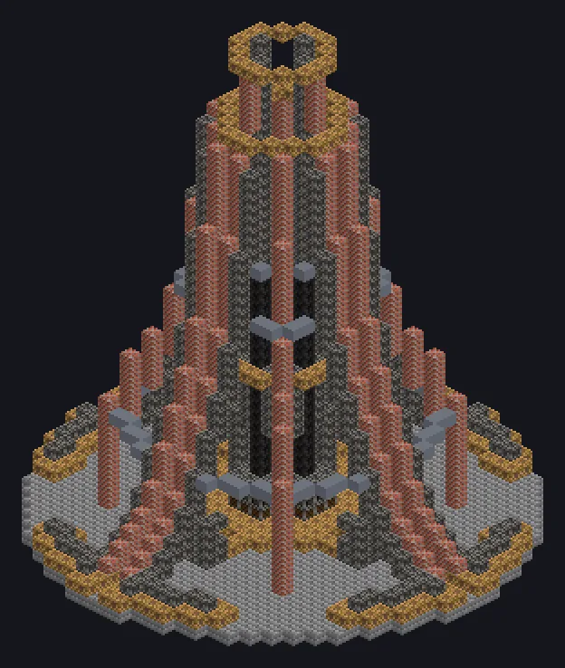

---
tags:
  - Steam and primitive
---

# Steam Elevator

<!-- Generated from the mod code; the structure shown is the smallest variant. -->

*Going up? Please hold on to your top hat.*

{ loading=lazy }

| | |
|---|---|
| **Machine type** | Modular Elevator |
| **Category** | Steam and primitive |
| **Recipe types** | None |
| **Size** | 35 × 43 × 35 |
| **Blocks** | 2,698 |
| **Origin** | GT: Not Leisure |

## Description

A modular steam-powered elevator that hosts utility modules and launches you to other planets.

- Set out: opens the Ad Astra planet selection
- Up to 12 module slots
- Modules only work while attached

## Structure

| Block | Qty |
|---|---:|
| Stone Bricks | 800 |
| Solid Machine Casing | 742 |
| Bricks | 620 |
| Steam Machine Casing | 349 |
| Steam Compact Pipe Casing | 88 |
| Steel Frame | 67 |
| Steel Reinforced Wood | 16 |
| Steel Firebox Casing | 15 |
| Steam Elevator | 1 |

<small>Generated from the mod code; the structure shown is the smallest variant.</small>
