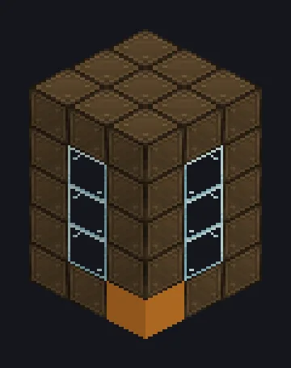

---
tags:
  - Vapor e primitivos
---

# Gerador de Lava a Vapor

<!-- Gerada a partir do código do mod; a estrutura mostrada é a menor variante. -->

*Transformando o chão em lava, profissionalmente.*

{ loading=lazy }

| | |
|---|---|
| **Tipo de máquina** | Fabricante de Lava |
| **Categoria** | Vapor e primitivos |
| **Tipos de receita** | Fabricante de Lava |
| **Tamanho** | 3 × 5 × 3 |
| **Blocos** | 45 |
| **Origem** | GT: Not Leisure |

## Descrição

Derrete pedra em lava usando vapor no lugar de EU.

- 1 s por bloco de pedra
- Alta pressão: 2x velocidade, 2x vapor
- Paralelos: 16 padrão, ajustável até 16

## Estrutura

| Bloco | Qtd. |
|---|---:|
| Stronze Wrapped Casing | 28 |
| Glass | 12 |
| Lava | 3 |
| Gerador de Lava a Vapor | 1 |
| Hatch de Entrada de Vapor Wireless | 1 |

<small>Gerada a partir do código do mod; a estrutura mostrada é a menor variante.</small>
