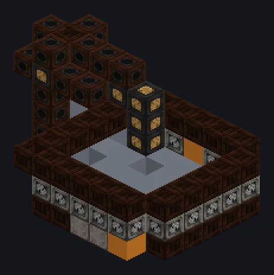

---
tags:
  - Vapor e primitivos
---

# Fabricante a Vapor

<!-- Gerada a partir do código do mod; a estrutura mostrada é a menor variante. -->

*A linha de montagem, mas cada operário é um pistão.*

{ loading=lazy }

| | |
|---|---|
| **Tipo de máquina** | Manufatura Hidráulica |
| **Categoria** | Vapor e primitivos |
| **Tipos de receita** | Manufatura Hidráulica |
| **Tamanho** | 9 × 7 × 7 |
| **Blocos** | 139 |
| **Origem** | GT: Not Leisure |

## Descrição

Uma linha de montagem hidráulica avançada que constrói as maiores máquinas da era do vapor.

- Fabrica o Supercompressor a Vapor e mais
- Paralelos: 16 padrão, ajustável até 16

## Estrutura

| Bloco | Qtd. |
|---|---:|
| Breel Plated Casing | 74 |
| Breel Pipe Casing | 20 |
| Steel Frame | 16 |
| Steel Gearbox Casing | 16 |
| Hydraulic Assembler Casing | 9 |
| ULV Output Bus | 1 |
| Fabricante a Vapor | 1 |
| ULV Input Bus | 1 |
| Hatch de Entrada de Vapor Wireless | 1 |

<small>Gerada a partir do código do mod; a estrutura mostrada é a menor variante.</small>
