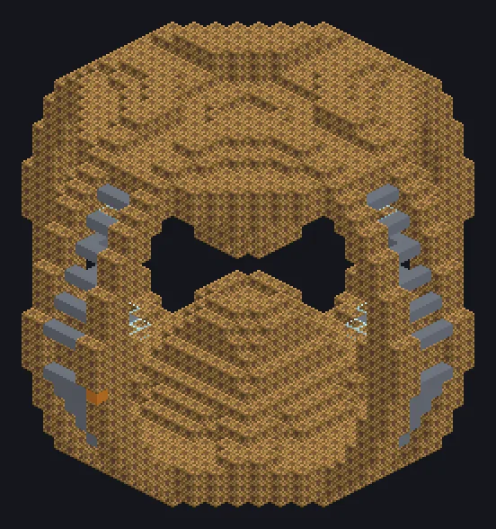

---
tags:
  - Vapor e primitivos
---

# Supercompressor a Vapor

<!-- Gerada a partir do código do mod; a estrutura mostrada é a menor variante. -->

*Diamantes nascem sob pressão. Esta máquina também.*

{ loading=lazy }

| | |
|---|---|
| **Tipo de máquina** | Compressor |
| **Categoria** | Vapor e primitivos |
| **Tipos de receita** | Compressor |
| **Tamanho** | 35 × 33 × 35 |
| **Blocos** | 4.868 |
| **Origem** | GT: Not Leisure |

## Descrição

Um supercompressor em que jatos impossíveis de vapor esmagam o material até tomar forma.

- Velocidade 2x maior que a singleblock
- Paralelos: até 256
- Fabricado com 64 Large Steam Compressors

## Estrutura

| Bloco | Qtd. |
|---|---:|
| Steam Machine Casing | 4.657 |
| Bronze Frame | 144 |
| Glass | 64 |
| Supercompressor a Vapor | 1 |
| Cleaning Maintenance Hatch | 1 |
| Hatch de Entrada de Vapor Wireless | 1 |

<small>Gerada a partir do código do mod; a estrutura mostrada é a menor variante.</small>
