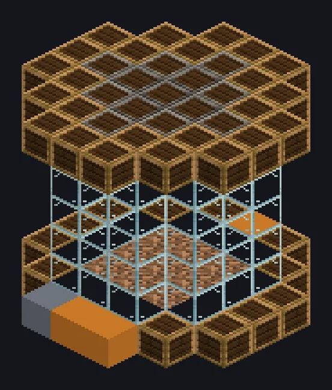

---
tags:
  - Catálogo de multiblocos
---

# Cortador de Madeira a Vapor

<!-- Página gerada a partir do código do mod; a estrutura é a menor variante. -->

{ loading=lazy }

| | |
|---|---|
| **Tipos de receita** | Serralheria |
| **Tamanho** | 7 × 7 × 7 |
| **Blocos** | 134 |

[Guia completo →](../steam/steam-woodcutter.md)

## Descrição

Sou lenhador e tá tudo bem. Um processador de árvores industrial que transforma mudas em toras usando só vapor.

- Tipo de Máquina: Lenhador
- Muda entra, tora sai, sem plantar árvore
- Paralelos: 64 padrão, ajustável até 64

## Estrutura

| Bloco | Qtd. |
|---|---:|
| Glass | 60 |
| Bronze Reinforced Wood | 44 |
| Iron Reinforced Wood | 12 |
| Dirt | 9 |
| Steel Reinforced Wood | 5 |
| Steam Output Bus | 1 |
| Cortador de Madeira a Vapor | 1 |
| Barramento Grande de Entrada a Vapor | 1 |
| Hatch de Entrada de Vapor Wireless | 1 |

<small>Página gerada a partir do código do mod; a estrutura é a menor variante.</small>
