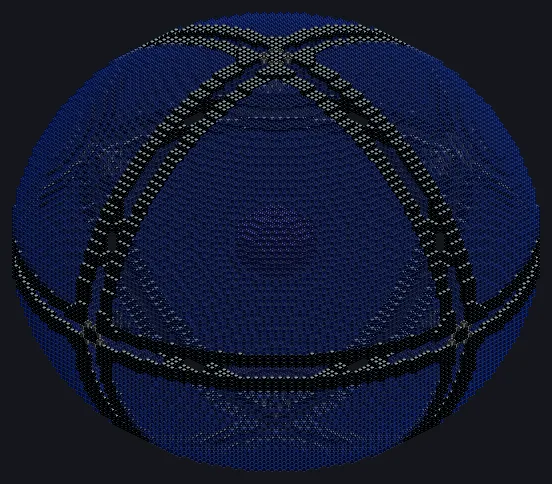

---
tags:
  - Catálogo de multiblocos
---

# Câmara de Contenção Estelar

<!-- Página gerada a partir do código do mod; a estrutura é a menor variante. -->

{ loading=lazy }

| | |
|---|---|
| **Tipos de receita** | Nenhum |
| **Tamanho** | 93 × 93 × 93 |
| **Blocos** | 21.823 |

## Descrição

Gira setecentas vezes por segundo. Não encoste. Mantém uma estrela de nêutrons presa em bandas de campo e extrai a energia da rotação para a rede Nexus.

- Tipo de Máquina: Contenção Estelar
- Saída de até 2^59 EU/t como estrela de nêutrons
- Modo buraco negro: até 2^62 EU/t da ergosfera
- Alimentar massa acelera a estrela (pulsar reciclado)
- Tremores decifram a estrela e liberam tiers de banda
- Acima de 2,2 M☉ ela colapsa num buraco negro
- Girar abaixo do período de Kepler despedaça a estrela
- Bandas sem energia num tremor danificam a contenção

## Estrutura

| Bloco | Qtd. |
|---|---:|
| Vidro de Campo de Plasma | 15.773 |
| Carcaça Estável de Neutrônio | 4.428 |
| Núcleo de Matéria Degenerada | 1.419 |
| Carcaça de Liga de Naquadah Radiante | 200 |
| ULV Input Hatch | 1 |
| Câmara de Contenção Estelar | 1 |
| ULV Output Bus | 1 |

<small>Página gerada a partir do código do mod; a estrutura é a menor variante.</small>
