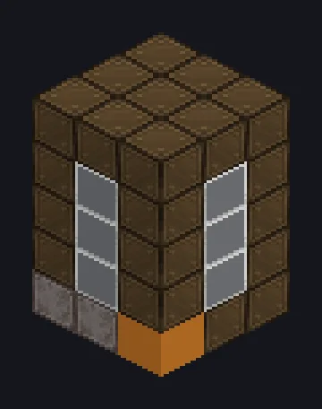

---
tags:
  - Steam and primitive
---

# Stone SuperHeater

<!-- Generated from the mod code; the structure shown is the smallest variant. -->

*Rocks, but hotter. Much hotter.*

{ loading=lazy }

| | |
|---|---|
| **Machine type** | Super Heating |
| **Category** | Steam and primitive |
| **Recipe types** | Super Heating |
| **Size** | 3 × 5 × 3 |
| **Blocks** | 45 |
| **Origin** | GT: Not Leisure |

## Description

Melts stone with extreme heat for the steam era's hottest recipes.

- Adjustable parallel in the controller
- Parallel: 32 default, adjustable up to 32

## Structure

| Block | Qty |
|---|---:|
| Stronze-Wrapped Casing | 26 |
| Borosilicate Glass | 12 |
| Magma Block | 3 |
| ULV Output Hatch | 1 |
| Stone SuperHeater | 1 |
| ULV Input Bus | 1 |
| Wireless Steam Input Hatch | 1 |

<small>Generated from the mod code; the structure shown is the smallest variant.</small>
