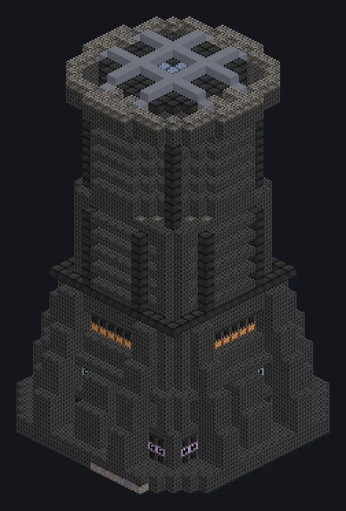

---
tags:
  - Electric processing
---

# Super Blast Smelter

<!-- Generated from the mod code; the structure shown is the smallest variant. -->

*Smelting all things at artificial-sun temperatures.*

{ loading=lazy }

| | |
|---|---|
| **Machine type** | Blast Furnace, Alloy Blast |
| **Category** | Electric processing |
| **Recipe types** | Electric Blast Furnace, Alloy Blast Smelter |
| **Size** | 24 × 43 × 23 |
| **Blocks** | 6,908 |
| **Origin** | GregTech Odyssey |

## Description

Electric Blast Furnace and Alloy Blast Smelter recipes.

- Smelts and alloys at star-core heat:
- +100K heat per voltage tier above MV
- Thread Hatch: several recipes at once
- Parallel set by the Parallel Hatch
- Coils must meet the recipe temperature

## Structure

| Block | Qty |
|---|---:|
| High Temperature Smelting Casing | 3,567 |
| Cupronickel Coil Block | 888 |
| Naquadah Alloy Casing | 276 |
| Tungstensteel Pipe Casing | 274 |
| Heat Vent | 268 |
| Bronze Firebox Casing | 225 |
| Steel Firebox Casing | 225 |
| Bronze Pipe Casing | 196 |
| Steel Pipe Casing | 169 |
| Titanium Firebox Casing | 169 |
| Tungstensteel Firebox Casing | 169 |
| Titanium Pipe Casing | 144 |
| Solid Steel Machine Casing | 112 |
| Engine Intake Casing | 60 |
| Extreme Engine Intake Casing | 52 |
| Naquadah Frame | 48 |
| PTFE Pipe Casing | 29 |
| Amprosium Pipe Casing | 25 |
| Muffler Hatch IV | 5 |
| Super Blast Smelter | 1 |
| ULV Output Hatch | 1 |
| ULV Input Hatch | 1 |
| ULV Output Bus | 1 |
| ULV Input Bus | 1 |
| Cleaning Maintenance Hatch | 1 |
| ULV Energy Hatch | 1 |

<small>Generated from the mod code; the structure shown is the smallest variant.</small>
