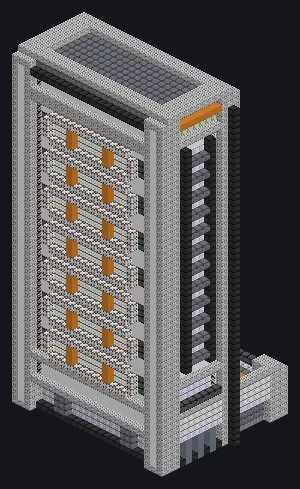

---
tags:
  - Multiblock catalog
---

# Supercomputing Center

<!-- Generated from the mod code; the structure shown is the smallest variant. -->

{ loading=lazy }

| | |
|---|---|
| **Recipe types** | None |
| **Size** | 28 × 59 × 21 |
| **Blocks** | 12,518 |

## Description

Three generations of computers under one roof. Mind the heat. supply CWU/t to the research network.

- Machine Type: Computation
- A tiered HPCA: HPCA, NICH or GWCA components
- Three tiers (screwdriver): HPCA, NICH, GWCA
- MFPC coolant restores the CWU/t multiplier
- Tier 1 pays a quarter of the components' upkeep
- Tiers 2-3 need an Optical / Exotic Mainframe
- CWU/t = sum of component power x correction factor
- Low cooling damages computing components
- Tier must match the casings, vents and glass
- At higher tiers, the correction factor decays over time
- Used MFPC turns into its invalidated form

## Structure

| Block | Qty |
|---|---:|
| Mc Nylon Tensile Mechanical Shell | 2,350 |
| Iridium Casing | 2,231 |
| White ABS Plastic Mechanical Casing | 1,325 |
| Computer Heat Vent | 980 |
| GWCA Cooling Components | 840 |
| Computer Casing | 728 |
| Tungsten Borosilicate Glass | 546 |
| Antifreeze Heatproof Machine Casing | 526 |
| Advanced Computer Casing | 468 |
| Pressure Containment Casing | 440 |
| Cobalt Oxide Ceramic Strong Thermally Conductive Mechanical Block | 434 |
| Naquadah Alloy Casing | 347 |
| Lithium Oxide Ceramic Heat Resistant Shock Resistant Mechanical Cube | 240 |
| Ruridit Frame | 229 |
| Nonconducting Casing | 221 |
| Hastelloy N Frame | 174 |
| Strontium Carbonate Ceramic Ray Absorbing Mechanical Cube | 143 |
| UHV Machine Casing | 112 |
| Oxidation Resistant Hastelloy N Mechanical Casing | 93 |
| High Power Casing | 54 |
| Stainless Steel Frame | 27 |
| Andesite Wall | 2 |
| Iron Bars | 2 |
| Supercomputing Center | 1 |
| ULV Output Hatch | 1 |
| ULV Input Hatch | 1 |
| ULV Input Bus | 1 |
| Cleaning Maintenance Hatch | 1 |
| ULV Energy Hatch | 1 |

<small>Generated from the mod code; the structure shown is the smallest variant.</small>
