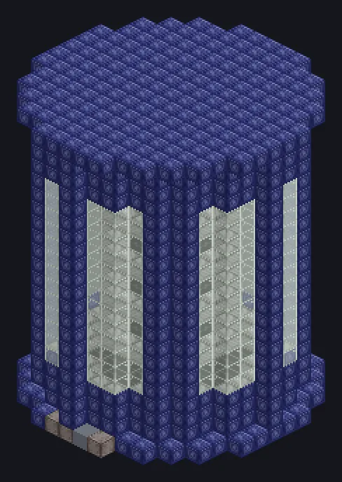

---
tags:
  - Catálogo de multiblocos
---

# Fábrica Eletromagnética Supercondutora

<!-- Página gerada a partir do código do mod; a estrutura é a menor variante. -->

{ loading=lazy }

| | |
|---|---|
| **Tipos de receita** | Polarizer, Electromagnetic Separator |
| **Tamanho** | 15 × 21 × 15 |
| **Blocos** | 1.629 |

## Descrição

As equações de Maxwell, agora em tamanho industrial. Polariza e separa magneticamente num campo supercondutor de resistência zero.

- Tipo de Máquina: Polarizador, Separador EM
- Thread Hatch: várias receitas ao mesmo tempo
- Aceita Laser Hatches
- Paralelos definidos pelo Parallel Hatch

## Estrutura

| Bloco | Qtd. |
|---|---:|
| Carcaça Mecânica de Lafium | 745 |
| Tempered Glass | 364 |
| Bobina Supercondutora Aprimorada | 316 |
| Electrolytic Cell | 156 |
| Molybdenum Disilicide Coil Block | 24 |
| Tubulação Acelerada | 19 |
| ULV Output Bus | 1 |
| Fábrica Eletromagnética Supercondutora | 1 |
| ULV Input Bus | 1 |
| Auto Maintenance Hatch | 1 |
| ULV Energy Hatch | 1 |

<small>Página gerada a partir do código do mod; a estrutura é a menor variante.</small>
