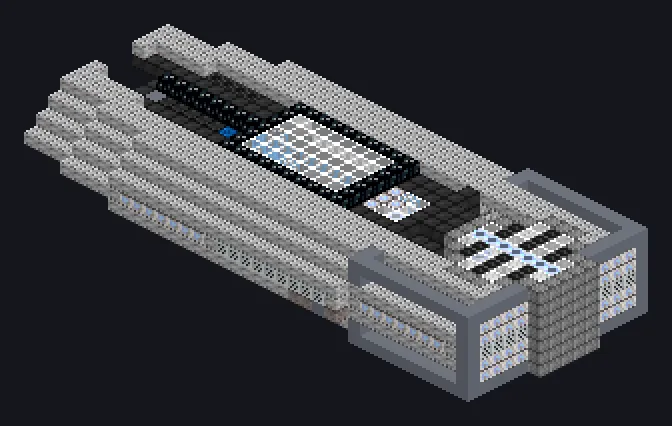

---
tags:
  - Electric processing
---

# Superconducting Magnetic Presser

<!-- Generated from the mod code; the structure shown is the smallest variant. -->

*Can easily accelerate coins to Mach 3!*

{ loading=lazy }

| | |
|---|---|
| **Machine type** | Forming Press |
| **Category** | Electric processing |
| **Recipe types** | Forming Press |
| **Size** | 38 × 7 × 17 |
| **Blocks** | 2,653 |
| **Origin** | GregTech Odyssey |

## Description

Shapes metal with railgun-grade electromagnetic force.

- Thread Hatch: several recipes at once
- Accepts Laser Hatches
- Parallel set by the Parallel Hatch

## Structure

| Block | Qty |
|---|---:|
| Iridium Casing | 1,270 |
| Naquadah Alloy Casing | 376 |
| Oxidation Resistant Hastelloy N Mechanical Casing | 175 |
| Amprosium Borosilicate Glass | 140 |
| Neutronium Stable Casing | 115 |
| Naquadah Reinforced Plant Casing | 105 |
| Dimension Injection Casing | 96 |
| Superconducting Coil Block | 96 |
| Hastelloy C-276 Frame | 74 |
| Molecular Casing | 44 |
| Amprosium Active Casing | 44 |
| Electrolytic Cell | 28 |
| Containment Field Generator | 26 |
| Filter Casing | 26 |
| Heat Vent | 16 |
| Block of Neutronium | 9 |
| Naquadria Frame | 8 |
| ULV Output Bus | 1 |
| ULV Input Bus | 1 |
| Cleaning Maintenance Hatch | 1 |
| ULV Energy Hatch | 1 |
| Superconducting Magnetic Presser | 1 |

<small>Generated from the mod code; the structure shown is the smallest variant.</small>
