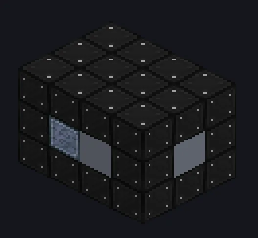

---
tags:
  - Catálogo de multiblocos
---

# Turbina de Vapor Supercrítica

<!-- Página gerada a partir do código do mod; a estrutura é a menor variante. -->

{ loading=lazy }

| | |
|---|---|
| **Tipos de receita** | Turbina a Vapor Supercrítico |
| **Tamanho** | 4 × 3 × 3 |
| **Blocos** | 36 |
| **Gerador** | ✓ |

## Descrição

Vapor, só que já viu coisas. Uma turbina IV que expande vapor supercrítico por um rotor e gera EU.

- Tipo de Máquina: Turbina a Vapor Supercrítico
- Cada tier de rotor acima de IV: +10% efic., 2x EU/t
- Módulo: velocidade 2x, +20% de eficiência
- Produção base: 16.384 EU/t
- O Modo Alta Velocidade soma com o módulo
- O módulo dobra o desgaste do rotor

## Estrutura

| Bloco | Qtd. |
|---|---:|
| Carcaça de Turbina Supercrítica | 27 |
| Tungstensteel Gearbox Casing | 2 |
| ULV Dynamo Hatch | 1 |
| ULV Output Hatch | 1 |
| Muffler Hatch IV | 1 |
| ULV Input Hatch | 1 |
| Turbina de Vapor Supercrítica | 1 |
| Auto Maintenance Hatch | 1 |
| IV Rotor Holder | 1 |

<small>Página gerada a partir do código do mod; a estrutura é a menor variante.</small>
