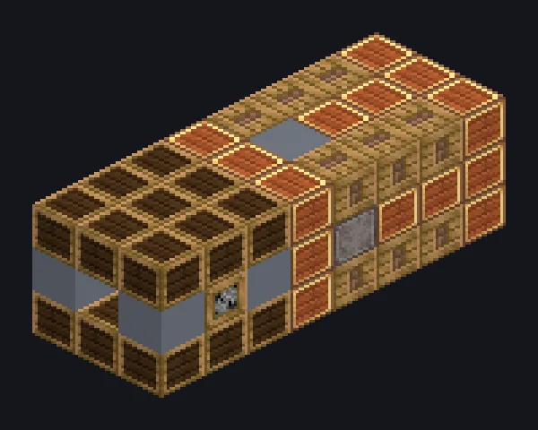

---
tags:
  - Multiblock catalog
---

# Thermal Power Pump

<!-- Generated from the mod code; the structure shown is the smallest variant. -->

{ loading=lazy }

| | |
|---|---|
| **Recipe types** | None |
| **Size** | 3 × 3 × 8 |
| **Blocks** | 71 |

## Description

Turns steam back into water. Circle of life. Condenses steam into water based on the surrounding biome.

- Machine Type: Water Pump
- Rain boosts output by 50%
- Oceans and rivers produce the most
- Output depends on the biome
- Produces nothing in the Nether

## Structure

| Block | Qty |
|---|---:|
| Brass Reinforced Wooden Casing | 25 |
| Bronze Reinforced Wood | 17 |
| Steam Machine Casing | 12 |
| Bronze Pipe Casing | 5 |
| Treated Wood Frame | 4 |
| Bronze Gearbox Casing | 4 |
| ULV Output Hatch | 1 |
| Thermal Power Pump | 1 |
| Auto Maintenance Hatch | 1 |
| ULV Input Hatch | 1 |

<small>Generated from the mod code; the structure shown is the smallest variant.</small>
