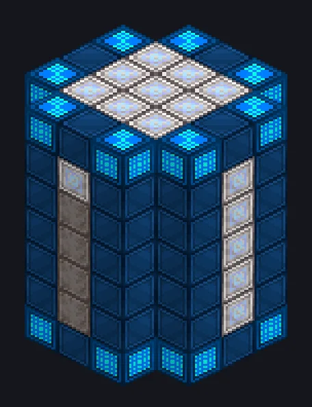

---
tags:
  - Endgame systems
---

# Transcendent Plasma Mixer

<!-- Generated from the mod code; the structure shown is the smallest variant. -->

*Assisting in all your DTPF needs!*

{ loading=lazy }

| | |
|---|---|
| **Machine type** | Transcendent Mixer, TPM |
| **Category** | Endgame systems |
| **Recipe types** | Transcendent Plasma Mixer |
| **Size** | 5 × 7 × 5 |
| **Blocks** | 102 |
| **Origin** | GT: New Horizons |

## Description

Mixes the exotic plasmas that feed the Plasma Forge, scaled with a Parallel Hatch.

- All inputs scale with parallel, time does not
- Cost per parallel: 10 x EU/t x duration
- Power only from wireless networks
- EU is paid when the recipe starts

## Structure

| Block | Qty |
|---|---:|
| Dimensionally Transcendent Casing | 48 |
| Dimension Injection Casing | 33 |
| Dimensional Bridge Casing | 16 |
| ULV Input Hatch | 2 |
| Transcendent Plasma Mixer | 1 |
| ULV Output Hatch | 1 |
| ULV Input Bus | 1 |

<small>Generated from the mod code; the structure shown is the smallest variant.</small>
