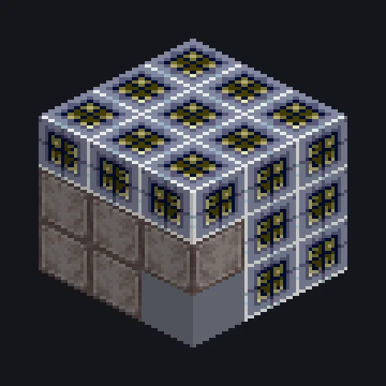

---
tags:
  - Electric processing
---

# Universal Factory

<!-- Generated from the mod code; the structure shown is the smallest variant. -->

*One factory to rule them all.*

{ loading=lazy }

| | |
|---|---|
| **Machine type** | Universal Factory |
| **Category** | Electric processing |
| **Recipe types** | Bender, Compressor, Forge Hammer, Cutter, Extruder, Lathe, Wiremill, Forming Press, Polarizer, Laser Engraver, Fluid Solidifier, Assembler, Arc Furnace, Circuit Assembler, Canner, Centrifuge, Thermal Centrifuge, Electrolyzer, Sifter, Macerator, Extractor, Chemical Reactor, Mixer, Chemical Bath, Ore Washer, Large Chemical Reactor, Packer, Distillery, Autoclave, Fluid Heater, Brewery, Fermenter |
| **Size** | 3 × 3 × 3 |
| **Blocks** | 27 |
| **Origin** | GTLSupb |

## Description

Processes many different recipes at once with cross-recipe parallel and threads.

- Runs 32 recipe types in one machine
- Legacy mode: thermal warmup and batch
- Threads and parallel follow balance mode and tier
- Special hatches must be enabled in the config

## Structure

| Block | Qty |
|---|---:|
| Universal Factory Casing | 19 |
| ULV Output Bus | 1 |
| ULV Energy Hatch | 1 |
| ULV Input Bus | 1 |
| Universal Factory | 1 |
| Steel Frame | 1 |
| ULV Output Hatch | 1 |
| Cleaning Maintenance Hatch | 1 |
| ULV Input Hatch | 1 |

<small>Generated from the mod code; the structure shown is the smallest variant.</small>
