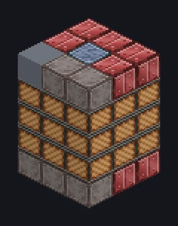

---
tags:
  - Catálogo de multiblocos
---

# Fornalha de Secagem a Vácuo

<!-- Página gerada a partir do código do mod; a estrutura é a menor variante. -->

{ loading=lazy }

| | |
|---|---|
| **Tipos de receita** | Secagem a Vácuo, Desidratador |
| **Tamanho** | 3 × 5 × 3 |
| **Blocos** | 42 |

## Descrição

Transforma espuma de volta em pó. Mágica, só que com vácuo. Seca espumas de flotação de volta em pós, Lama Vermelha e Água, ou roda o Desidratador.

- Tipo de Máquina: Secagem a Vácuo, Desidratador
- Desidratador: paralelos 2x a cada 900K de bobina
- Escolha o modo Desidratador no controlador
- As bobinas precisam da temperatura da receita
- A Secagem a Vácuo sempre roda em série

## Estrutura

| Bloco | Qtd. |
|---|---:|
| Cupronickel Coil Block | 24 |
| Carcaça de Aço Vermelho | 10 |
| ULV Input Bus | 1 |
| Cleaning Maintenance Hatch | 1 |
| Fornalha de Secagem a Vácuo | 1 |
| ULV Input Hatch | 1 |
| Muffler Hatch IV | 1 |
| ULV Output Bus | 1 |
| ULV Energy Hatch | 1 |
| ULV Output Hatch | 1 |

<small>Página gerada a partir do código do mod; a estrutura é a menor variante.</small>
