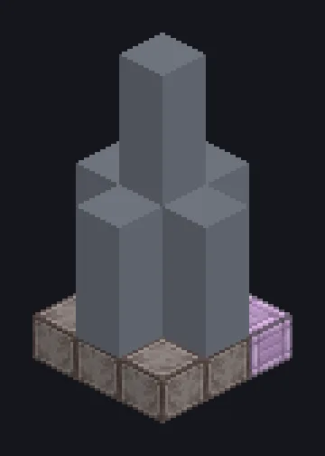

---
tags:
  - Processamento elétrico
---

# Void Fluid Drilling Rig

<!-- Gerada a partir do código do mod; a estrutura mostrada é a menor variante. -->

*O poço secou. O vazio não.*

{ loading=lazy }

| | |
|---|---|
| **Tipo de máquina** | Perfuração de Fluidos do Vazio |
| **Categoria** | Processamento elétrico |
| **Tipos de receita** | Perfuração de Fluidos Void |
| **Tamanho** | 3 × 7 × 3 |
| **Blocos** | 27 |
| **Origem** | GregTech Leisure |

## Descrição

Continua produzindo um fluido depois que o depósito natural foi extraído e registrado.

- Os Dados de Depósito são reutilizáveis
- Paralelos escalam energia, reagentes e produção
- Tier de entrada: EV
- Só na dimensão de origem, até o upgrade
- Precisa de Fluido de Perfuração; saída cheia pausa

## Estrutura

| Bloco | Qtd. |
|---|---:|
| Steel Frame | 15 |
| Stable Titanium Machine Casing | 6 |
| ULV Input Hatch | 1 |
| Void Fluid Drilling Rig | 1 |
| Cleaning Maintenance Hatch | 1 |
| ULV Input Bus | 1 |
| ULV Output Hatch | 1 |
| ULV Energy Hatch | 1 |

<small>Gerada a partir do código do mod; a estrutura mostrada é a menor variante.</small>
