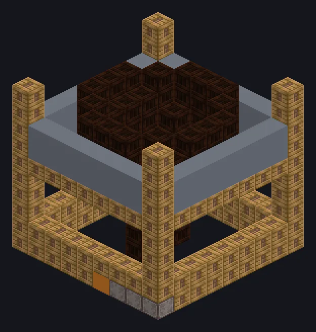

---
tags:
  - Catálogo de multiblocos
---

# Portão a Vapor Envelhecido do Minerador do Vazio

<!-- Página gerada a partir do código do mod; a estrutura é a menor variante. -->

{ loading=lazy }

| | |
|---|---|
| **Tipos de receita** | Nenhum |
| **Tamanho** | 9 × 10 × 9 |
| **Blocos** | 280 |

## Descrição

Minerando uma dimensão feita só de vapor. Não pergunte. Extrai recursos brutos das Dimensões de e Carvão brutos.

- Tipo de Máquina: Minerador do Vazio
- Vapor: Ouro, Cobre, Ferro, Cobalto
- Vapor Denso: itens 2x, velocidade 2x
- SuperAquecido: itens 3x, velocidade 3x
- Insanely: itens 5x, velocidade 5x
- Os bônus são configuráveis na config do GTNA
- Custo de EU: 1,5x / 2x / 4x com cada bônus
- Precisa de Fluido de Perfuração por operação

## Estrutura

| Bloco | Qtd. |
|---|---:|
| Steam Machine Casing | 119 |
| Breel Plated Casing | 100 |
| Steel Frame | 56 |
| Portão a Vapor Envelhecido do Minerador do Vazio | 1 |
| Hatch de Entrada de Vapor Wireless | 1 |
| ULV Output Hatch | 1 |
| ULV Input Hatch | 1 |
| ULV Output Bus | 1 |

<small>Página gerada a partir do código do mod; a estrutura é a menor variante.</small>
