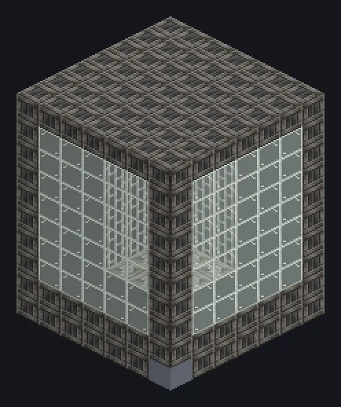

# 工业屠宰场

{ loading=lazy }

虚拟刷怪：机器直接抽取所选生物组的原版战利品表，世界中不需要任何生物。[图鉴页](catalog/industrial_slaughterhouse.md)。

## 模式

在输入总线中放入编程电路：

| 电路 | 模式 | 生物 | 起始等级 | EU/t | 掉落倍率 |
|:---:|---|---|---|---:|---|
| 1 | 被动 | 鸡、牛、猪、羊、兔子、马、山羊 | LV | 1,000 | $2^{\,\text{等级} - \text{LV}}$ |
| 2 | 敌对 | 僵尸、骷髅、苦力怕、蜘蛛、末影人、女巫、烈焰人 | MV | 2,560 | $2^{\,\text{等级} - \text{MV}}$ |
| 3 | Boss | 监守者、凋灵、远古守卫者 | ZPM | 32,000 | $3^{\,\text{等级} - \text{ZPM}}$ |
| 4 | 末影龙 | 1 个龙蛋、4 瓶龙息、1 个龙首 | UHV | 120,000 | $5^{\,\text{等级} - \text{UHV}}$ |

每次运行 40 刻。等级为机器的能量等级。低于模式起始等级时机器不产出任何东西。

## 产量

每次运行重复 $\max(1,\ (\text{等级} - 2) \times 8)$ 次：LV 和 MV 为 1 次，HV 为 8 次，EV 为 16 次，IV 为 24 次，依此类推。每次重复随机选择该组中的一种生物，抽取其战利品表，并把每项掉落乘以该模式的倍率，每项掉落**最多一组**。

| 等级 | 重复次数 | 被动 | 敌对 | Boss | 末影龙 |
|---|---:|---:|---:|---:|---:|
| LV | 1 | 1× | — | — | — |
| MV | 1 | 2× | 1× | — | — |
| HV | 8 | 4× | 2× | — | — |
| EV | 16 | 8× | 4× | — | — |
| IV | 24 | 16× | 8× | — | — |
| LuV | 32 | 32× | 16× | — | — |
| ZPM | 40 | 64× | 32× | 1× | — |
| UV | 48 | 128× | 64× | 3× | — |
| UHV | 56 | 256× | 128× | 9× | 1× |
| UEV | 64 | 512× | 256× | 27× | 5× |

每项掉落最多一组（大多数物品为 64 个），因此倍率超过 64 倍后不再增加数量；但额外的重复次数仍然有效。掉落来自真实的战利品表，因此修改生物掉落的模组和数据包也会影响这台机器。

## 提示

- 多装几个输出总线：高等级时每次运行会产出很多组物品。
- 它基于 GTNA 的多配方逻辑，可安装[线程仓](../parts/thread-hatch.md)、[加速仓](../parts/accelerate-hatch.md)和[超频仓](../parts/overclock-hatch.md)。
- 界面显示当前模式、倍率和最近的掉落。
