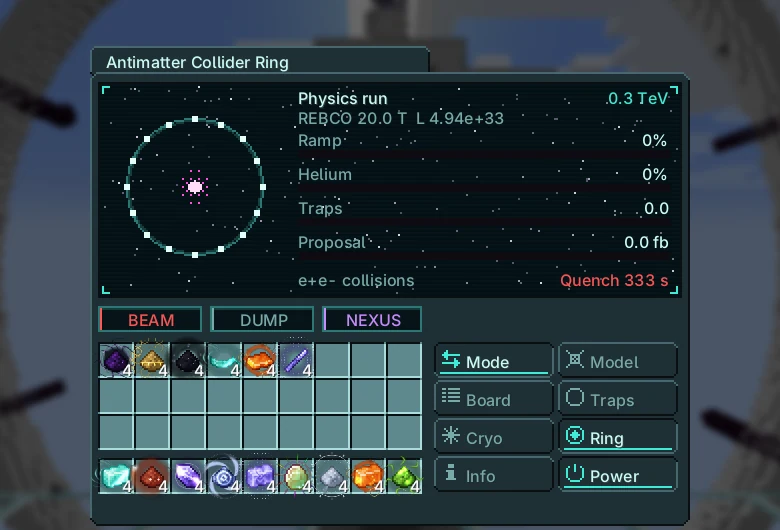
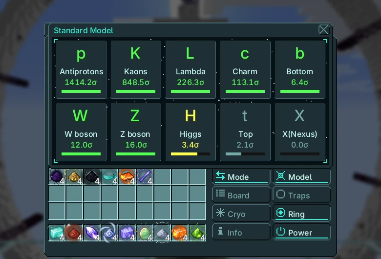
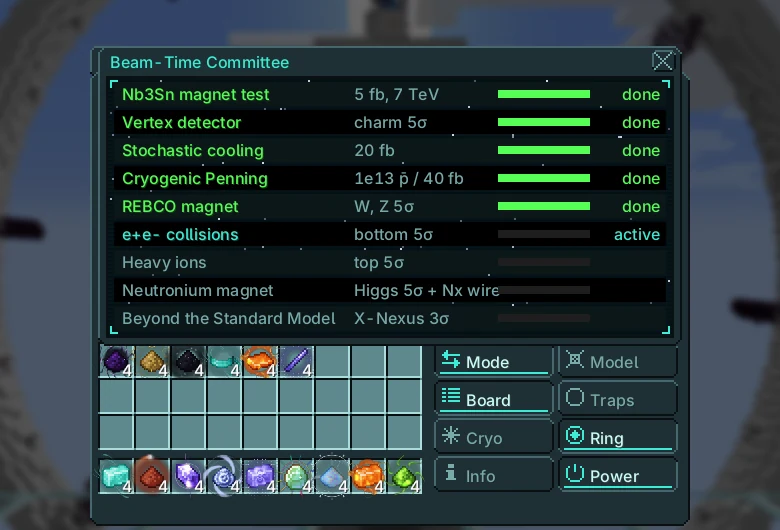

# Antimatter Collider Ring

{ loading=lazy }

Accelerates two counter-rotating beams around a 3 km ring and collides them. Production runs make exotic particles and antiprotons; physics runs gather luminosity to discover particles and complete committee proposals.

|  |  |
|---|---|
| **Tier** | UIV |
| **Size** | 155 × 127 × 137 |
| **Energy** | owner's Nexus network (magnets and traps) |
| **Fluid** | liquid helium |
| **Controller** | Assembly Line (UIV), research on the UIV Emitter |
| **Blocks** | [catalog page](../catalog/antimatter_collider_ring.md) |

## Structure and hatches

| Hatch | Max | Use |
|---|---|---|
| Input Hatch | 4 | liquid helium |
| Input Bus | 2 | fine Nexium wire (Neutronium Magnet proposal) |
| Output Bus | 4 | particles, Antiproton Penning Cells |
| Collision Detector Hatch | 1 | needed to record physics runs |
| Beam Dump | 1 | halves the quench recovery |

While running, the ring and gyro blocks are taken into the controller and drawn moving; they come back when the machine stops.

## Modes

Click the mode line to switch. Production: particles with 10% yield before evidence, 40% at 3σ and 100% after the 5σ discovery; antiprotons fill the traps and leave as Antiproton Penning Cells (1e11 each).

Physics: the integrated luminosity raises each particle's significance and advances the active proposal.

$$
\begin{aligned}
E_{\text{beam}} &= 0.3\,B\,\rho \quad (\text{GeV, } B \text{ in T, } \rho = 3000\ \text{m}) \\
E_{\text{cm}} &= 2\left(150 + (E_{\text{beam}} - 150) \cdot \min\!\left(1, \tfrac{t}{20\ \text{s}}\right)\right)\ \text{GeV} \\
\mathcal{L} &= \frac{f_{\text{rev}}\,n_b\,N^{2}}{4\pi\sigma^{2}}, \qquad f_{\text{rev}} = \frac{c}{2\pi\rho} \approx 15{,}905\ \text{Hz},\ N = 10^{11} \\
\Delta\!\int\!\mathcal{L} &= \mathcal{L} \cdot 10^{-39} \cdot 10^{5}\ \text{fb}^{-1}\ \text{per second} \\
Z &= s\,\sqrt{\textstyle\int\!\mathcal{L}} \cdot (\sqrt{2}\ \text{with the vertex detector})
\end{aligned}
$$

A full ring ramps in 20 s from 150 GeV. Base luminosity is $3.16 \times 10^{32}$ cm⁻²s⁻¹ (0.03 fb⁻¹/s); with stochastic cooling and the vertex detector it is $4.94 \times 10^{33}$ (0.49 fb⁻¹/s). Production yield: 10% before 3σ, 40% from 3σ, 100% from 5σ.

| Magnet | B (T) | Max beam (TeV) | Upkeep (EU/t) | Liquid helium (L/s) | Quench pause |
|---|---|---|---|---|---|
| NbTi | 8.3 | 7.47 | $2^{33}$ | 0.5 (0.3) | 60 s |
| Nb₃Sn | 12 | 10.8 | $2^{34}$ | 1 (0.6) | 120 s |
| REBCO | 20 | 18 | $2^{35}$ | 2 (1.2) | 180 s |
| Neutronium | 45 | 40.5 | $2^{36}$ | 4 (2.4) | 240 s |
| Infinity | 120 | 108 | $2^{37}$ | 8 (4.8) | 300 s |

Helium in brackets: after the cryogenic Penning proposal. The quench pause doubles without a Beam Dump.

| Particle | Threshold E_cm (GeV) | $s$ | fb⁻¹ for 5σ | with vertex | hours at base luminosity |
|---|---|---|---|---|---|
| Antiprotons | 5.6 | 50 | 0.01 | $5.00 \times 10^{-3}$ | $8.78 \times 10^{-5}$ |
| Kaons | 1 | 30 | 0.03 | 0.01 | $2.44 \times 10^{-4}$ |
| Lambda | 2.5 | 8 | 0.39 | 0.2 | $3.43 \times 10^{-3}$ |
| Charm | 10 | 4 | 1.56 | 0.78 | 0.01 |
| Bottom | 40 | 1.5 | 11.11 | 5.56 | 0.1 |
| W boson | 161 | 0.6 | 69.44 | 34.72 | 0.61 |
| Z boson | 182 | 0.8 | 39.06 | 19.53 | 0.34 |
| Higgs | 250 | 0.08 | 3,906 | 1,953 | 34.29 |
| Top | 346 | 0.15 | 1,111 | 555.56 | 9.75 |
| X(Nexus) | 4,800 | 0.02 | 62,500 | 31,250 | 548.68 |

X-Nexus also needs the heavy-ion proposal.

## Power and cooling

$$
\begin{aligned}
P_{\text{magnets}} &= 2^{\,33 + k_{\text{magnet}}}\ \text{EU/t} \qquad P_{\text{traps}} = 2^{\,20 + k_{\text{trap}}}\ \text{EU/t} \\
\dot V_{\text{He}} &= 0.5 \cdot 2^{k_{\text{magnet}}}\ \text{L/s} \quad (\times 0.6\ \text{after cryogenic Penning}) \\
\text{trap capacity} &= 10^{12} \cdot 4^{\,k_{\text{trap}} - 1}\ \bar p
\end{aligned}
$$

Less helium than the demand quenches the magnets: the beam stops for 60·(tier + 1) seconds.

## Committee proposals

The committee grants one proposal at a time, in this order. Physics runs advance the active proposal.

| # | Proposal | Needs | Gives |
|---|---|---|---|
| 1 | Nb3Sn magnet test | 5 fb⁻¹ delivered | magnet Nb₃Sn (12 T) |
| 2 | Vertex detector | charm at 5σ | significance × √2, beam 16 µm |
| 3 | Stochastic cooling | 20 fb⁻¹ | 1,000 bunches |
| 4 | Cryogenic Penning | 10¹³ antiprotons stored or 40 fb⁻¹ | trap tier 3, helium × 0.6 |
| 5 | REBCO magnet | W and Z at 5σ | magnet REBCO (20 T) |
| 6 | e+e- collisions | bottom at 5σ | e+e− button (electron beams) |
| 7 | Heavy ions | top at 5σ | heavy ions: X-Nexus can be produced |
| 8 | Neutronium magnet | Higgs at 5σ + 1024 fine Nexium wire | magnet Neutronium (45 T) |
| 9 | Beyond the Standard Model | X-Nexus at 3σ | magnet Infinity (120 T) |

If the trap upkeep is not paid the stored antiprotons annihilate and damage the ring. Side tabs: Standard Model board and Committee.

**Electron beams.** After the e+e− proposal the e+e− button switches the ring to electron beams. Synchrotron light caps them at 100 GeV per beam (like LEP): $E_{\text{cm}} \le 200$ GeV, so W, Z, charm and bottom are reachable but not the Higgs or the top. Clean collisions count twice in physics runs. Switch back to protons for the heavier particles.

## Endgame

Exclusive: antiproton cells go into the Cosmic Neutronium and Infinity fuel rods and the Forge of Gods siphon. Higgs and top: Gravitational Lens. X-Nexus: Forge of Gods controller and deep anchors.

Needs: the Neutronium Magnet proposal only closes with 1024 fine Nexium wire in the input buses; the wire is wound into the tier-4 dipoles when it closes.

Nexium comes from the Kinetic Orbital Lance (Nexus-1); the Rift Gate needs your X-Nexus to go past depth 40.

## Screens

In-game screens of the current version, in English.

=== "Main screen"

    { loading=lazy }

=== "Standard Model board"

    { loading=lazy }

=== "Committee"

    { loading=lazy }
