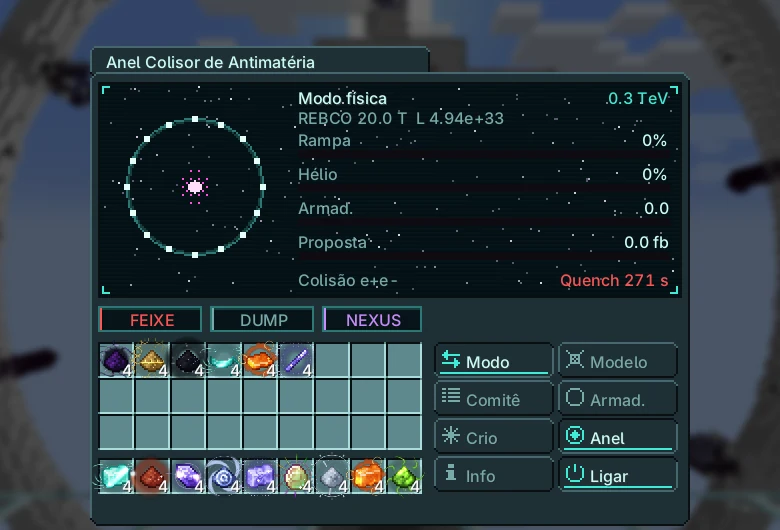
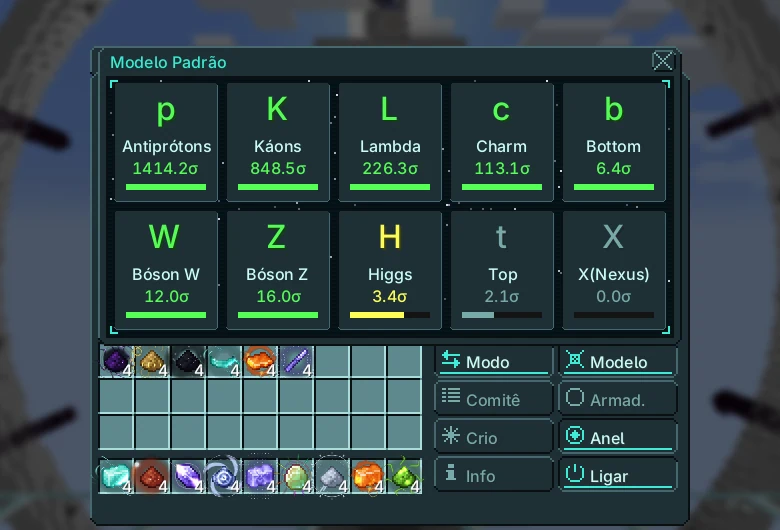
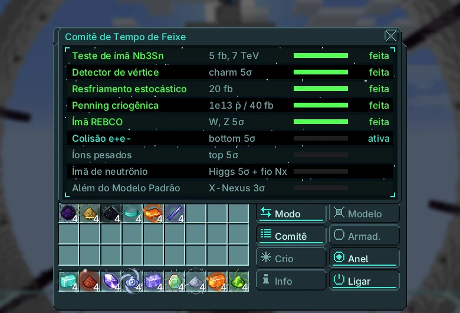

# Anel Colisor de Antimatéria

{ loading=lazy }

Acelera dois feixes em sentidos opostos num anel de 3 km e os colide. O modo produção gera partículas exóticas e antiprótons; o modo física acumula luminosidade para descobrir partículas e cumprir as propostas do comitê.

|  |  |
|---|---|
| **Tier** | UIV |
| **Tamanho** | 155 × 127 × 137 |
| **Energia** | rede Nexus do dono (ímãs e armadilhas) |
| **Fluido** | hélio líquido |
| **Controlador** | Linha de Montagem (UIV), pesquisa no Emissor UIV |
| **Blocos** | [página do catálogo](../catalog/antimatter_collider_ring.md) |

## Estrutura e hatches

| Hatch | Máx. | Uso |
|---|---|---|
| Hatch de Entrada | 4 | hélio líquido |
| Barramento de Entrada | 2 | fio fino de Nexium (proposta do ímã de Neutrônio) |
| Barramento de Saída | 4 | partículas, Células de Penning de Antiprótons |
| Hatch de Detector de Colisões | 1 | obrigatório para gravar corridas de física |
| Descarte de Feixe | 1 | corta pela metade a recuperação do quench |

Em operação, os blocos do anel e do giroscópio entram no controlador e são desenhados em movimento; voltam quando a máquina para.

## Modos

Clique na linha do modo para trocar. Produção: partículas com rendimento de 10% antes de evidência, 40% em 3σ e 100% após a descoberta em 5σ; antiprótons enchem as armadilhas e saem como Antiproton Penning Cells (1e11 cada).

Física: a luminosidade integrada aumenta a significância de cada partícula e avança a proposta ativa.

$$
\begin{aligned}
E_{\text{beam}} &= 0{,}3\,B\,\rho \quad (\text{GeV, } B \text{ in T, } \rho = 3000\ \text{m}) \\
E_{\text{cm}} &= 2\left(150 + (E_{\text{beam}} - 150) \cdot \min\!\left(1, \tfrac{t}{20\ \text{s}}\right)\right)\ \text{GeV} \\
\mathcal{L} &= \frac{f_{\text{rev}}\,n_b\,N^{2}}{4\pi\sigma^{2}}, \qquad f_{\text{rev}} = \frac{c}{2\pi\rho} \approx 15.905\ \text{Hz},\ N = 10^{11} \\
\Delta\!\int\!\mathcal{L} &= \mathcal{L} \cdot 10^{-39} \cdot 10^{5}\ \text{fb}^{-1}\ \text{por segundo} \\
Z &= s\,\sqrt{\textstyle\int\!\mathcal{L}} \cdot (\sqrt{2}\ \text{com o detector de vértice})
\end{aligned}
$$

O anel sobe em 20 s a partir de 150 GeV. A luminosidade base é $3{,}16 \times 10^{32}$ cm⁻²s⁻¹ (0,03 fb⁻¹/s); com resfriamento estocástico e detector de vértice, $4{,}94 \times 10^{33}$ (0,49 fb⁻¹/s). Rendimento da produção: 10% antes de 3σ, 40% a partir de 3σ, 100% a partir de 5σ.

| Ímã | B (T) | Feixe máx. (TeV) | Manutenção (EU/t) | Hélio líquido (L/s) | Pausa do quench |
|---|---|---|---|---|---|
| NbTi | 8,3 | 7,47 | $2^{33}$ | 0,5 (0,3) | 60 s |
| Nb₃Sn | 12 | 10,8 | $2^{34}$ | 1 (0,6) | 120 s |
| REBCO | 20 | 18 | $2^{35}$ | 2 (1,2) | 180 s |
| Neutronium | 45 | 40,5 | $2^{36}$ | 4 (2,4) | 240 s |
| Infinity | 120 | 108 | $2^{37}$ | 8 (4,8) | 300 s |

Hélio entre parênteses: depois da proposta de Penning criogênico. A pausa do quench dobra sem Beam Dump.

| Partícula | Limiar E_cm (GeV) | $s$ | fb⁻¹ para 5σ | com vértice | horas na luminosidade base |
|---|---|---|---|---|---|
| Antiprótons | 5,6 | 50 | 0,01 | $5{,}00 \times 10^{-3}$ | $8{,}78 \times 10^{-5}$ |
| Káons | 1 | 30 | 0,03 | 0,01 | $2{,}44 \times 10^{-4}$ |
| Lambda | 2,5 | 8 | 0,39 | 0,2 | $3{,}43 \times 10^{-3}$ |
| Charm | 10 | 4 | 1,56 | 0,78 | 0,01 |
| Bottom | 40 | 1,5 | 11,11 | 5,56 | 0,1 |
| Bóson W | 161 | 0,6 | 69,44 | 34,72 | 0,61 |
| Bóson Z | 182 | 0,8 | 39,06 | 19,53 | 0,34 |
| Higgs | 250 | 0,08 | 3.906 | 1.953 | 34,29 |
| Top | 346 | 0,15 | 1.111 | 555,56 | 9,75 |
| X(Nexus) | 4.800 | 0,02 | 62.500 | 31.250 | 548,68 |

O X-Nexus também precisa da proposta de íons pesados.

## Energia e resfriamento

$$
\begin{aligned}
P_{\text{magnets}} &= 2^{\,33 + k_{\text{magnet}}}\ \text{EU/t} \qquad P_{\text{traps}} = 2^{\,20 + k_{\text{trap}}}\ \text{EU/t} \\
\dot V_{\text{He}} &= 0{,}5 \cdot 2^{k_{\text{magnet}}}\ \text{L/s} \quad (\times 0{,}6\ \text{depois do Penning criogênico}) \\
\text{capacidade das armadilhas} &= 10^{12} \cdot 4^{\,k_{\text{trap}} - 1}\ \bar p
\end{aligned}
$$

Menos hélio que a demanda causa quench nos ímãs: o feixe para por 60·(tier + 1) segundos.

## Propostas do comitê

O comitê aprova uma proposta por vez, nesta ordem. As corridas de física avançam a proposta ativa.

| # | Proposta | Pede | Dá |
|---|---|---|---|
| 1 | Teste de ímã Nb3Sn | 5 fb⁻¹ entregues | ímã Nb₃Sn (12 T) |
| 2 | Detector de vértice | charm em 5σ | significância × √2, feixe de 16 µm |
| 3 | Resfriamento estocástico | 20 fb⁻¹ | 1.000 pacotes |
| 4 | Penning criogênica | 10¹³ antiprótons guardados ou 40 fb⁻¹ | armadilha tier 3, hélio × 0,6 |
| 5 | Ímã REBCO | W e Z em 5σ | ímã REBCO (20 T) |
| 6 | Colisão e+e- | bottom em 5σ | botão e+e− (feixes de elétrons) |
| 7 | Íons pesados | top em 5σ | íons pesados: X-Nexus pode ser produzido |
| 8 | Ímã de neutrônio | Higgs em 5σ + 1024 fios finos de Nexium | ímã de Neutrônio (45 T) |
| 9 | Além do Modelo Padrão | X-Nexus em 3σ | ímã Infinity (120 T) |

Se a manutenção das armadilhas não for paga, os antiprótons guardados aniquilam e danificam o anel. Abas laterais: quadro do Modelo Padrão e Comitê.

**Feixes de elétrons.** Depois da proposta e+e− o botão e+e− troca o anel para feixes de elétrons. A luz síncrotron limita cada feixe a 100 GeV (como no LEP): $E_{\text{cm}} \le 200$ GeV, então W, Z, charm e bottom são alcançáveis, mas Higgs e top não. As colisões limpas contam em dobro nas corridas de física. Volte aos prótons para as partículas mais pesadas.

## Endgame

Exclusivo: células de antipróton entram nas barras Cosmic Neutronium e Infinity e no sifão do Forge of Gods. Higgs e top: Lente Gravitacional. X-Nexus: controlador do Forge of Gods e âncoras profundas.

Precisa de: a proposta Ímã de Neutrônio só fecha com 1024 fios finos de Nexium nos barramentos de entrada; o fio é enrolado nos dipolos nível 4 quando ela fecha.

O Nexium vem da Lança Cinética Orbital (Nexus-1); a Fenda precisa do seu X-Nexus para passar da profundidade 40.

## Telas

Telas do jogo na versão atual, em português.

=== "Tela principal"

    { loading=lazy }

=== "Quadro do Modelo Padrão"

    { loading=lazy }

=== "Comitê"

    { loading=lazy }
