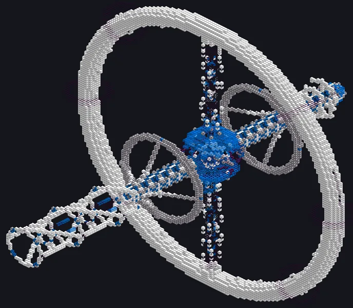
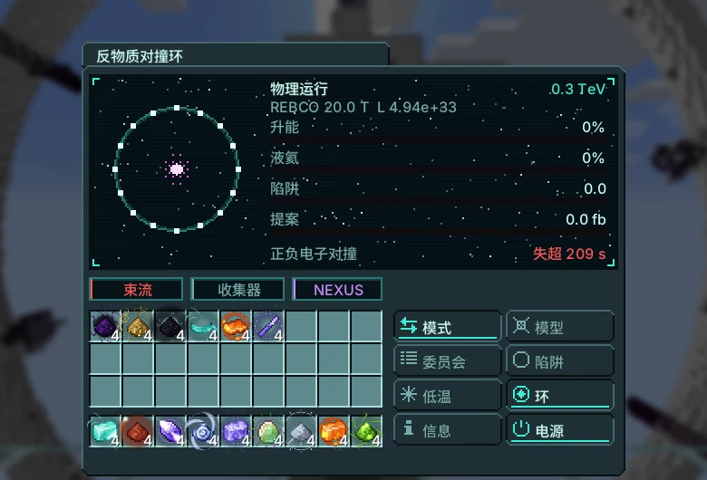
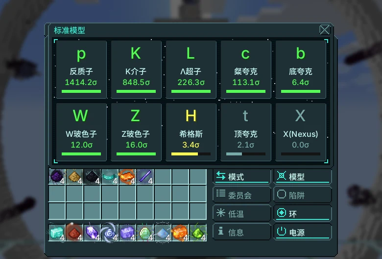
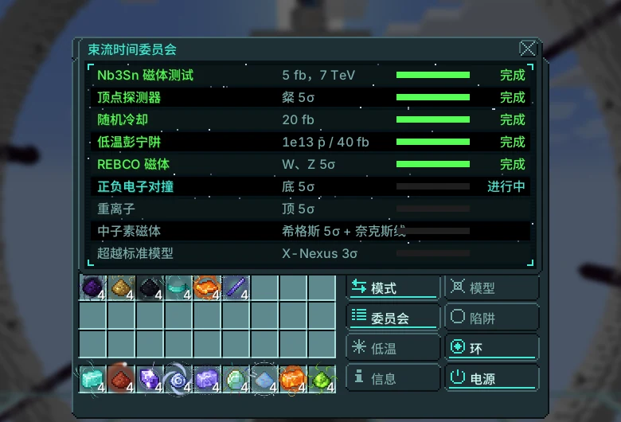

# 反物质对撞环

{ loading=lazy }

在 3 km 的环中加速两束反向运行的粒子束并使其对撞。生产模式产出奇异粒子和反质子；物理模式积累亮度以发现粒子并完成委员会提案。

|  |  |
|---|---|
| **Tier** | UIV |
| **尺寸** | 155 × 127 × 137 |
| **能量** | 所有者的 Nexus 网络（磁体与陷阱） |
| **流体** | 液氦 |
| **控制器** | 装配线（UIV），研究 UIV 发射器 |
| **方块** | [图鉴页面](../catalog/antimatter_collider_ring.md) |

## 结构与仓口

| 仓室 | 上限 | 用途 |
|---|---|---|
| 输入仓 | 4 | 液氦 |
| 输入总线 | 2 | 奈克斯金属细线（中子素磁体提案） |
| 输出总线 | 4 | 粒子、反质子彭宁电池 |
| 碰撞探测仓 | 1 | 物理运行记录所必需 |
| 束流收集器 | 1 | 失超恢复时间减半 |

运行时环和陀螺方块会被吸入控制器并以动画显示；机器停止时恢复。

## 模式

点击模式行切换。生产：未有证据前产率 10%，3σ 时 40%，5σ 发现后 100%；反质子填满彭宁阱后以反质子彭宁单元（每个 1e11）输出。

物理：积分亮度提高每种粒子的显著性并推进当前提案。

$$
\begin{aligned}
E_{\text{beam}} &= 0.3\,B\,\rho \quad (\text{GeV, } B \text{ in T, } \rho = 3000\ \text{m}) \\
E_{\text{cm}} &= 2\left(150 + (E_{\text{beam}} - 150) \cdot \min\!\left(1, \tfrac{t}{20\ \text{s}}\right)\right)\ \text{GeV} \\
\mathcal{L} &= \frac{f_{\text{rev}}\,n_b\,N^{2}}{4\pi\sigma^{2}}, \qquad f_{\text{rev}} = \frac{c}{2\pi\rho} \approx 15{,}905\ \text{Hz},\ N = 10^{11} \\
\Delta\!\int\!\mathcal{L} &= \mathcal{L} \cdot 10^{-39} \cdot 10^{5}\ \text{fb}^{-1}\ \text{每秒} \\
Z &= s\,\sqrt{\textstyle\int\!\mathcal{L}} \cdot (\sqrt{2}\ \text{有顶点探测器时})
\end{aligned}
$$

满环从 150 GeV 起在 20 秒内升能。基础亮度为 $3.16 \times 10^{32}$ cm⁻²s⁻¹（0.03 fb⁻¹/秒）；有随机冷却和顶点探测器时为 $4.94 \times 10^{33}$（0.49 fb⁻¹/秒）。生产产率：3σ 前 10%，3σ 起 40%，5σ 起 100%。

| 磁体 | B (T) | 最大束流（TeV） | 维持（EU/t） | 液氦（L/s） | 失超暂停 |
|---|---|---|---|---|---|
| NbTi | 8.3 | 7.47 | $2^{33}$ | 0.5 (0.3) | 60 s |
| Nb₃Sn | 12 | 10.8 | $2^{34}$ | 1 (0.6) | 120 s |
| REBCO | 20 | 18 | $2^{35}$ | 2 (1.2) | 180 s |
| Neutronium | 45 | 40.5 | $2^{36}$ | 4 (2.4) | 240 s |
| Infinity | 120 | 108 | $2^{37}$ | 8 (4.8) | 300 s |

括号内为低温彭宁提案后的液氦用量。没有束流收集器时失超暂停时间翻倍。

| 粒子 | 阈值 E_cm (GeV) | $s$ | 5σ 所需 fb⁻¹ | 有顶点探测器 | 基础亮度下小时数 |
|---|---|---|---|---|---|
| 反质子 | 5.6 | 50 | 0.01 | $5.00 \times 10^{-3}$ | $8.78 \times 10^{-5}$ |
| K介子 | 1 | 30 | 0.03 | 0.01 | $2.44 \times 10^{-4}$ |
| Λ超子 | 2.5 | 8 | 0.39 | 0.2 | $3.43 \times 10^{-3}$ |
| 粲夸克 | 10 | 4 | 1.56 | 0.78 | 0.01 |
| 底夸克 | 40 | 1.5 | 11.11 | 5.56 | 0.1 |
| W玻色子 | 161 | 0.6 | 69.44 | 34.72 | 0.61 |
| Z玻色子 | 182 | 0.8 | 39.06 | 19.53 | 0.34 |
| 希格斯 | 250 | 0.08 | 3,906 | 1,953 | 34.29 |
| 顶夸克 | 346 | 0.15 | 1,111 | 555.56 | 9.75 |
| X(Nexus) | 4,800 | 0.02 | 62,500 | 31,250 | 548.68 |

X-Nexus 还需要重离子提案。

## 能量与冷却

$$
\begin{aligned}
P_{\text{magnets}} &= 2^{\,33 + k_{\text{magnet}}}\ \text{EU/t} \qquad P_{\text{traps}} = 2^{\,20 + k_{\text{trap}}}\ \text{EU/t} \\
\dot V_{\text{He}} &= 0.5 \cdot 2^{k_{\text{magnet}}}\ \text{L/s} \quad (\times 0.6\ \text{低温彭宁后}) \\
\text{陷阱容量} &= 10^{12} \cdot 4^{\,k_{\text{trap}} - 1}\ \bar p
\end{aligned}
$$

液氦不足会导致磁体失超：束流停止 60·（等级 + 1） 秒。

## 委员会提案

委员会每次批准一个提案，按以下顺序。物理运行推进当前提案。

| # | 提案 | 要求 | 奖励 |
|---|---|---|---|
| 1 | Nb3Sn 磁体测试 | 累计 5 fb⁻¹ | Nb₃Sn 磁体（12 T） |
| 2 | 顶点探测器 | charm 达到 5σ | 显著性 × √2，束流 16 µm |
| 3 | 随机冷却 | 20 fb⁻¹ | 1,000 个束团 |
| 4 | 低温彭宁阱 | 储存 10¹³ 反质子或 40 fb⁻¹ | 陷阱等级 3，氦 × 0.6 |
| 5 | REBCO 磁体 | W 与 Z 达到 5σ | REBCO 磁体（20 T） |
| 6 | 正负电子对撞 | bottom 达到 5σ | 电子束 |
| 7 | 重离子 | top 达到 5σ | 重离子：可产生 X-Nexus |
| 8 | 中子素磁体 | Higgs 达到 5σ + 1024 根奈克斯金属细线 | 中子素磁体（45 T） |
| 9 | 超越标准模型 | X-Nexus 达到 3σ | 无尽磁体（120 T） |

若未支付彭宁阱维持能量，储存的反质子会湮灭并损坏环。侧边标签页：标准模型面板和委员会。

## 终局

独有产物：反质子胶囊用于宇宙中子素与无尽燃料棒及神之锻炉虹吸外壳。希格斯与顶夸克：引力透镜。X-Nexus：神之锻炉控制器与深层锚。

需求：中子素磁体提案只有在输入总线中放有1024根精细奈克斯金属导线时才会完成；完成时导线被绕入第4级偶极磁体。

奈克斯金属来自轨道动能长矛（奈克斯-1）；维度裂隙门需要你的X-Nexus才能深入40层以下。

!!! bug "已知问题"

    - 完成 **e+e− 对撞**提案后，环会改为电子束，同步辐射负载每秒都会导致磁体失超，环将永久停机。修复前，请在 REBCO 磁体完成后切换到生产模式。本版本无法达到重离子、中子素磁体、X-Nexus 以及最后一个提案。

    其他问题请提交到 [issue tracker](https://github.com/GTInfinityAscension/GregTech-Nexus-Addon/issues)。

## 界面

当前版本的游戏界面（简体中文）。

=== "主界面"

    { loading=lazy }

=== "标准模型面板"

    { loading=lazy }

=== "委员会"

    { loading=lazy }
