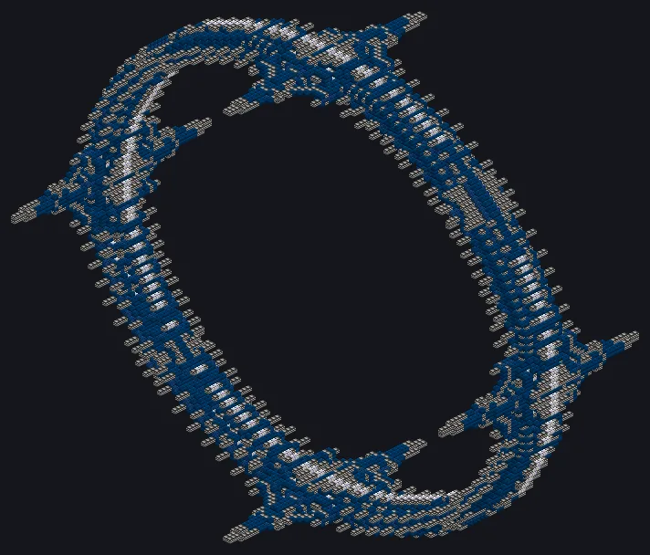

# Dimensional Rift Gate

{ loading=lazy }

Opens a rift to a seeded dimension and pulls resources from it. Tune frequency, phase and amplitude towards the seed's hidden optimum to raise the resonance.

|  |  |
|---|---|
| **Tier** | UIV |
| **Size** | 126 × 126 × 54 |
| **Energy** | $2^{36}$ EU/t from the owner's Nexus network while the rift is open |
| **Fluid** | SpaceTime (stability) |
| **Controller** | Assembly Line (UIV), research on the UIV Field Generator |
| **Blocks** | [catalog page](../catalog/dimensional_rift_gate.md) |

## Structure and hatches

| Hatch | Max | Use |
|---|---|---|
| Input Hatch | 4 | SpaceTime |
| Input Bus | 4 | Rift Probes, Depth Anchors, Contained X-Nexus |
| Output Bus | 4 | biome dusts, Rift Singularity |
| Rift Tuning Hatch | 1 | redstone 0–15 sets the amplitude to 0–100% |

## Tuning

Click Open for a rift with a random seed. Tune with [--] [-] [+] [++] (±10 / ±1). Each Rift Probe consumed narrows the tolerances by 20%.

$$
\begin{aligned}
R &= \exp\!\left(-\left(\frac{f - f^{*}}{\sigma_f}\right)^{2} - \left(\frac{\Delta\varphi}{\sigma_\varphi}\right)^{2} - \left(\frac{A - A^{*}}{\sigma_A}\right)^{2}\right) \\
\sigma_f &= 260\ \text{THz} \cdot 0.8^{n} \qquad \sigma_\varphi = 100^\circ \cdot 0.8^{n} \qquad \sigma_A = 45\,\% \cdot 0.8^{n}
\end{aligned}
$$

$f$ goes from 1 to 1000 THz, $\varphi$ from 0 to 360° and $A$ from 0 to 100%; $(f^*, \varphi^*, A^*)$ is the seed's hidden optimum and $n$ the number of probes consumed on this seed. Each knob shows a hot/cold bar for its own axis.

| Probes | $\sigma_f$ (THz) | $\sigma_\varphi$ (°) | $\sigma_A$ (%) | Window for R ≥ 0.9 in f |
|---|---|---|---|---|
| 0 | 260 | 100 | 45 | ±84.39 THz |
| 2 | 166.4 | 64 | 28.8 | ±54.01 THz |
| 4 | 106.5 | 40.96 | 18.43 | ±34.57 THz |
| 6 | 68.16 | 26.21 | 11.8 | ±22.12 THz |
| 8 | 43.62 | 16.78 | 7.55 | ±14.16 THz |
| 10 | 27.92 | 10.74 | 4.83 | ±9.06 THz |

## Power and stability

Field = 2^36 EU/t from the Nexus network while open; without it the rift collapses

SpaceTime fluid keeps it stable: each litre adds 2 stability. Losses grow with low resonance and with depth.

$$
\begin{aligned}
\frac{dS}{dt} &= 2\,\dot V - \lambda\,(1 - R)\left(1 + \frac{D}{10}\right) - 0.4\,(8 - P) \\
\lambda &= 1.5\,(1.3 - C) \\
\dot V_{\text{SpaceTime}} &= 16 \cdot \frac{\lambda\,(1 - R)\,(1 + D/10) + 0.4\,(8 - P)}{2}\ \text{L/s}
\end{aligned}
$$

$S$ is the stability (0–100), $D$ the depth, $P$ the active pylons (4 in the current structure) and $C$ the chord consonance (next section). The machine drains enough SpaceTime each second to cover the upkeep plus one unit; each litre of SpaceTime is worth 1/16 of a stability unit.

| R | D | SpaceTime (L/s), no chord, 4 pylons |
|---|---|---|
| 0.5 | 1 | 19.4 |
| 0.9 | 1 | 14.12 |
| 0.9 | 5 | 14.6 |
| 0.98 | 5 | 13.16 |
| 0.98 | 8 | 13.23 |
| 1 | 8 | 12.8 |

## Harmonics

Holding R ≥ 0.9 for 30 s records the seed's harmonic. Click recorded harmonics to load up to 5 in the chord: consonant chords (octave, fifth) are stable; dissonant chords (tritone, minor second) dig deeper but cost more SpaceTime.

Holding R ≥ 0.98 for a minute can give a Rift Singularity. Stability at 0 collapses the rift; R under 0.2 for 10 s inverts it (−10 stability). Side tabs: Seismograph and Atlas.

$$
\begin{aligned}
\text{c}(p\!:\!q) &= \frac{1}{\log_2 (p\,q)} \qquad C = \overline{\text{c}} \ (\text{mean of the chord; 0.3 with no chord}) \\
D_{\max} &= \left\lfloor 5 \cdot \max\!\left(0.5,\ 1 + 3\,(0.3 - C)\right) \right\rfloor
\end{aligned}
$$

| Interval | Ratio | Consonance | λ factor (alone) | Max depth (alone) | Recorded in |
|---|---|---|---|---|---|
| Octave | 2:1 | 1 | 0.3 | 2 | not dropped by any biome |
| Fifth | 3:2 | 0.39 | 0.91 | 3 | Crystal plains |
| Fourth | 4:3 | 0.28 | 1.02 | 5 | Spore forest |
| Major third | 5:4 | 0.23 | 1.07 | 6 | Mercury ocean |
| Minor sixth | 8:5 | 0.19 | 1.11 | 6 | Forge world |
| Minor seventh | 9:5 | 0.18 | 1.12 | 6 | Civilisation relic |
| Tritone | 45:32 | 0.1 | 1.2 | 8 | Antimatter abyss |
| Minor second | 16:15 | 0.13 | 1.17 | 7 | Void |

## Endgame

Each biome drops dusts of its materials into the output buses. Rate of **each** material:

$$
\text{dusts/s} = 16 \cdot R^{2} \cdot D^{1.5} \cdot \frac{S}{100}
$$

| Biome | Chance | Min. depth | Dusts |
|---|---|---|---|
| Crystal plains | 30% | — | **Prismatium**, Certus Quartz, Silicon, Titanium |
| Mercury ocean | 20% | — | **Chronomercury**, Gold, Thallium, Cinnabar |
| Forge world | 15% | — | **Forgecore**, Tungsten, Osmium, Iridium |
| Spore forest | 15% | — | **Vivispore**, Wood, Carbon, Phosphorus |
| Antimatter abyss | 8% | — | **Abyssal Antimatter**, Naquadah, Naquadah Enriched |
| Civilisation relic | 7% | 20 | **Precursor Residue**, Naquadria, Trinium, Duranium |
| Void | 5% | 40 | **Void Ash**, Neutronium, Space Time |

Exclusive: one material per biome (Prismatium, Chronomercury, Forgecore, Vivispore, Abyssal Antimatter, Precursor Residue, Void Ash). The Singularity goes into the Forge of Gods controller and Advanced+ Eye of Harmony fields.

Needs: from depth 40 on, each Depth Anchor also takes one Contained X-Nexus; without one it stays in the bus.

X-Nexus comes from the Antimatter Collider Ring; the Stellar Chamber needs your Forgecore to hold a magnetar.

!!! bug "Known issues"

    - The maximum depth starts at 5 and nothing raises it yet; the most dissonant chord reaches 8. Civilisation Relic (depth 20) and Void (depth 40) therefore yield nothing, so **Precursor Residue** and **Void Ash** cannot be obtained in this version.
    - Pylon cores are not in the game: the structure always counts 4 active pylons.

    Report anything else on the [issue tracker](https://github.com/GTInfinityAscension/GregTech-Nexus-Addon/issues).

