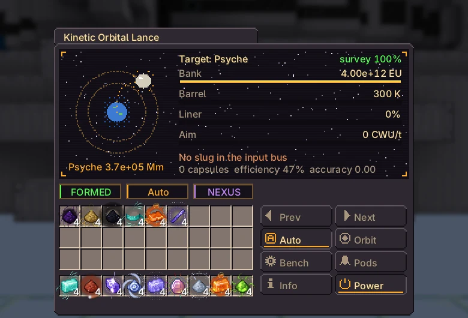
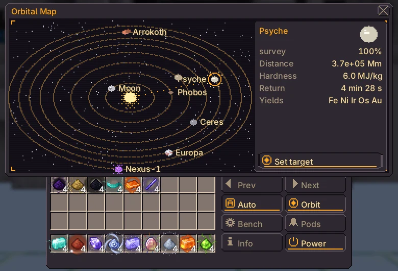
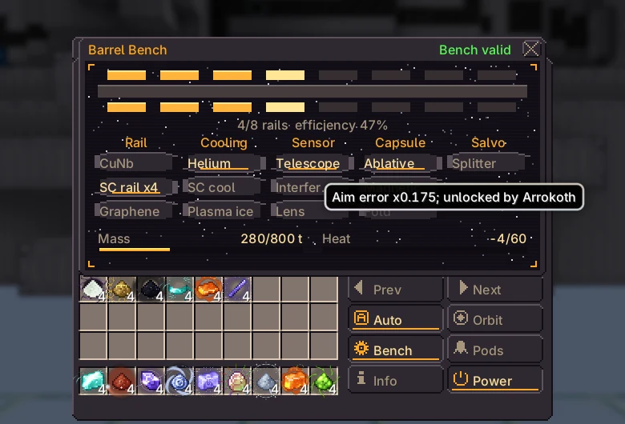

# Kinetic Orbital Lance

{ loading=lazy }

Fires projectiles from a capacitor bank at moons and asteroids and recovers the fragments in return capsules, which land as dusts of the body's materials.

|  |  |
|---|---|
| **Tier** | UEV |
| **Size** | 242 × 130 × 142 |
| **Energy** | owner's Nexus network, up to $2^{36}$ EU/t into the bank |
| **Computation** | up to 16,000 CWU/t (aim) |
| **Controller** | Assembly Line (UEV), research on the UEV Electric Piston |
| **Blocks** | [catalog page](../catalog/kinetic_orbital_lance.md) |

## Structure and hatches

| Hatch | Max | Use |
|---|---|---|
| Input Bus | 4 | projectile ingots |
| Output Bus | 4 | dusts from the capsules |
| Computation Data Reception Hatch | 1 | aim (without it the aim is blind) |
| Barrel Liner Hatch | 1 | spare liners, swapped in automatically |
| Target Cartridge Hatch | 1 | up to 8 target cartridges, one per shot in turn |

While formed, the gun (everything above the turret ring) is taken into the controller and drawn slewing to the target.

## Bank and firing

The bank charges from the Nexus network at up to $2^{36}$ EU/t. With auto-fire on, the Lance fires the whole bank as soon as it is full, the target can be aimed at and an input bus holds a projectile that can break that body.

$$
\begin{aligned}
E &= 4 \times 10^{12}\ \text{EU} \\
\eta &= \min\!\left(0.85,\ 0.35 + \textstyle\sum \Delta\eta_{\text{rail}} \cdot \left(1 - 0.5\,\tfrac{n_{\text{rail}}}{8}\right)\right) \\
M_{\text{frag}} &= \frac{0.2\,\eta\,E \cdot 1000\ \text{J/EU}}{H} \\
M_{\text{rec}} &= M_{\text{frag}} \cdot r \cdot A
\end{aligned}
$$

$H$ is the body hardness (J/kg), $r$ the capsule recovery (0.6 without a capsule component) and $A$ the accuracy (next section). The capsule lands after $t = 30\ \text{s} \cdot \ln(1 + d / 50\ \text{Mm})$ and unloads **one dust per 100 t**, split evenly over the body's materials. A capsule that does not fit waits in the queue.

Projectiles are ingots. The type only decides which body can be hit: **Nexus-1 only breaks under Magnetarium**, every projectile works on the other bodies.

| Projectile (ingot) | Mass (kg) | Breaks Nexus-1 |
|---|---|---|
| Naquadah Alloy | 50 | — |
| Trinium | 80 | — |
| Neutronium | 400 | — |
| Cosmic Neutronium | 800 | — |
| White Dwarf Matter | 1,200 | — |
| Magnetarium | 2,000 | ✅ |

## Targets and aim

Start with the Moon. A body becomes targetable once its parents are surveyed to 100% (recover their characteristic mass). Cartridges in the Target Cartridge Hatch pick the target and take turns shot by shot.

The reception hatch must be linked by optical cable to a transmission hatch of a working computation network (e.g. Network Switch fed by a Supercomputer). More CWU/t tightens the aim; it matters for far bodies.

$$
\begin{aligned}
S &= 1 - e^{-M / M_{\text{car}}} && \text{survey, 99\% counts as complete} \\
\theta &= \frac{10^{-9}\,u}{\sqrt{\text{CWU/t} / 1000}} + 2 \times 10^{-10} \cdot \frac{\max(0,\ T - 300)}{100} \\
A &= \max\!\left(0,\ 1 - \frac{d\,\theta}{5000\ \text{m}}\right)
\end{aligned}
$$

$M$ is the mass recovered from the body, $u$ the aim factor of the sensor (1 without one), $T$ the barrel temperature (K) and $d$ the distance. The Lance asks the computation hatch for 16,000 CWU/t at most.

| Body | Distance (Mm) | H (MJ/kg) | $M_{car}$ (kg) | Capsule | Needs 100% of | Materials | Accuracy* | Shots to 100%* |
|---|---|---|---|---|---|---|---|---|
| Moon | 384 | 2 | $1.00 \times 10^{6}$ | 65 s | — | Iron, Titanium, Aluminium, Helium 3 | 1 | 1 |
| Phobos | 78 | 1.2 | $2.00 \times 10^{6}$ | 28 s | Moon | Carbon, Nickel, Iron | 1 | 1 |
| Vesta | 170,000 | 3.5 | $8.00 \times 10^{6}$ | 244 s | Phobos | Iron, Magnesium, Chromium, Platinum | 0.99 | 1 |
| Ceres | 410,000 | 1.5 | $8.00 \times 10^{6}$ | 270 s | Phobos | Magnesium, Sodium, Ammonia | 0.98 | 1 |
| Psyche | 370,000 | 6 | $5.00 \times 10^{7}$ | 267 s | Vesta | Iron, Nickel, Iridium, Osmium, Gold | 0.98 | 9 |
| Europa | 630,000 | 2.8 | $5.00 \times 10^{7}$ | 283 s | Ceres | Magnesium, Sulfur, Deuterium | 0.97 | 4 |
| Arrokoth | $6.60 \times 10^{6}$ | 0.9 | $2.00 \times 10^{8}$ | 354 s | Europa | Primordial Tholin, Nitrogen, Methane, Carbon | 0.67 | 8 |
| Nexus-1 | $7.50 \times 10^{6}$ | 9.5 | $1.00 \times 10^{9}$ | 358 s | Psyche, Arrokoth | Nexium, Naquadah, Neutronium, Space Time | 0.62 | 417 |

\* No bench components ($\eta = 0.35$, $r = 0.6$, $u = 1$), 16,000 CWU/t, cold barrel.

## Barrel bench and wear

Click components on the bench line or in the Bench tab. Up to 8 rails (shift-click removes one); every other slot takes one component. Surveying a body to 100% unlocks the components that come from it. The loadout must fit three budgets, otherwise the Lance does not fire:

$$
\sum m \le 800\ \text{t} \qquad \sum Q \le 60 \qquad \frac{n_{\text{rail}}}{8} \le 1
$$

| Component | Slot | Effect | Mass (t) | Heat | Unlocked by |
|---|---|---|---|---|---|
| `rail_cu_nb` | Rail | $\Delta\eta = +0.02$ | 40 | 3 | start |
| `rail_superconductor` | Rail | $\Delta\eta = +0.04$ | 60 | 1 | Phobos |
| `rail_graphene` | Rail | $\Delta\eta = +0.07$ | 140 | 2 | Psyche |
| `cooling_helium` | Cooling | $C_{\text{barrel}} \times 2$ | 30 | -10 | Ceres |
| `cooling_superconductor` | Cooling | $C_{\text{barrel}} \times 4$ | 60 | -25 | Europa |
| `cooling_plasma_ice` | Cooling | $C_{\text{barrel}} \times 8$ | 90 | -60 | Arrokoth |
| `sensor_telescope` | Sensor | $u = 0.7$ | 10 | 2 | Moon |
| `sensor_interferometer` | Sensor | $u = 0.35$ | 40 | 2 | Europa |
| `sensor_lens` | Sensor | $u = 0.17$ | 80 | 2 | Arrokoth |
| `capsule_ablative` | Capsule | $r = 0.75$ | 0 | 0 | Ceres |
| `capsule_magnetic` | Capsule | $r = 0.85$ | 0 | 0 | Psyche |
| `capsule_fold` | Capsule | $r = 0.95$ | 0 | 0 | Nexus-1 |
| `salvo_splitter` | Salvo | 2 projectiles per shot | 50 | 5 | Vesta |

$$
\begin{aligned}
\Delta T &= \frac{(1 - \eta)\,E}{C_{\text{barrel}}}, \qquad C_{\text{barrel}} = 2 \times 10^{9}\ \text{EU/K} \times k_{\text{cooling}} \\
\dot T_{\text{cooling}} &= -\frac{2^{34} \cdot 20\ \text{EU/s}}{C_{\text{barrel}}} \quad (\text{down to 300 K}) \\
W &\mathrel{+}= \frac{E}{E_{\text{liner}}}
\end{aligned}
$$

Each shot wears the liner and heats the barrel. A worn liner (100%) or a barrel over 2500 K misfires. Spare liners (naquadah alloy or neutronium plates) in the Barrel Liner Hatch are swapped in automatically. Side tabs: Orbital map and Bench.

| Liner (plate or dense plate) | $E_{liner}$ (EU) | Full shots |
|---|---|---|
| Naquadah Alloy | $5.00 \times 10^{13}$ | 12.5 |
| Neutronium | $2.00 \times 10^{14}$ | 50 |

Without bench components a full shot heats the barrel by 1,300 K and the base cooling removes about 172 K per second.

## Endgame

Exclusive: capsules from Arrokoth bring Primordial Tholin (Forge of Gods structure casing); capsules from Nexus-1 bring Nexium (Collider dipoles, Magnetarium).

Needs: Nexus-1's crust only breaks under Magnetarium ingots (Magnetar Slug, 2000 t). Mixer: 2 Nexium + 1 Magnetar Crystal + 4 White Dwarf Matter dust, then the blast furnace at 12000 K.

The Magnetar Crystal comes from the Stellar Containment Chamber; the Collider needs your Nexium for its last magnets.

!!! bug "Known issues"

    - The projectile mass, the impact regime and the salvo splitter do not change what comes back yet: the recovered mass depends only on $\eta$, $E$, $H$, $r$ and $A$.
    - The bank has one capacitor ring ($4 \times 10^{12}$ EU); extra rings are not in the game yet, so the mass budget is 800 t and the heat budget 60.

    Report anything else on the [issue tracker](https://github.com/GTInfinityAscension/GregTech-Nexus-Addon/issues).

## Screens

In-game screens of the current version, in English.

=== "Main screen"

    { loading=lazy }

=== "Orbital map"

    { loading=lazy }

=== "Barrel bench"

    { loading=lazy }
