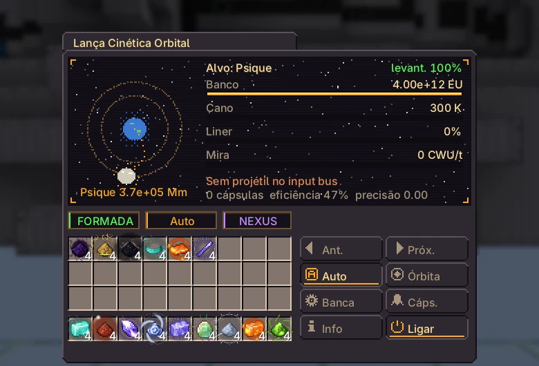
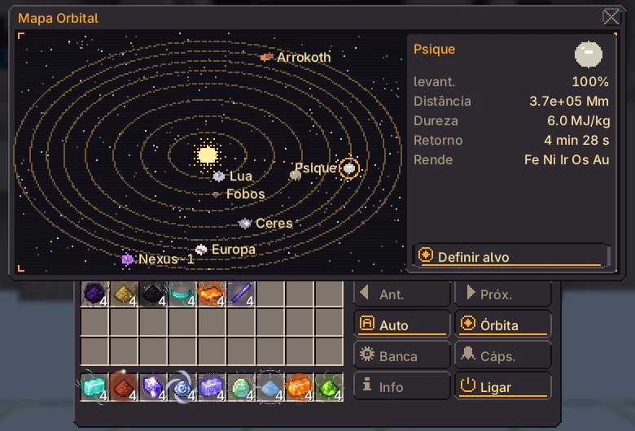
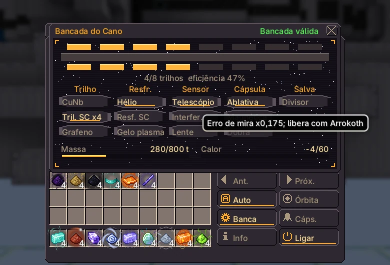

# Lança Cinética Orbital

{ loading=lazy }

Dispara projéteis de um banco de capacitores contra luas e asteroides e recupera os fragmentos em cápsulas de retorno, que chegam como pós dos materiais do corpo.

|  |  |
|---|---|
| **Tier** | UEV |
| **Tamanho** | 242 × 130 × 142 |
| **Energia** | rede Nexus do dono, até $2^{36}$ EU/t para o banco |
| **Computação** | até $2^{20}$ CWU/t (mira) |
| **Controlador** | Linha de Montagem (UEV), pesquisa no Pistão Elétrico UEV |
| **Blocos** | [página do catálogo](../catalog/kinetic_orbital_lance.md) |

## Estrutura e hatches

| Hatch | Máx. | Uso |
|---|---|---|
| Barramento de Entrada | 4 | lingotes de projétil |
| Barramento de Saída | 4 | pós das cápsulas |
| Hatch de Recepção de Dados de Computação | 1 | mira (sem ele a mira fica cega) |
| Hatch de Revestimento do Cano | 1 | revestimentos reserva, trocados sozinhos |
| Hatch de Cartucho de Alvo | 1 | até 8 cartuchos de alvo, um por tiro em rodízio |

Com a estrutura formada, o canhão (tudo acima do anel da torre) entra no controlador e é desenhado girando para o alvo.

## Banco e disparo

O banco carrega pela rede Nexus a até $2^{36}$ EU/t. Com o disparo automático ligado, a Lança descarrega o banco inteiro assim que ele enche, se o alvo puder ser mirado e houver no barramento um projétil capaz de quebrar aquele corpo.

$$
\begin{aligned}
E &= 4 \times 10^{12}\ \text{EU} \\
\eta &= \min\!\left(0{,}85,\ 0{,}35 + \textstyle\sum \Delta\eta_{\text{rail}} \cdot \left(1 - 0{,}5\,\tfrac{n_{\text{rail}}}{8}\right)\right) \\
M_{\text{frag}} &= \frac{0{,}2\,\eta\,E \cdot 1000\ \text{J/EU}}{H} \\
M_{\text{rec}} &= M_{\text{frag}} \cdot r \cdot A
\end{aligned}
$$

$H$ é a dureza do corpo (J/kg), $r$ a recuperação da cápsula (0,6 sem componente de cápsula) e $A$ a precisão (próxima seção). A cápsula pousa depois de $t = 30\ \text{s} \cdot \ln(1 + d / 50\ \text{Mm})$ e descarrega **um pó a cada 100 t**, dividido por igual entre os materiais do corpo. Cápsula que não cabe espera na fila.

Os projéteis são lingotes. O tipo só decide qual corpo pode ser atingido: **Nexus-1 só quebra com Magnetário**; qualquer projétil serve para os outros corpos.

| Projétil (lingote) | Massa (kg) | Quebra Nexus-1 |
|---|---|---|
| Liga de Naquadah | 50 | — |
| Trínio | 80 | — |
| Neutrônio | 400 | — |
| Neutrônio Cósmico | 800 | — |
| Matéria de Anã Branca | 1.200 | — |
| Magnetário | 2.000 | ✅ |

## Alvos e mira

Comece pela Lua. Um corpo vira alvo quando os corpos anteriores estão 100% pesquisados (recupere a massa característica deles). Cartuchos no Target Cartridge Hatch escolhem o alvo e se revezam a cada tiro.

O hatch receptor precisa estar ligado por cabo óptico ao hatch transmissor de uma rede de computação funcionando (ex.: Network Switch alimentado por um Supercomputador). Mais CWU/t aperta a mira; isso pesa nos corpos distantes.

$$
\begin{aligned}
S &= 1 - e^{-M / M_{\text{car}}} && \text{levantamento; 99\% conta como completo} \\
\theta &= \frac{10^{-9}\,u}{\sqrt{\text{CWU/t} / 1000}} + 2 \times 10^{-10} \cdot \frac{\max(0,\ T - 300)}{100} \\
A &= \max\!\left(0,\ 1 - \frac{d\,\theta}{5000\ \text{m}}\right)
\end{aligned}
$$

$M$ é a massa recuperada do corpo, $u$ o fator de mira do sensor (1 sem sensor), $T$ a temperatura do cano (K) e $d$ a distância. A Lança pede até $2^{20}$ (1.048.576) CWU/t ao hatch de computação; rede maior mira melhor.

| Corpo | Distância (Mm) | H (MJ/kg) | $M_{car}$ (kg) | Cápsula | Precisa de 100% em | Materiais | Precisão* | Tiros até 100%* |
|---|---|---|---|---|---|---|---|---|
| Lua | 384 | 2 | $1{,}00 \times 10^{6}$ | 65 s | — | Ferro, Titânio, Alumínio, Hélio-3 | 1 | 1 |
| Fobos | 78 | 1,2 | $2{,}00 \times 10^{6}$ | 28 s | Lua | Carbono, Níquel, Ferro | 1 | 1 |
| Vesta | 170.000 | 3,5 | $8{,}00 \times 10^{6}$ | 244 s | Fobos | Ferro, Magnésio, Cromo, Platina | 1 | 1 |
| Ceres | 410.000 | 1,5 | $8{,}00 \times 10^{6}$ | 270 s | Fobos | Magnésio, Sódio, Amônia | 1 | 1 |
| Psique | 370.000 | 6 | $5{,}00 \times 10^{7}$ | 267 s | Vesta | Ferro, Níquel, Irídio, Ósmio, Ouro | 1 | 9 |
| Europa | 630.000 | 2,8 | $5{,}00 \times 10^{7}$ | 283 s | Ceres | Magnésio, Enxofre, Deutério | 1 | 4 |
| Arrokoth | $6{,}60 \times 10^{6}$ | 0,9 | $2{,}00 \times 10^{8}$ | 354 s | Europa | Tolina Primordial, Nitrogênio, Metano, Carbono | 0,96 | 6 |
| Nexus-1 | $7{,}50 \times 10^{6}$ | 9,5 | $1{,}00 \times 10^{9}$ | 358 s | Psique, Arrokoth | Nexium, Naquadah, Neutrônio, Espaço-Tempo | 0,95 | 274 |

\* Sem componentes na bancada ($\eta = 0{,}35$, $r = 0{,}6$, $u = 1$), $2^{20}$ CWU/t, cano frio.

## Bancada e desgaste

Clique nos componentes na linha da bancada ou na aba Bancada. Até 8 trilhos (shift-clique tira um); os outros encaixes levam um componente cada. Levantar um corpo até 100% libera os componentes que vêm dele. A montagem precisa caber em três orçamentos, senão a Lança não dispara:

$$
\sum m \le 800\ \text{t} \qquad \sum Q \le 60 \qquad \frac{n_{\text{rail}}}{8} \le 1
$$

| Componente | Encaixe | Efeito | Massa (t) | Calor | Liberado por |
|---|---|---|---|---|---|
| `rail_cu_nb` | Trilho | $\Delta\eta = +0,02$ | 40 | 3 | início |
| `rail_superconductor` | Trilho | $\Delta\eta = +0,04$ | 60 | 1 | Fobos |
| `rail_graphene` | Trilho | $\Delta\eta = +0,07$ | 140 | 2 | Psique |
| `cooling_helium` | Arrefecimento | $C_{\text{barrel}} \times 2$ | 30 | -10 | Ceres |
| `cooling_superconductor` | Arrefecimento | $C_{\text{barrel}} \times 4$ | 60 | -25 | Europa |
| `cooling_plasma_ice` | Arrefecimento | $C_{\text{barrel}} \times 8$ | 90 | -60 | Arrokoth |
| `sensor_telescope` | Sensor | $u = 0,7$ | 10 | 2 | Lua |
| `sensor_interferometer` | Sensor | $u = 0,35$ | 40 | 2 | Europa |
| `sensor_lens` | Sensor | $u = 0,17$ | 80 | 2 | Arrokoth |
| `capsule_ablative` | Cápsula | $r = 0,75$ | 0 | 0 | Ceres |
| `capsule_magnetic` | Cápsula | $r = 0,85$ | 0 | 0 | Psique |
| `capsule_fold` | Cápsula | $r = 0,95$ | 0 | 0 | Nexus-1 |
| `salvo_splitter` | Salva | 2 projéteis por tiro | 50 | 5 | Vesta |

$$
\begin{aligned}
\Delta T &= \frac{(1 - \eta)\,E}{C_{\text{barrel}}}, \qquad C_{\text{barrel}} = 2 \times 10^{9}\ \text{EU/K} \times k_{\text{cooling}} \\
\dot T_{\text{cooling}} &= -\frac{2^{34} \cdot 20\ \text{EU/s}}{C_{\text{barrel}}} \quad (\text{até 300 K}) \\
W &\mathrel{+}= \frac{E}{E_{\text{liner}}}
\end{aligned}
$$

Cada tiro desgasta o liner e aquece o cano. Liner gasto (100%) ou cano acima de 2500 K falha o tiro. Liners de reserva (placas de liga de naquadah ou de neutrônio) no Barrel Liner Hatch são trocados sozinhos. Abas laterais: Mapa orbital e Bancada.

| Revestimento (placa ou placa densa) | $E_{liner}$ (EU) | Tiros cheios |
|---|---|---|
| Liga de Naquadah | $5{,}00 \times 10^{13}$ | 12,5 |
| Neutrônio | $2{,}00 \times 10^{14}$ | 50 |

Sem componentes na bancada, um tiro cheio esquenta o cano em 1.300 K e o resfriamento base tira uns 172 K por segundo.

## Endgame

Exclusivo: cápsulas de Arrokoth trazem Tolina Primordial (casing estrutural do Forge of Gods); cápsulas de Nexus-1 trazem Nexium (dipolos do Colisor, Magnetário).

Precisa de: a crosta de Nexus-1 só quebra com lingotes de Magnetário (Magnetar Slug, 2000 t). Misturador: 2 Nexium + 1 Cristal de Magnetar + 4 pó de Matéria de Anã Branca; depois alto-forno a 12000 K.

O Cristal de Magnetar vem da Câmara de Contenção Estelar; o Colisor precisa do seu Nexium para os últimos ímãs.

!!! bug "Problemas conhecidos"

    - A massa do projétil, o regime do impacto e o divisor de salva ainda não mudam o que volta: a massa recuperada depende só de $\eta$, $E$, $H$, $r$ e $A$.
    - O banco tem um anel de capacitores ($4 \times 10^{12}$ EU); anéis extras ainda não existem, então o orçamento de massa é 800 t e o de calor, 60.

    Outros problemas: [issue tracker](https://github.com/GTInfinityAscension/GregTech-Nexus-Addon/issues).

## Telas

Telas do jogo na versão atual, em português.

=== "Tela principal"

    { loading=lazy }

=== "Mapa orbital"

    { loading=lazy }

=== "Bancada do cano"

    { loading=lazy }
