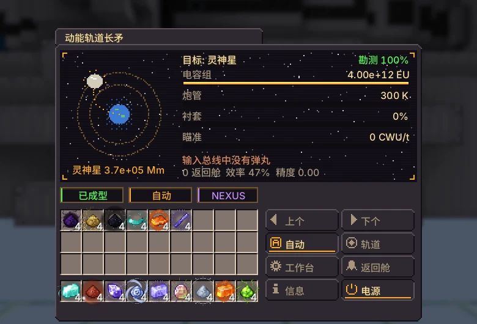
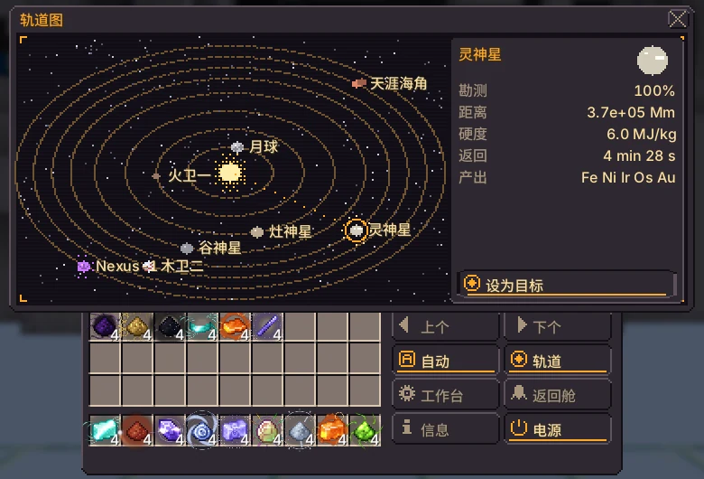
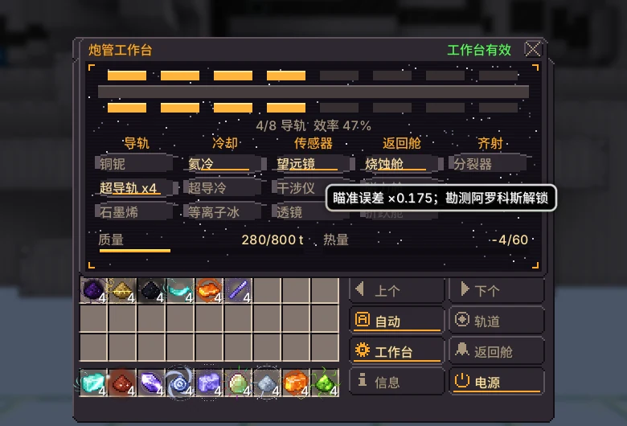

# 动能轨道长矛

{ loading=lazy }

用电容器组向卫星和小行星发射弹丸，并用返回舱回收碎片，碎片以该天体材料的粉形式送达。

|  |  |
|---|---|
| **Tier** | UEV |
| **尺寸** | 242 × 130 × 142 |
| **能量** | 所有者的 Nexus 网络，最高 $2^{36}$ EU/t 充入电容组 |
| **算力** | 最多 16000 CWU/t（瞄准） |
| **控制器** | 装配线（UEV），研究 UEV 电动活塞 |
| **方块** | [图鉴页面](../catalog/kinetic_orbital_lance.md) |

## 结构与仓口

| 仓室 | 上限 | 用途 |
|---|---|---|
| 输入总线 | 4 | 弹丸锭 |
| 输出总线 | 4 | 返回舱的粉 |
| 计算数据接收仓 | 1 | 瞄准（没有时为盲射） |
| 炮管衬套仓 | 1 | 备用内衬，自动更换 |
| 目标弹匣仓 | 1 | 最多 8 个目标弹匣，每次射击轮换 |

成型后，炮身（炮塔环以上的部分）被吸入控制器并以转向目标的动画显示。

## 电容组与发射

电容组通过 Nexus 网络以最高 $2^{36}$ EU/t 充能。开启自动射击后，只要电容组充满、目标可瞄准、输入总线中有能击穿该天体的弹丸，长矛就会一次释放整个电容组。

$$
\begin{aligned}
E &= 4 \times 10^{12}\ \text{EU} \\
\eta &= \min\!\left(0.85,\ 0.35 + \textstyle\sum \Delta\eta_{\text{rail}} \cdot \left(1 - 0.5\,\tfrac{n_{\text{rail}}}{8}\right)\right) \\
M_{\text{frag}} &= \frac{0.2\,\eta\,E \cdot 1000\ \text{J/EU}}{H} \\
M_{\text{rec}} &= M_{\text{frag}} \cdot r \cdot A
\end{aligned}
$$

$H$ 为天体硬度（J/kg），$r$ 为返回舱回收率（无返回舱部件时为 0.6），$A$ 为精度（见下一节）。返回舱在 $t = 30\ \text{s} \cdot \ln(1 + d / 50\ \text{Mm})$ 后着陆，**每 100 t 卸下一份粉**，平均分配给该天体的各种材料。放不下的返回舱会排队等待。

弹丸为锭。弹丸种类只决定能命中哪些天体：**Nexus-1 只能被磁星合金击穿**，其他天体任何弹丸都可以。

| 弹丸（锭） | 质量（kg） | 可击穿 Nexus-1 |
|---|---|---|
| 硅岩合金 | 50 | — |
| 凯金 | 80 | — |
| 中子素 | 400 | — |
| 宇宙中子素 | 800 | — |
| 白矮星物质 | 1,200 | — |
| 磁星合金 | 2,000 | ✅ |

## 目标与瞄准

从月球开始。前置天体勘测达到 100%（回收其特征质量）后才能瞄准下一个天体。目标弹匣仓中的弹匣决定目标，并逐发轮换。

接收仓必须用光缆连接到正在运行的算力网络的发送仓（例如由超级计算机供能的网络交换机）。CWU/t 越高瞄准越准，对远距离天体影响明显。

$$
\begin{aligned}
S &= 1 - e^{-M / M_{\text{car}}} && \text{勘测度，99\% 视为完成} \\
\theta &= \frac{10^{-9}\,u}{\sqrt{\text{CWU/t} / 1000}} + 2 \times 10^{-10} \cdot \frac{\max(0,\ T - 300)}{100} \\
A &= \max\!\left(0,\ 1 - \frac{d\,\theta}{5000\ \text{m}}\right)
\end{aligned}
$$

$M$ 为从该天体回收的质量，$u$ 为传感器的瞄准系数（无传感器时为 1），$T$ 为炮管温度（K），$d$ 为距离。长矛最多向算力仓请求 16,000 CWU/t。

| 天体 | 距离（Mm） | H (MJ/kg) | $M_{car}$ (kg) | 返回舱 | 前置（100%） | 材料 | 精度* | 勘测满所需射击数* |
|---|---|---|---|---|---|---|---|---|
| 月球 | 384 | 2 | $1.00 \times 10^{6}$ | 65 s | — | 铁，钛，铝，氦-3 | 1 | 1 |
| 火卫一 | 78 | 1.2 | $2.00 \times 10^{6}$ | 28 s | 月球 | 碳，镍，铁 | 1 | 1 |
| 灶神星 | 170,000 | 3.5 | $8.00 \times 10^{6}$ | 244 s | 火卫一 | 铁，镁，铬，铂 | 0.99 | 1 |
| 谷神星 | 410,000 | 1.5 | $8.00 \times 10^{6}$ | 270 s | 火卫一 | 镁，钠，氨 | 0.98 | 1 |
| 灵神星 | 370,000 | 6 | $5.00 \times 10^{7}$ | 267 s | 灶神星 | 铁，镍，铱，锇，金 | 0.98 | 9 |
| 木卫二 | 630,000 | 2.8 | $5.00 \times 10^{7}$ | 283 s | 谷神星 | 镁，硫，氘 | 0.97 | 4 |
| 天涯海角 | $6.60 \times 10^{6}$ | 0.9 | $2.00 \times 10^{8}$ | 354 s | 木卫二 | 原初索林，氮，甲烷，碳 | 0.67 | 8 |
| Nexus-1 | $7.50 \times 10^{6}$ | 9.5 | $1.00 \times 10^{9}$ | 358 s | 灵神星，天涯海角 | 奈克斯金属，硅岩，中子素，时空 | 0.62 | 417 |

\* 无工作台部件（$\eta = 0.35$，$r = 0.6$，$u = 1$），16,000 CWU/t，炮管冷却。

## 炮管工作台与磨损

在工作台行或“工作台”标签中点击部件。轨道最多 8 条（Shift+点击移除一条），其他槽位各放一个部件。将天体勘测至 100% 会解锁来自该天体的部件。配置必须满足三项预算，否则长矛不会射击：

$$
\sum m \le 800\ \text{t} \qquad \sum Q \le 60 \qquad \frac{n_{\text{rail}}}{8} \le 1
$$

| 部件 | 槽位 | 效果 | 质量（t） | 热量 | 解锁来源 |
|---|---|---|---|---|---|
| `rail_cu_nb` | 轨道 | $\Delta\eta = +0.02$ | 40 | 3 | 初始 |
| `rail_superconductor` | 轨道 | $\Delta\eta = +0.04$ | 60 | 1 | 火卫一 |
| `rail_graphene` | 轨道 | $\Delta\eta = +0.07$ | 140 | 2 | 灵神星 |
| `cooling_helium` | 冷却 | $C_{\text{barrel}} \times 2$ | 30 | -10 | 谷神星 |
| `cooling_superconductor` | 冷却 | $C_{\text{barrel}} \times 4$ | 60 | -25 | 木卫二 |
| `cooling_plasma_ice` | 冷却 | $C_{\text{barrel}} \times 8$ | 90 | -60 | 天涯海角 |
| `sensor_telescope` | 传感器 | $u = 0.7$ | 10 | 2 | 月球 |
| `sensor_interferometer` | 传感器 | $u = 0.35$ | 40 | 2 | 木卫二 |
| `sensor_lens` | 传感器 | $u = 0.17$ | 80 | 2 | 天涯海角 |
| `capsule_ablative` | 返回舱 | $r = 0.75$ | 0 | 0 | 谷神星 |
| `capsule_magnetic` | 返回舱 | $r = 0.85$ | 0 | 0 | 灵神星 |
| `capsule_fold` | 返回舱 | $r = 0.95$ | 0 | 0 | Nexus-1 |
| `salvo_splitter` | 齐射 | 每次 2 发弹丸 | 50 | 5 | 灶神星 |

$$
\begin{aligned}
\Delta T &= \frac{(1 - \eta)\,E}{C_{\text{barrel}}}, \qquad C_{\text{barrel}} = 2 \times 10^{9}\ \text{EU/K} \times k_{\text{cooling}} \\
\dot T_{\text{cooling}} &= -\frac{2^{34} \cdot 20\ \text{EU/s}}{C_{\text{barrel}}} \quad (\text{降至 300 K}) \\
W &\mathrel{+}= \frac{E}{E_{\text{liner}}}
\end{aligned}
$$

每次射击都会磨损衬套并加热炮管。衬套磨损 100% 或炮管超过 2500 K 会哑火。炮管衬套仓中的备用衬套（硅岩合金板或中子素板）会自动更换。侧边标签页：轨道图和工作台。

| 内衬（板或致密板） | $E_{liner}$ (EU) | 满能射击次数 |
|---|---|---|
| 硅岩合金 | $5.00 \times 10^{13}$ | 12.5 |
| 中子素 | $2.00 \times 10^{14}$ | 50 |

无工作台部件时，一次满能射击使炮管升温 1,300 K，基础冷却每秒约降低 172 K。

## 终局

独有产物：阿罗科斯的回收舱带回原初索林（神之锻炉结构外壳）；奈克斯-1的回收舱带回奈克斯金属（对撞机偶极磁体、磁星合金）。

需求：奈克斯-1的地壳只有磁星合金锭（磁星弹，2000吨）才能击碎。搅拌机：2奈克斯金属粉 + 1磁星晶体 + 4白矮星物质粉，再在12000 K高炉中冶炼。

磁星晶体来自恒星约束室；对撞机需要你的奈克斯金属来绕制最后一级磁体。

!!! bug "已知问题"

    - 弹丸质量、撞击模式和齐射分流器目前不会改变回收量：回收质量只取决于 $\eta$、$E$、$H$、$r$ 和 $A$。
    - 电容组只有一个电容环（$4 \times 10^{12}$ EU）；额外的环尚未加入，因此质量预算为 800 t，热量预算为 60。

    其他问题请提交到 [issue tracker](https://github.com/GTInfinityAscension/GregTech-Nexus-Addon/issues)。

## 界面

当前版本的游戏界面（简体中文）。

=== "主界面"

    { loading=lazy }

=== "轨道图"

    { loading=lazy }

=== "炮管工作台"

    { loading=lazy }
