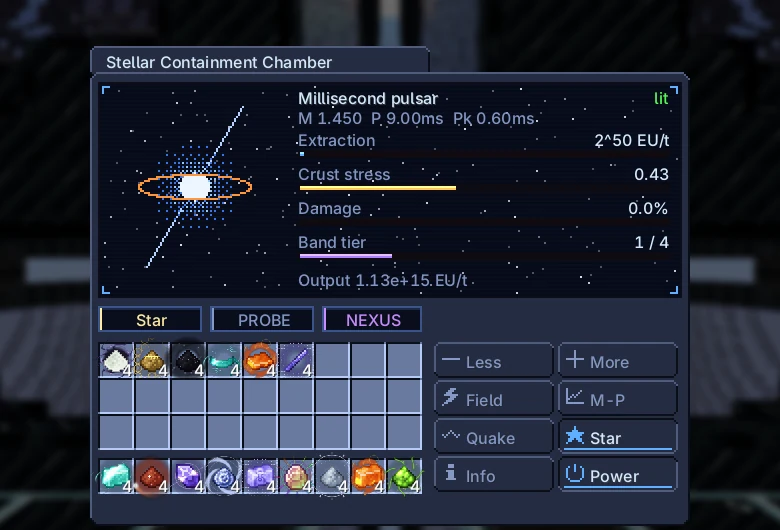
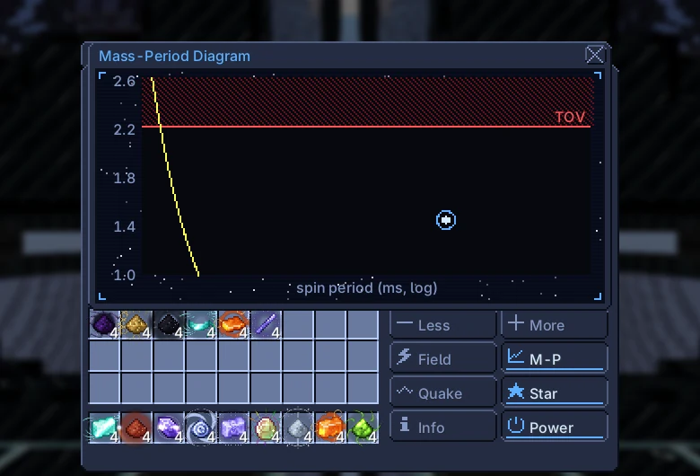
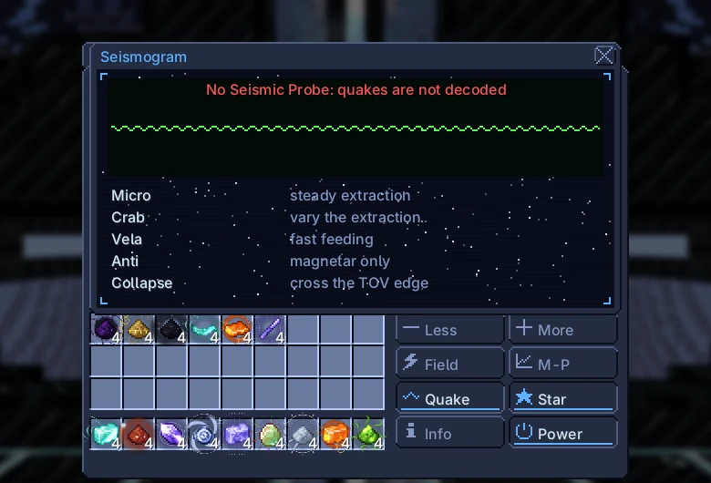

# Stellar Containment Chamber

{ loading=lazy }

Holds a neutron star in containment bands and turns its spin into EU for the owner's Nexus wireless network. There are no recipes: the star has a mass, a spin period and a crust, and everything you do changes them.

|  |  |
|---|---|
| **Tier** | MAX |
| **Size** | 93 × 93 × 93 |
| **Energy** | produces EU into the owner's Nexus network |
| **Output** | up to $2^{59}$ EU/t (neutron star), $2^{62}$ EU/t (black hole) |
| **Controller** | Assembly Line (UXV), research on the UXV Field Generator |
| **Blocks** | [catalog page](../catalog/stellar_containment_chamber.md) |

## Structure and hatches

| Hatch | Max | Use |
|---|---|---|
| Input Hatch | 8 | star matter (any fluid form) |
| Output Bus | 4 | neutronium, white dwarf matter, crystals, core matter |
| Mass Injector | 4 | dusts and ingots of star matter; Forgecore plates |
| Seismic Probe | 1 | decodes starquakes |

The Degenerate Matter Core (radius 7) at the centre must be complete. When the bands get power the core is taken into the star; it comes back as blocks when the chamber stops or the structure breaks.

## Power and extraction

The bands draw their upkeep from the owner's Nexus network every second. Without it the star stays dark, and a lit star takes containment damage.

Set the extraction with [-] and [+] as 2^n EU/t (n from 40 to 62). The energy goes to the Nexus network.

$$
\begin{aligned}
I &= 0.4\,M R^{2}, \quad R = 12\ \text{km} \qquad E_{\text{rot}} = \tfrac12 I\,\omega^{2} \cdot 10^{-20}\ \text{EU/J}, \quad \omega = \frac{2\pi}{P} \\
P_{\text{dipole}} &= \frac{B^{2} R^{6} \omega^{4}}{6 c^{3}} \cdot 10^{-20}\ \text{EU/J}, \quad B = 6.7 \times 10^{11}\ \text{T}\ (\times 4\ \text{magnetar}) \\
\text{upkeep} &= 2^{\,40 + 2k}\ \text{EU/t} \qquad \text{cap} = 2^{\,55 + k}\ \text{EU/t}\ (\tfrac12\ \text{until the millisecond region})
\end{aligned}
$$

| Band tier | Unlocked by | Upkeep (EU/t) | Cap (EU/t) | Quake capacity |
|---|---|---|---|---|
| 1 | start | $2^{42}$ | $2^{56}$ | $1.00 \times 10^{16}$ |
| 2 | micro quake decoded | $2^{44}$ | $2^{57}$ | $1.00 \times 10^{17}$ |
| 3 | Vela quake decoded | $2^{46}$ | $2^{58}$ | $1.00 \times 10^{18}$ |
| 4 | Vela + record spin (< 1.4 ms) | $2^{48}$ | $2^{59}$ | $1.00 \times 10^{19}$ |

Extraction also mines the crust: $\text{EU/t} / 2^{52}$ neutronium dusts per second.

## Feeding and outputs

Feed star matter through Input Hatches (liquid, molten, gas or plasma) or as dusts and ingots through a Mass Injector (144 mB each). Feeding adds mass and spins the star up, like a recycled pulsar; 15% of the mass leaves as binding energy, paid at once as EU.

Outputs in the Output Buses: neutronium dust from crust mining (grows with extraction) and white dwarf matter dust from starquakes.

$$
\begin{aligned}
\Delta J &= \Delta M\,\sqrt{G M R} \qquad \omega' = \frac{I\omega + \Delta J}{I'} \\
M' &= M + 0.85\,\Delta M \qquad E_{\text{bind}} = 0.15\,\Delta M\,c^{2} \cdot 10^{-26}\ \text{EU/J}
\end{aligned}
$$

| Feed | M☉ per mB | M☉ per dust or ingot |
|---|---|---|
| Magnetohydrodynamically Constrained Star Matter | $1.00 \times 10^{-7}$ | $1.44 \times 10^{-5}$ |
| White Dwarf Matter | $1.00 \times 10^{-8}$ | $1.44 \times 10^{-6}$ |
| Raw Star Matter | $1.00 \times 10^{-9}$ | $1.44 \times 10^{-7}$ |
| Neutronium | $1.00 \times 10^{-10}$ | $1.44 \times 10^{-8}$ |

## Starquakes and bands

Changing the spin builds stress; at 1 a starquake happens. Only a Seismic Probe decodes quakes (Seismogram tab). Decoded quakes raise the band tier: micro → tier 2, Vela (fast feeding) → tier 3, Vela plus a record spin (< 1.4 ms) → tier 4.

The Magnetar button inverts the band field. After 10 minutes the star becomes a magnetar and can give antiquakes.

A quake bigger than the band capacity, or any quake with unpowered bands, damages containment by 10%. At 100% the star loses 10% of its mass.

$$
\sigma \mathrel{+}= 10^{4} \cdot \frac{|\Delta\omega|}{\omega} \quad (\text{a quake at σ ≥ 1})
$$

| Quake | How | ΔΩ/Ω |
|---|---|---|
| Micro | steady extraction | $5.00 \times 10^{-9}$ |
| Crab | vary the extraction | $5.00 \times 10^{-8}$ |
| Vela | fast feeding | $1.10 \times 10^{-6}$ |
| Anti | magnetar only | $-3.00 \times 10^{-7}$ |
| Collapse | cross the TOV edge | $1.00 \times 10^{-4}$ |

## Limits

Above the TOV limit (2.2 M☉) the star collapses into a black hole, for good. Energy then comes from the ergosphere: the faster it spun when it collapsed, the more there is.

$$
\begin{aligned}
P_{\text{Kepler}} &= 2\pi\sqrt{\frac{R^{3}}{G M}} \\
a^{*} &= \min\!\left(0.998,\ \frac{J c}{G M^{2}}\right) \qquad E_{\text{hole}} = \left(1 - \sqrt{\frac{1 + \sqrt{1 - a^{*2}}}{2}}\right) M c^{2}
\end{aligned}
$$

| Mass (M☉) | Kepler period (ms) |
|---|---|
| 1.2 | 0.65 |
| 1.4 | 0.61 |
| 1.8 | 0.53 |
| 2.1 | 0.49 |
| 2.2 | 0.48 |

| $a^*$ | Extractable share of $Mc^2$ |
|---|---|
| 0.3 | 1.16% |
| 0.6 | 5.13% |
| 0.9 | 15.27% |
| 1 | 27.09% |

The TOV limit is 2.2 M☉, or 2.4 M☉ after an anti-quake has been decoded. Mass–period regions: young (< 30 ms), millisecond (< 10 ms after feeding), record (< 1.4 ms), magnetar (600 s of inverted field), TOV edge (> 2.1 M☉), black hole.

## Endgame

Exclusive: a magnetar starquake (field inverted for 600 s) leaves 4 Magnetar Crystals; a collapse leaves 64 Degenerate Core Matter (Eye of Harmony fields from Advanced tier).

Needs: the inverted field tears the crust. Each 60 s of magnetar field takes one Forgecore plate from the Mass Injector; without one the field drops and the crust takes 10% damage.

Forgecore comes from the Forge World biome of the Dimensional Rift Gate; the Lance needs your crystals for the Magnetar Slug.

## Screens

In-game screens of the current version, in English.

=== "Main screen"

    { loading=lazy }

=== "Mass–period diagram"

    { loading=lazy }

=== "Seismogram"

    { loading=lazy }
