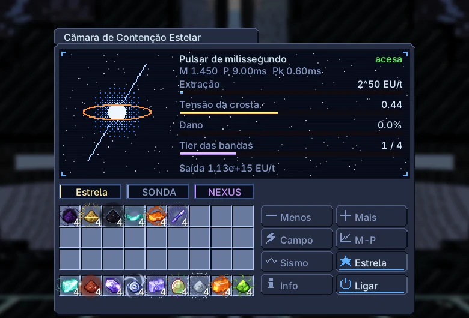
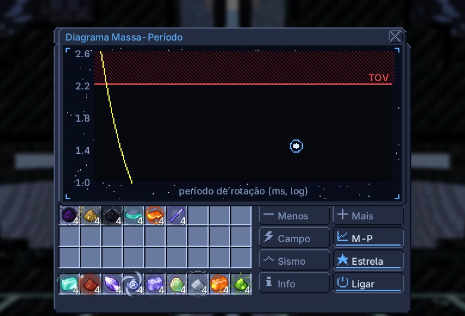
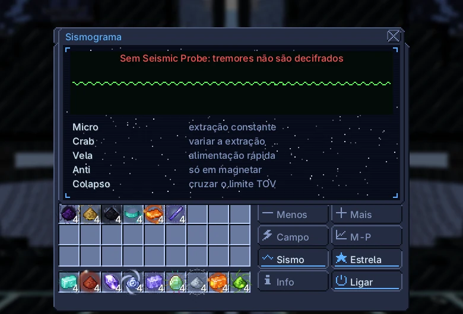

# Câmara de Contenção Estelar

{ loading=lazy }

Prende uma estrela de nêutrons em bandas de contenção e transforma a rotação dela em EU para a rede sem fio Nexus do dono. Não há receitas: a estrela tem massa, período de rotação e crosta, e tudo o que você faz muda esses valores.

|  |  |
|---|---|
| **Tier** | MAX |
| **Tamanho** | 93 × 93 × 93 |
| **Energia** | gera EU para a rede Nexus do dono |
| **Saída** | até $2^{59}$ EU/t (estrela de nêutrons), $2^{62}$ EU/t (buraco negro) |
| **Controlador** | Linha de Montagem (UXV), pesquisa no Gerador de Campo UXV |
| **Blocos** | [página do catálogo](../catalog/stellar_containment_chamber.md) |

## Estrutura e hatches

| Hatch | Máx. | Uso |
|---|---|---|
| Hatch de Entrada | 8 | matéria estelar (qualquer forma de fluido) |
| Barramento de Saída | 4 | neutrônio, matéria de anã branca, cristais, matéria do núcleo |
| Injetor de Massa | 4 | pós e lingotes de matéria estelar; placas de Forjacor |
| Sonda Sísmica | 1 | decifra os tremores |

O Núcleo de Matéria Degenerada (raio 7) no centro precisa estar completo. Quando as bandas recebem energia o núcleo vira a estrela; ele volta como blocos quando a câmara para ou a estrutura quebra.

## Energia e extração

As bandas cobram a manutenção da rede Nexus do dono a cada segundo. Sem ela a estrela não acende, e uma estrela acesa sofre dano de contenção.

Ajuste a extração com [-] e [+] como 2^n EU/t (n de 40 a 62). A energia vai para a rede Nexus.

$$
\begin{aligned}
I &= 0{,}4\,M R^{2}, \quad R = 12\ \text{km} \qquad E_{\text{rot}} = \tfrac12 I\,\omega^{2} \cdot 10^{-20}\ \text{EU/J}, \quad \omega = \frac{2\pi}{P} \\
P_{\text{dipole}} &= \frac{B^{2} R^{6} \omega^{4}}{6 c^{3}} \cdot 10^{-20}\ \text{EU/J}, \quad B = 6{,}7 \times 10^{11}\ \text{T}\ (\times 4\ \text{magnetar}) \\
\text{manutenção} &= 2^{\,40 + 2k}\ \text{EU/t} \qquad \text{teto} = 2^{\,55 + k}\ \text{EU/t}\ (\tfrac12\ \text{até a região de milissegundos})
\end{aligned}
$$

| Tier da banda | Liberado por | Manutenção (EU/t) | Teto (EU/t) | Capacidade de tremor |
|---|---|---|---|---|
| 1 | início | $2^{42}$ | $2^{56}$ | $1{,}00 \times 10^{16}$ |
| 2 | tremor micro decifrado | $2^{44}$ | $2^{57}$ | $1{,}00 \times 10^{17}$ |
| 3 | tremor Vela decifrado | $2^{46}$ | $2^{58}$ | $1{,}00 \times 10^{18}$ |
| 4 | Vela + rotação recorde (< 1,4 ms) | $2^{48}$ | $2^{59}$ | $1{,}00 \times 10^{19}$ |

A extração também minera a crosta: $\text{EU/t} / 2^{52}$ pós de neutrônio por segundo.

## Alimentação e saídas

Alimente matéria estelar pelos Input Hatches (líquida, fundida, gás ou plasma) ou como pó e lingote pelo Mass Injector (144 mB cada). Alimentar aumenta a massa e acelera a rotação, como um pulsar reciclado; 15% da massa sai como energia de ligação, paga na hora em EU.

Saídas nos Output Buses: pó de neutrônio da mineração da crosta (cresce com a extração) e pó de matéria de anã branca dos tremores.

$$
\begin{aligned}
\Delta J &= \Delta M\,\sqrt{G M R} \qquad \omega' = \frac{I\omega + \Delta J}{I'} \\
M' &= M + 0{,}85\,\Delta M \qquad E_{\text{bind}} = 0{,}15\,\Delta M\,c^{2} \cdot 10^{-26}\ \text{EU/J}
\end{aligned}
$$

| Alimento | M☉ por mB | M☉ por pó ou lingote |
|---|---|---|
| Matéria Estelar Magneto-hidrodinamicamente Confinada | $1{,}00 \times 10^{-7}$ | $1{,}44 \times 10^{-5}$ |
| Matéria de Anã Branca | $1{,}00 \times 10^{-8}$ | $1{,}44 \times 10^{-6}$ |
| Mistura Condensada de Plasma Estelar Bruto | $1{,}00 \times 10^{-9}$ | $1{,}44 \times 10^{-7}$ |
| Neutrônio | $1{,}00 \times 10^{-10}$ | $1{,}44 \times 10^{-8}$ |

## Tremores e bandas

Mudar a rotação acumula tensão; em 1 acontece um tremor. Só a Seismic Probe decifra tremores (aba Sismograma). Tremores decifrados sobem o tier das bandas: micro → tier 2, Vela (alimentação rápida) → tier 3, Vela mais rotação recorde (< 1,4 ms) → tier 4.

O botão Magnetar inverte o campo das bandas. Depois de 10 minutos a estrela vira magnetar e pode dar antitremores.

Um tremor maior que a capacidade das bandas, ou qualquer tremor com as bandas sem energia, causa 10% de dano à contenção. Em 100% a estrela perde 10% da massa.

$$
\sigma \mathrel{+}= 10^{4} \cdot \frac{|\Delta\omega|}{\omega} \quad (\text{tremor em σ ≥ 1})
$$

| Tremor | Como | ΔΩ/Ω |
|---|---|---|
| Micro | extração constante | $5{,}00 \times 10^{-9}$ |
| Crab | variar a extração | $5{,}00 \times 10^{-8}$ |
| Vela | alimentação rápida | $1{,}10 \times 10^{-6}$ |
| Anti | só em magnetar | $-3{,}00 \times 10^{-7}$ |
| Colapso | cruzar o limite TOV | $1{,}00 \times 10^{-4}$ |

## Limites

Acima do limite TOV (2,2 M☉) a estrela colapsa em buraco negro, sem volta. A energia passa a vir da ergosfera: quanto mais rápido ela girava ao colapsar, mais energia.

$$
\begin{aligned}
P_{\text{Kepler}} &= 2\pi\sqrt{\frac{R^{3}}{G M}} \\
a^{*} &= \min\!\left(0{,}998,\ \frac{J c}{G M^{2}}\right) \qquad E_{\text{hole}} = \left(1 - \sqrt{\frac{1 + \sqrt{1 - a^{*2}}}{2}}\right) M c^{2}
\end{aligned}
$$

| Massa (M☉) | Período de Kepler (ms) |
|---|---|
| 1,2 | 0,65 |
| 1,4 | 0,61 |
| 1,8 | 0,53 |
| 2,1 | 0,49 |
| 2,2 | 0,48 |

| $a^*$ | Fração extraível de $Mc^2$ |
|---|---|
| 0,3 | 1,16% |
| 0,6 | 5,13% |
| 0,9 | 15,27% |
| 1 | 27,09% |

O limite TOV é 2,2 M☉, ou 2,4 M☉ depois de decifrar um antitremor. Regiões do diagrama massa–período: jovem (< 30 ms), milissegundos (< 10 ms depois de alimentar), recorde (< 1,4 ms), magnetar (600 s de campo invertido), borda TOV (> 2,1 M☉), buraco negro.

## Endgame

Exclusivo: um starquake de magnetar (campo invertido por 600 s) deixa 4 Cristais de Magnetar; um colapso deixa 64 Matéria de Núcleo Degenerado (campos do Eye of Harmony a partir do nível Advanced).

Precisa de: o campo invertido rasga a crosta. Cada 60 s de campo magnetar consome uma placa de Forjacor do Injetor de Massa; sem ela o campo cai e a crosta leva 10% de dano.

O Forjacor vem do bioma Forge World da Fenda Dimensional; a Lança precisa dos seus cristais para o Magnetar Slug.

## Telas

Telas do jogo na versão atual, em português.

=== "Tela principal"

    { loading=lazy }

=== "Diagrama massa–período"

    { loading=lazy }

=== "Sismograma"

    { loading=lazy }
