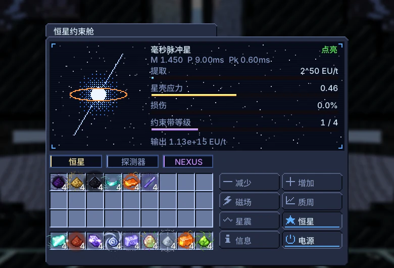
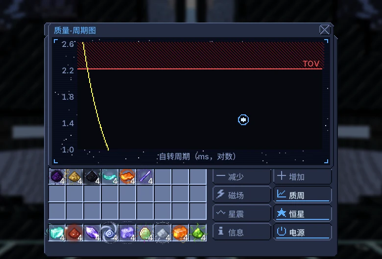
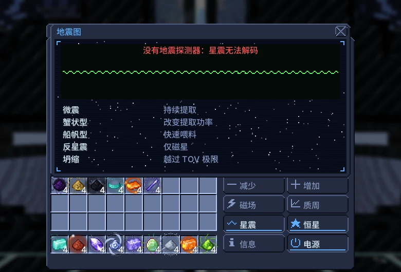

# 恒星约束舱

{ loading=lazy }

用约束带囚禁一颗中子星，并把它的自转转化为 EU，送入所有者的 Nexus 无线网络。没有配方：这颗星有质量、自转周期和星壳，你的每个操作都会改变它们。

|  |  |
|---|---|
| **Tier** | MAX |
| **尺寸** | 93 × 93 × 93 |
| **能量** | 向所有者的 Nexus 网络输出 EU |
| **输出** | 最高 $2^{59}$ EU/t（中子星），$2^{62}$ EU/t（黑洞） |
| **控制器** | 装配线（UXV），研究 UXV 力场发生器 |
| **方块** | [图鉴页面](../catalog/stellar_containment_chamber.md) |

## 结构与仓口

| 仓室 | 上限 | 用途 |
|---|---|---|
| 输入仓 | 8 | 恒星物质（任意流体形态） |
| 输出总线 | 4 | 中子素、白矮星物质、晶体、核心物质 |
| 质量注入器 | 4 | 恒星物质的粉和锭；锻核金属板 |
| 地震探针 | 1 | 解码星震 |

中心的简并物质核心（半径 7）必须完整。约束带通电后核心被吸入恒星；舱室停止或结构损坏时会恢复成方块。

## 能量与提取

约束带每秒从所有者的 Nexus 网络扣除维持能量。没有能量时恒星不会点亮，已点亮的恒星会受到约束损伤。

用 [-] 和 [+] 设定提取功率 2^n EU/t（n 为 40 到 62）。能量送入 Nexus 网络。

$$
\begin{aligned}
I &= 0.4\,M R^{2}, \quad R = 12\ \text{km} \qquad E_{\text{rot}} = \tfrac12 I\,\omega^{2} \cdot 10^{-20}\ \text{EU/J}, \quad \omega = \frac{2\pi}{P} \\
P_{\text{dipole}} &= \frac{B^{2} R^{6} \omega^{4}}{6 c^{3}} \cdot 10^{-20}\ \text{EU/J}, \quad B = 6.7 \times 10^{11}\ \text{T}\ (\times 4\ \text{磁星}) \\
\text{维持} &= 2^{\,40 + 2k}\ \text{EU/t} \qquad \text{上限} = 2^{\,55 + k}\ \text{EU/t}\ (\tfrac12\ \text{到达毫秒区之前})
\end{aligned}
$$

| 束带等级 | 解锁方式 | 维持（EU/t） | 上限（EU/t） | 星震容量 |
|---|---|---|---|---|
| 1 | 初始 | $2^{42}$ | $2^{56}$ | $1.00 \times 10^{16}$ |
| 2 | 解码微震 | $2^{44}$ | $2^{57}$ | $1.00 \times 10^{17}$ |
| 3 | 解码 Vela 震 | $2^{46}$ | $2^{58}$ | $1.00 \times 10^{18}$ |
| 4 | Vela + 纪录自转（< 1.4 ms） | $2^{48}$ | $2^{59}$ | $1.00 \times 10^{19}$ |

提取同时开采星壳：每秒 $\text{EU/t} / 2^{52}$ 份中子素粉。

## 喂料与产出

通过输入仓（液态、熔融、气态或等离子体）或质量注入器（粉和锭，每个 144 mB）喂入恒星物质。喂料会增加质量并加快自转，就像再生脉冲星；15% 的质量作为结合能立即转为 EU。

输出总线中的产物：星壳开采得到中子素粉（随提取功率增加），星震得到白矮星物质粉。

$$
\begin{aligned}
\Delta J &= \Delta M\,\sqrt{G M R} \qquad \omega' = \frac{I\omega + \Delta J}{I'} \\
M' &= M + 0.85\,\Delta M \qquad E_{\text{bind}} = 0.15\,\Delta M\,c^{2} \cdot 10^{-26}\ \text{EU/J}
\end{aligned}
$$

| 投料 | 每 mB 太阳质量 | 每份粉或锭太阳质量 |
|---|---|---|
| 磁流体动力学约束恒星物质 | $1.00 \times 10^{-7}$ | $1.44 \times 10^{-5}$ |
| 白矮星物质 | $1.00 \times 10^{-8}$ | $1.44 \times 10^{-6}$ |
| 原始恒星混合物 | $1.00 \times 10^{-9}$ | $1.44 \times 10^{-7}$ |
| 中子素 | $1.00 \times 10^{-10}$ | $1.44 \times 10^{-8}$ |

## 星震与约束带

自转变化会积累应力；应力达到 1 时发生星震。只有地震探测器能解码星震（地震图标签页）。解码的星震会提升约束带等级：微震 → 2 级，船帆型（快速喂料）→ 3 级，船帆型加纪录自转（< 1.4 ms）→ 4 级。

磁星按钮会反转约束带磁场。10 分钟后恒星成为磁星，可能发生反星震。

超过约束带容量的星震，或约束带断电时的任何星震，会造成 10% 约束损伤。损伤达到 100% 时恒星损失 10% 质量。

$$
\sigma \mathrel{+}= 10^{4} \cdot \frac{|\Delta\omega|}{\omega} \quad (\text{σ ≥ 1 时发生星震})
$$

| 星震 | 触发 | ΔΩ/Ω |
|---|---|---|
| 微震 | 持续提取 | $5.00 \times 10^{-9}$ |
| 蟹状型 | 改变提取功率 | $5.00 \times 10^{-8}$ |
| 船帆型 | 快速喂料 | $1.10 \times 10^{-6}$ |
| 反星震 | 仅磁星 | $-3.00 \times 10^{-7}$ |
| 坍缩 | 越过 TOV 极限 | $1.00 \times 10^{-4}$ |

## 极限

超过 TOV 极限（2.2 M☉）恒星会不可逆地坍缩成黑洞。之后能量来自能层：坍缩时转得越快，能量越多。

$$
\begin{aligned}
P_{\text{Kepler}} &= 2\pi\sqrt{\frac{R^{3}}{G M}} \\
a^{*} &= \min\!\left(0.998,\ \frac{J c}{G M^{2}}\right) \qquad E_{\text{hole}} = \left(1 - \sqrt{\frac{1 + \sqrt{1 - a^{*2}}}{2}}\right) M c^{2}
\end{aligned}
$$

| 质量（M☉） | 开普勒周期（ms） |
|---|---|
| 1.2 | 0.65 |
| 1.4 | 0.61 |
| 1.8 | 0.53 |
| 2.1 | 0.49 |
| 2.2 | 0.48 |

| $a^*$ | 可提取的 $Mc^2$ 比例 |
|---|---|
| 0.3 | 1.16% |
| 0.6 | 5.13% |
| 0.9 | 15.27% |
| 1 | 27.09% |

TOV 极限为 2.2 M☉，解码反星震后为 2.4 M☉。质量-周期图区域：年轻（< 30 ms）、毫秒（投料后 < 10 ms）、纪录（< 1.4 ms）、磁星（反转场 600 秒）、TOV 边缘（> 2.1 M☉）、黑洞。

## 终局

独有产物：磁星星震（磁场反转600秒）产出4颗磁星晶体；坍缩产出64份简并核心物质（和谐之眼高级及以上场发生器）。

需求：反转磁场会撕裂星壳。磁星磁场每持续60秒，从质量注入仓消耗一块锻核金属板；没有则磁场消失，星壳受到10%损伤。

锻核金属来自维度裂隙门的锻造世界生物群系；轨道动能长矛需要你的晶体制造磁星弹。

## 界面

当前版本的游戏界面（简体中文）。

=== "主界面"

    { loading=lazy }

=== "质量-周期图"

    { loading=lazy }

=== "地震图"

    { loading=lazy }
