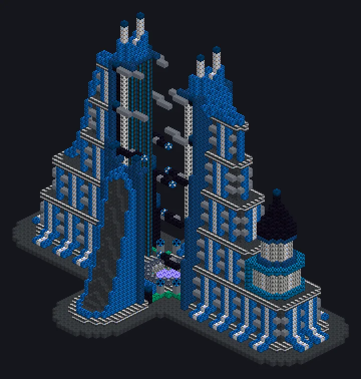

# Dyson Sphere

{ loading=lazy }

Two multiblocks build a swarm of collectors around a planet's star and turn it into laser power.

| Machine | Role |
|---|---|
| [Launch Silo](../machines/catalog/dyson_sphere_launch_silo.md) | launches Dyson Swarm Modules into orbit of the planet it stands on. Surface only, not in orbit. Launch time grows with the planet's distance |
| [Receiving Station](../machines/catalog/dyson_sphere_receiving_station.md) | turns the swarm into power and sends it out as a laser. Needs computation and liquid helium |

## Formulas

$$\text{EU/t} = V_{\text{MAX}} \cdot \text{modules} \cdot \frac{50 - \max(0,\ \text{damage} - 60)}{50}$$

- Each station cycle adds 1 damage to the swarm. Above 99 damage the swarm loses a module.
- A launch while damage is above 60 **repairs** the swarm instead of adding a module.
- Up to 100,000 modules per planet.

Keep launching to keep damage below 60 and the output at full power.
