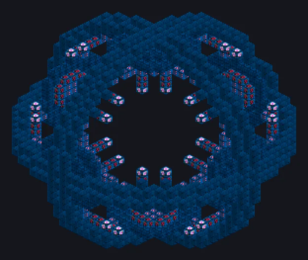

# Eye of Harmony

{ loading=lazy }

The Eye of Harmony simulates a miniature universe and extracts the ores of a whole planet. Each run is expensive, slow and may fail; this page shows every calculation the controller makes.

|  |  |
|---|---|
| **Tier** | UXV |
| **Energy** | wireless (Nexus network) |
| **Origin** | port of GT5-Unofficial a3e1e112 |

## Planetary programs

The planet item in the controller slot picks the program. Products come from the GTCEu ore veins registered in that dimension. Packs add planets through KubeJS (`GTNAStartupEvents.eyeOfHarmony`). Planets beyond the Minecraft dimensions need Ad Astra.

$$
\begin{aligned}
\text{base duration} &= 18000\ \text{s} \cdot 1.4^{\text{tier}} \\
\text{each gas (H and He)} &= 10^{9} \cdot (\text{tier} + 1)\ \text{mB} \\
\text{base chance} &= 1 - 0.05 \cdot \text{tier} \\
\text{return} &= \text{cost} \cdot (0.6 + \text{tier}/10) \\
\text{cost} &= \text{plasmas} + \text{ticks} \cdot (2^{19} + 10^{11})\ \text{EU}
\end{aligned}
$$

| Planet | Tier | Base duration | H and He (mB) | Base chance | Cost without plasmas (EU) |
|---|---|---|---|---|---|
| Overworld, Nether, End | 0 | 5 h | 1e9 | 100% | 3.6e16 |
| Moon | 1 | 7 h | 2e9 | 95% | 5.04e16 |
| Mars | 2 | 9.80 h | 3e9 | 90% | 7.06e16 |
| Venus, Mercury | 4 | 19.21 h | 5e9 | 80% | 1.38e17 |
| Glacio | 5 | 26.89 h | 6e9 | 75% | 1.94e17 |

## Fields and circuit

Three fields of tier 0 to 8 (compression $c$, acceleration $a$, stabilisation $s$) and a circuit $k$ from 0 to 24:

$$
\begin{aligned}
\text{duration} &= \max\!\left(T \cdot 2^{-a} \cdot 0.97^{\,c - r} \cdot 2^{-k},\ 1\right) && r = \text{program minimum compression} \\
\text{startup cost} &= \text{cost} \cdot 4^{k} \\
\text{return} &= \text{base return} \cdot \left(1 - (8 - s) \cdot 0.05\right) && \text{does not scale with the circuit} \\
\text{chance} &= \text{base chance} - 0.0925\,a + 0.05\,s - \text{gas penalties} \\
\text{yield} &= 1 - 0.05\,s - \text{gas penalties} \\
\text{gas penalty} &= 1 - \exp\!\left(-\left(30 \cdot \left(\tfrac{\text{stored}}{\text{required}} - 1\right)\right)^{2}\right)
\end{aligned}
$$

| a / s | Chance (Overworld) | Yield | Time |
|---|---|---|---|
| 0 / 0 | 100% | 100% | ÷1 |
| 2 / 2 | 91.50% | 90% | ÷4 |
| 4 / 4 | 83% | 80% | ÷16 |
| 6 / 6 | 74.50% | 70% | ÷64 |
| 8 / 8 | 66% | 60% | ÷256 |
| 8 / 0 | 26% | 100% | ÷256 |
| 0 / 8 | 100% | 60% | ÷1 |

Excess gas also reduces chance and yield: storing 10% more already costs 99.99% per gas. Deliver the exact amount.

## Failure and pity

- A failure still returns the EU and produces SpaceTime: $\text{chance} \cdot 14400 \cdot 2^{\text{tier} + 1}$ mB.
- Consecutive failures **under the same conditions** build pity: $(1 - \text{chance}) \cdot \text{chance}$ per failure. Changing fields or circuit resets it.
- The result is rolled at startup and saved: breaking the controller or reloading the world does not change it.

## Tips

- The controller consumes **all** stored hydrogen and helium at startup, excess included.
- The return arrives through the Nexus network in parts; network loss is shown separately in the GUI.
- A full output never loses anything: the cycle waits.
