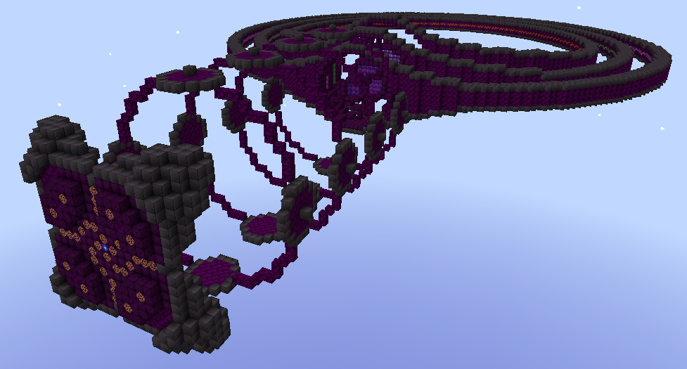
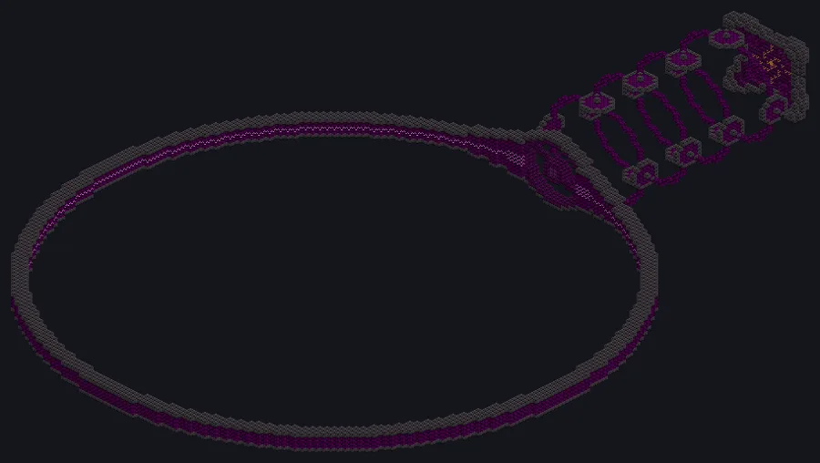
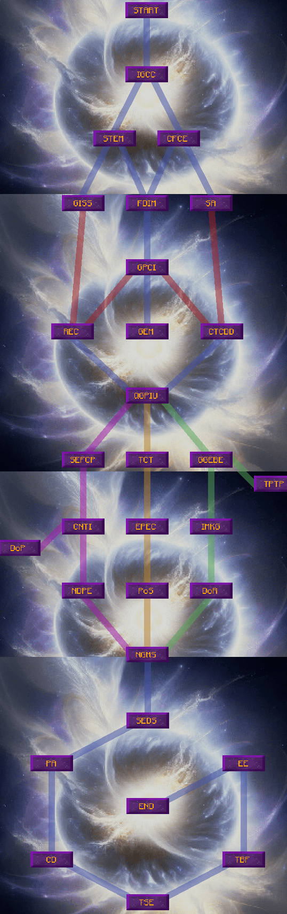

# Forge of the Gods

{ loading=lazy }

<small>Image: GTNH Wiki, CC BY-SA 4.0.</small>

The Forge of the Gods (Godforge) is a UIV multiblock that keeps an artificial star and powers up to 16 processing **modules** with wireless energy. This page collects what the game does not show: every formula, tables computed from the GTNA code, and the differences from GTNH.

|  |  |
|---|---|
| **Tier** | UIV |
| **Size** | 186 × 127 × 29 (ring 1) |
| **Energy** | wireless, no energy hatch |
| **Overclock** | imperfect (4/2), 4/2.3 with GGEBE |
| **Source** | port of GT5-Unofficial a3e1e112 |

## Structure

Up to three rings. Modules sit in smaller rings around them. To build a new ring, turn the animation off (screwdriver on the controller or the cosmetics button), build it, and turn it back on with a soft mallet. The hologram projector uses the stack size to pick how many rings to show.

{ loading=lazy }

## Modules

| Module | Unlock | Base parallel | Function |
|---|---|---|---|
| Helioflare Power Forge | START | 1024 | blast furnace or multi-smelter (furnace mode does not count for milestones) |
| Helioflux Melting Core | FDIM | 512 | blast furnace with molten output |
| Heliothermal Plasma Fabricator | GPCI | 512 | dust/fluid straight to plasma |
| Heliofusion Exoticizer | QGPIU (magmatter: EE) | 64 | quark-gluon plasma and MagMatter; needs automation |

Module limit: 8, 12 with ring 2 (CD), 16 with ring 3 (EE). Exceeding it disconnects all modules.

## Fuel

The star is lit with Stellar Fuel in the input bus. Startup cost: `f · 25 · 1.2^f` items. The consumption factor `f` goes up to 5 without upgrades. The controller drains every 5 s (×2 while the battery charges).

```
DTR (residue)        f · 300 · 1.15^f      (×0.8 with STEM)
Stellar plasma       f · 2 · 1.08^f        (×0.8 with STEM)
MCSM                 f / 25
heat                 12601 + log₁.₅(f) · 1000   (base 1.12 / 1.18 with SEFCP)
```

| f | Base heat (K) | Startup (items) | DTR/s | DTR/s with STEM | Stellar plasma/s | MCSM/s |
|---|---|---|---|---|---|---|
| 1 | 12,601 | 30 | 345 | 276 | 2.16 | 0.04 |
| 2 | 14,310 | 72 | 793 | 635 | 4.67 | 0.08 |
| 3 | 15,310 | 129 | 1,369 | 1,095 | 7.56 | 0.12 |
| 4 | 16,020 | 207 | 2,099 | 1,679 | 10.88 | 0.16 |
| 5 | 16,570 | 311 | 3,017 | 2,414 | 14.69 | 0.20 |
| 6 | 17,020 | 447 | 4,164 | 3,331 | 19.04 | 0.24 |
| 10 | 18,279 | 1,547 | 12,137 | 9,709 | 43.18 | 0.40 |
| 20 | 19,989 | 19,168 | 98,199 | 78,559 | 186 | 0.80 |
| 43 | 21,877 | 2,730,247 | 5,255,292 | 4,204,234 | 2,354 | 1.72 |
| 70 | 23,079 | 6.11e8 | 3.72e8 | 2.98e8 | 30,605 | 2.80 |

Max factors with TSE: residue 70 (72 with STEM), stellar plasma 181 (184 with STEM), MCSM uncapped. Above 43 the SA effective factor grows slowly: `43 + (f − 43)^0.4`.

## Heat and bonus cap

Heat bonuses apply up to the cap: 15,000 K, or 30,000 K with CNTI. With NDPE, heat above 30,000 K counts compressed: `30000 + (heat − 30000)^e`, e = 0.85 for the Power Forge and 0.8 for the others.

## Parallel

```
parallel = base · CTCDD(×2) · SA · EPEC · PoS
SA    = 1 + f_effective / 15        (TCT: ×3 on Melting Core and on Power Forge with DoP, ×2 otherwise)
EPEC  = 1 + heat / 15000            (Melting Core, Power Forge with DoP) or 1 + heat / 25000
PoS   = 1 + upgrades / 5            (Melting Core, Power Forge with DoP) or 1 + upgrades / 8
Exoticizer: square root of the total with PA, otherwise 1
```

| f | f_ef. | SA | SA+TCT (Melting) |
|---|---|---|---|
| 5 | 5 | 1.33 | 4 |
| 15 | 15 | 2 | 6 |
| 43 | 43 | 3.87 | 11.60 |
| 70 | 46 | 4.07 | 12.20 |
| 181 | 50 | 4.33 | 13 |
| 1000 | 58 | 4.87 | 14.60 |

The GTNH wiki only shows the /15000 and /5 versions. The code uses larger divisors outside the Melting Core.

## Speed and energy

```
IGCC   time × heat^−0.01
DoR    time ÷ parallel^0.02 (plasma) or ^0.012 (others)
REC    discount = (1 − 1.05^(−0.05 · max battery)) / 20
IMKG   charge discount: 1 − (−0.6·(c − 0.5)² + 0.15) on plasma, ×2/3 on the others
GISS   voltage += fuel units/s · 1e8 EU/t
NGMS   voltage × 4 per active ring (applied last)
```

## Milestones

Each milestone has 7 tiers and grants graviton shards equal to the tier. Once all four reach tier 7, **Inversion** removes the cap and every new tier costs the same as tier 7.

| Tier | Charge (EU) | Conversion (recipes) | Catalyst (fuel) | Composition |
|---|---|---|---|---|
| 1 | 1e15 | 1e7 | 10,000 | 1 |
| 2 | 9e15 | 4e7 | 30,000 | 2 |
| 3 | 8.1e16 | 1.6e8 | 90,000 | 3 |
| 4 | 7.29e17 | 6.4e8 | 270,000 | 4 |
| 5 | 6.56e18 | 2.56e9 | 810,000 | 5 |
| 6 | 5.9e19 | 1.02e10 | 2,430,000 | 6 |
| 7 | 5.31e20 | 4.1e10 | 7,290,000 | 7 |

## Upgrades

Bought with shards. Blue line: one prerequisite is enough; red: all are needed. After the Exoticizer the tree splits in three (purple: heat; orange: parallel; green: plasma). One branch first, the second with ring 2, all three with ring 3. Refunds only with no dependent upgrade active.

| Tag | Cost | Requires | Effect |
|---|---|---|---|
| START | 0 | — | 8 modules, ring 1, Power Forge, 2 bn EU/t, 15,000 K cap |
| IGCC | 1 | START | time × heat^−0.01 |
| STEM | 1 | IGCC | fuel × 0.8 |
| CFCE | 1 | IGCC | max factor × 1.2 |
| GISS | 1 | STEM | voltage += fuel/s · 1e8 |
| FDIM | 1 | STEM, CFCE | unlocks Melting Core |
| SA | 1 | CFCE | parallel × (1 + f/15) |
| GPCI | 2 | FDIM | unlocks Plasma Fabricator (T3, single step) |
| REC | 2 | GISS + GPCI | configurable battery and discount |
| GEM | 2 | GPCI | max factor += active upgrades |
| CTCDD | 2 | GPCI + SA | parallel × 2 |
| QGPIU | 2 | REC, CTCDD | unlocks Exoticizer |
| SEFCP | 3 | QGPIU | heat with base 1.12 / 1.18 |
| TCT | 3 | QGPIU | SA × 2 or × 3 |
| GGEBE | 3 | QGPIU | overclock 4/2.3 |
| TPTP | 4 | GGEBE | multi-step plasmas |
| CNTI | 3 | SEFCP | 30,000 K cap |
| DOP | 4 | CNTI | Power Forge gets Melting Core bonuses |
| EPEC | 3 | TCT | parallel × (1 + heat/15000 or /25000) |
| IMKG | 3 | GGEBE | battery-charge discount |
| NDPE | 3 | CNTI | compressed heat above 30,000 K |
| POS | 3 | EPEC | parallel × (1 + upgrades/5 or /8) |
| DOR | 3 | IMKG | time ÷ parallel^0.02 |
| NGMS | 4 | NDPE, POS, DOR | voltage × 4 per ring |
| SEDS | 5 | NGMS | plasmas up to T5 |
| PA | 6 | SEDS | Exoticizer gets the bonuses (square root) |
| CD | 7 | PA | ring 2, +4 modules |
| TSE | 8 | CD | removes the fuel cap |
| TBF | 9 | TSE | free voltage per module |
| EE | 10 | TBF | ring 3, +4 modules, magmatter |
| END | 12 | EE | exotic plasmas, shard ejection |

### Upgrade tree (GTNH)

{ loading=lazy width=360 }

<small>Image: GTNH Wiki, CC BY-SA 4.0.</small>

## Extra upgrade materials (GTNA)

| Tag | Materials |
|---|---|
| START | 64 frame Superconductor UIV Base, 32 Superconductor Composite, 16 Metastable Oganesson gear, 8 Eternal Singularity, 64 Robot Arm UIV, 64 Field Generator UEV |
| FDIM | 16 Mega Alloy Blast Smelter, 64 Hypogen Coil, 32 Harmonic Phonon Conduit, 16 Eternal Singularity, 48 Field Restriction Coil T3, 64 Robot Arm UIV, 64 Field Generator UEV |
| GPCI | 8 Stellar Energy Siphon, 8 Advanced Fusion, 64 Fusion Casing MK4, 64 Neutronium foil, 48 dense Quantum plate, 32 Rhugnor gear, 16 Eternal Singularity, 64 Robot Arm UIV, 64 Field Generator UEV |
| QGPIU | 16 Stellar Energy Siphon, 2 Advanced Fusion, 64 Compressed Fusion Coil MK2, 16 Harmonic Phonon Conduit, 4 Transcendent Plasma Mixer, 64 Rhugnor gear, 64 Ichorium gear, 32 Eternal Singularity, 64 Robot Arm UIV, 64 Field Generator UEV |
| CD | 64 frame SpaceTime, 64 frame Superconductor UMV Base, 64 frame Hypogen, 64 frame Dragon Metal, 64 Spatial Casing, 8 Boundary Casing, 2 Mega Battery, 32 Field Generator UXV |
| EE | 64 frame White Dwarf Matter, 64 frame Black Dwarf Matter, 16 frame Eternity, 2 frame Universium, 64 Boundary Casing, 48 Stabilisation Field T5, 16 Mega Battery, 32 Exoticizer, 64 Siphon, 64 Field Generator UXV, 64 Robot Arm UXV |
| END | 64 frame MHDCSM, 64 frame Eternity, 64 frame MagMatter, 64 Stabilisation Field T7, 64 Exoticizer, 4 Astral Array Fabricator, 32 Mega Battery, 64 Field Generator UXV, 64 Robot Arm UXV |

GTNA substitutions compared with GTNH: UHT Resistant Mesh → Neutronium foil; Fusion Internal Casing 2 → Fusion Casing MK4; Compact Fusion Coil T4 → Compressed Fusion Coil MK2; UMV parts → UXV. Transdimensional Alignment Matrix and MagMatter nanites are left out.

## Differences from GTNH

- Plasma Fabricator base parallel is 512 in the code (the GTNH wiki says 384).
- Exoticizer magmatter is unlocked by **EE** in the GTNA code (the GTNH wiki says END).
- Material costs adapted to items that exist in GTNA (previous section).
- Fuels and max factors identical to GT5-Unofficial a3e1e112.

## Credits

Images marked "GTNH Wiki" come from the [GT New Horizons wiki](https://wiki.gtnewhorizons.com/wiki/Forge_of_the_Gods), licensed under [CC BY-SA 4.0](https://creativecommons.org/licenses/by-sa/4.0/). This page is distributed under the same license. Original mechanics: GT5-Unofficial (GTNH team).
