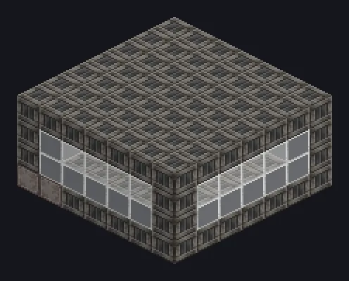

# Nexus 能量网络

GTNA 的无线 EU 网络。发电机把 EU 存入个人余额，机器从中取用，不限距离，无需导线。**Nexus通量矩阵**多方块决定网络能储存多少能量。

{ loading=lazy }

## 组成部分

| 部件 | 作用 |
|---|---|
| [Nexus通量矩阵](../machines/catalog/nexus_flux_matrix.md) | 储能本体：其中的 Nexus电容决定容量 |
| 无线能源仓 | 从网络向多方块取 EU。LV 至 MAX，1A 至 1,048,576A（4 的幂） |
| 无线动力仓 | 把发电机的 EU 送入网络。等级与电流相同 |
| Nexus无线网络输入 / 输出终端 | 多方块部件：直接从网络扣除配方所需 EU，或把产出的 EU 直接送入网络，每次运行最多 9.2 × 10¹⁸ EU |
| [发电阵列](../machines/catalog/generator_array.md) | 运行最多四台 GTCEu 发电机，并把输出送入网络 |
| Nexus连接器 | 把仓室连接到不属于你的网络 |
| 量子网络终端 | 手持监视器：储存的 EU、每刻输入/输出/损耗、连接列表 |

仓室的内部缓存为 `V × 64 × A` EU。每个仓室都会**绑定到放置它的玩家**：单人游戏中无需任何连接操作。

## 通量矩阵

矩阵是一个 7 × 7 的框架，中段可重复 2 到 30 层。每层放 25 个 Nexus电容，因此一台矩阵有 50 到 **750** 个电容。

- **容量**为所有电容之和。
- **效率**与**传输**数值取电容的平均等级（开启 `machines.nexusFluxMatrix.useHighestTierForEfficiency` 后取最高等级）。
- **750 个 MAX 电容**使网络无限：没有容量上限，也没有传输上限。
- 存入的能量即使矩阵被拆除也会保留在你的余额中。

| 电容 | 每块 EU | 传输（EU/t） | 跨维度 |
|---|---:|---:|:---:|
| LV | 160,000 | 2,000 | 否 |
| MV | 1,500,000 | 8,000 | 否 |
| HV | 10,000,000 | 32,000 | 否 |
| EV | 50,000,000 | 128,000 | 是 |
| IV | 250,000,000 | 512,000 | 是 |
| LuV | 1.5 × 10⁹ | 2,048,000 | 是 |
| ZPM | 1.5 × 10¹⁰ | 8,192,000 | 是 |
| UV | 1.5 × 10¹¹ | 32,768,000 | 是 |
| UHV | 3 × 10¹² | 131,072,000 | 是 |
| UEV | 5 × 10¹³ | 524,288,000 | 是 |
| UIV | 9 × 10¹⁴ | 2,097,152,000 | 是 |
| UXV | 1.5 × 10¹⁶ | 8,388,608,000 | 是 |
| OpV | 2.5 × 10¹⁷ | 33,554,432,000 | 是 |
| MAX | 5 × 10¹⁸ | 5 × 10²³ | 是 |

以上为 `config/gtna/balance/nexus_flux_matrix.json` 的默认值，整合包可以修改其中任意一项。平均等级低于 EV 时，仓室只能在矩阵所在维度连接网络。传输数值限制发电阵列每刻送出的能量。

## 损耗

平衡文件同时决定**能量在哪里损耗**：

| `lossApplication` | 行为 |
|---|---|
| `LEGACY`（默认） | 网络本身无损耗。发电阵列保留自身 5% 的损耗。矩阵界面显示的 85%（LV）至 100%（MAX）效率仅供参考 |
| `MATRIX_INPUT_ONCE` | 每次存入按电容平均等级损耗：LV 5%、MV 4%、HV 3%、EV 2%、IV 1%，LuV 起 0%。只有矩阵成型时网络才工作 |
| `NO_LOSS` | 没有损耗 |

损耗只在 EU 进入网络时扣除一次，结算精确：不足一单位的部分会累计到下一次存入，而不是被舍去。

## 搭建步骤

1. 建造 Nexus通量矩阵，并在中段放满电容。
2. 在发电机上安装无线动力仓（或建造发电阵列）。
3. 在机器上安装无线能源仓。
4. 用量子网络终端或 HUD（`client.wirelessEnergyHud`）查看余额。

使用朋友的网络：手持 Nexus连接器 **Shift + 右键**对方的矩阵以复制网络，再**右键**每个仓室。**Shift + 右键**仓室可解除绑定。
