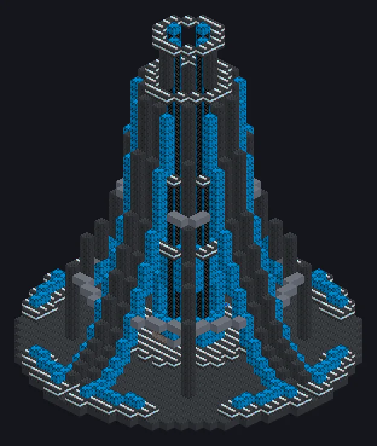

# Space Elevator

{ loading=lazy }

A cable to orbit that powers up to **12 modules** standing around its base. Ported from GT: New Horizons.

## Running the elevator

- It works only from UHV (above ZPM) and needs computation: `128 · (tier − ZPM)` CWU/t.
- Feed **256 Nanotube Spools** through its input bus.
- The **Power Modules** in the structure set every module's parallel: `4^(MK − 1)`. All Power Modules must be the same MK (I to V). The MK also decides which Assembler Module recipes can run.

| Power Module | Module parallel |
|---|---:|
| MK I | 1 |
| MK II | 4 |
| MK III | 16 |
| MK IV | 64 |
| MK V | 256 |

## Modules

| Module | What it does |
|---|---|
| [Assembler Module](../machines/catalog/assembler_module.md) | assembles parts in orbit |
| [Resource Collection Module](../machines/catalog/resource_collection_module.md) | sends drones to mine 20 asteroid ore mixes and collect 11 gases, with MK I to VI drones and rocket fuel |

Modules work only while their Space Elevator runs.
