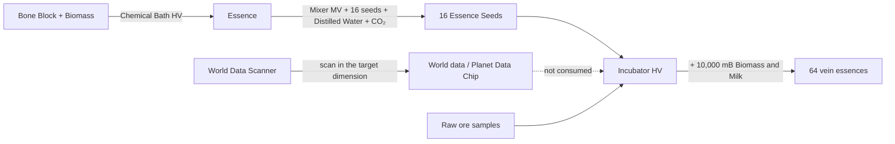

# Void mining

Three machines produce ores and fluids without digging: a steam-era miner, an electric miner driven by vein **essences**, and a rig that keeps pumping a fluid deposit after you found it. They give raw materials only, so ore processing still matters.

## Void Miner SteamGate Aged (steam)

[Catalog page](../machines/catalog/void_miner_steam_gate_aged.md). Mines a "steam dimension" for Raw Gold, Copper, Iron, Cobalt and Coal, with Drilling Fluid every run. Hotter steam in a fluid input hatch boosts it; the hottest fluid present wins:

| Fluid in the hatch | Items | Speed | Cost |
|---|---:|---:|---:|
| Steam | 1× | 1× | 1× |
| Dense Supercritical Steam | 2× | 2× | 1.5× |
| SuperHeated Steam | 3× | 3× | 2× |
| Insanely Supercritical Steam | 5× | 5× | 4× |

Multipliers are in `config/gtna/balance/machines.json` (`voidMinerSteamGateAged`).

## Electric Void Miner (EV)

[Catalog page](../machines/catalog/electric_void_miner.md). Uses EU and Drilling Fluid every run. Pick a mode in the machine's mode tab:

- **Precise:** consumes one **essence** and mines that vein. Circuit 1 runs the three EV programs (Iron/Copper, Tin/Lead, Gold/Silver); circuit 2 runs the 40 full vein programs ported from GregTech Leisure (LuV for Overworld and Nether veins, ZPM for End veins). Five planetary programs (Moon, Mars, Venus, Mercury, Glacio) need Ad Astra.
- **Random:** no essence. Circuit 1 rolls the EV pool (Iron, Copper, Tin, Lead, Gold, Silver at 25% each); circuit 2 rolls the full pool at ZPM (2% each). Both use 10,000 mB of Drilling Fluid and 30 s.

EV runs one operation at a time. From IV, a Parallel Hatch adds parallel up to 1,024, limited by energy, fluid and output space. An Accelerate Hatch also fits.

### Making essences

The **World Data Scanner** must stand in the dimension it scans (LV to IV for Overworld, Nether and End; EV on other planets). Data and planet chips are reusable. The [Incubator](../machines/catalog/incubator.md) needs the vein's raw ores as a sample, so the first ore still has to be mined some other way. The [Large Incubator](../machines/catalog/large_incubator.md) runs cultures in parallel.

Numbers are in `config/gtna/balance/electric_void_miner.json`: duration, EU/t, Drilling Fluid, output caps and parallel per tier.

## Void Fluid Drilling Rig (EV)

[Catalog page](../machines/catalog/void_fluid_drilling_rig.md). Keeps producing a fluid after you **really extracted** it from a natural deposit:

1. Pump a deposit with the GTCEu Fluid Drilling Rig until it delivers fluid.
2. Right-click that rig's controller with the **Deposit Recorder**, with a Data Stick in your inventory. You get reusable **Deposit Data** for that fluid and place.
3. Put the data in the Void Rig's input bus and supply EU and Drilling Fluid.

Default cycle: 400 ticks, 1,920 EU/t, 100 mB Drilling Fluid. Output per cycle: Oil 2,000, Heavy Oil 1,500, Light Oil 2,500, Natural Gas 1,500 (also needs 100 mB Nitrogen), Salt Water 4,000, Raw Oil 2,000 mB. Parallel: EV 1, IV 2, LuV 4, ZPM 8, UV 16, doubling up to 1,024.

The rig works in the deposit's own dimension; a **remote upgrade** in the same bus lets it work elsewhere. Discoveries belong to your FTB team when FTB Teams is installed. Programs live in `config/gtna/balance/void_fluid_drill.json`.

## Infinity Fluid Drilling Rig (ZPM)

[Catalog page](../machines/catalog/infinity_fluid_drilling_rig.md). A fluid drilling rig whose veins never deplete: 256× output at ZPM and 384× at UV.
