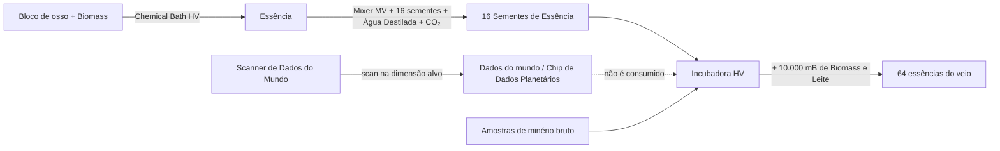

# Mineração do vazio

Três máquinas produzem minérios e fluidos sem cavar: um minerador da era do vapor, um minerador elétrico movido a **essências** de veio e uma sonda que continua bombeando um depósito de fluido depois que você o encontrou. Elas dão só matéria-prima, então o beneficiamento de minério continua valendo.

## Portão a Vapor Envelhecido do Minerador do Vazio (vapor)

[Página no catálogo](../machines/catalog/void_miner_steam_gate_aged.md). Minera uma "dimensão de vapor" e tira Raw Gold, Copper, Iron, Cobalt e Coal, gastando Drilling Fluid a cada operação. Vapor mais quente num hatch de entrada de fluido acelera a máquina; vale o fluido mais quente presente:

| Fluido no hatch | Itens | Velocidade | Custo |
|---|---:|---:|---:|
| Vapor | 1× | 1× | 1× |
| Vapor Supercrítico Denso | 2× | 2× | 1,5× |
| SuperHeated Steam | 3× | 3× | 2× |
| Vapor Insanamente Supercrítico | 5× | 5× | 4× |

Os multiplicadores ficam em `config/gtna/balance/machines.json` (`voidMinerSteamGateAged`).

## Minerador do Vazio Elétrico (EV)

[Página no catálogo](../machines/catalog/electric_void_miner.md). Gasta EU e Drilling Fluid a cada operação. Escolha o modo na aba de modos da máquina:

- **Preciso:** consome uma **essência** e minera aquele veio. O circuito 1 roda os três programas EV (Ferro/Cobre, Estanho/Chumbo, Ouro/Prata); o circuito 2 roda os 40 programas de veio completos trazidos do GregTech Leisure (LuV para veios do Overworld e do Nether, ZPM para os do End). Cinco programas planetários (Lua, Marte, Vênus, Mercúrio, Glacio) precisam do Ad Astra.
- **Aleatório:** sem essência. O circuito 1 sorteia o grupo EV (Ferro, Cobre, Estanho, Chumbo, Ouro, Prata, 25% cada); o circuito 2 sorteia o grupo completo em ZPM (2% cada). Os dois gastam 10.000 mB de Drilling Fluid e 30 s.

Em EV a máquina faz uma operação por vez. A partir de IV, um Parallel Hatch dá paralelo até 1.024, limitado por energia, fluido e espaço de saída. Também aceita um Accelerate Hatch.

### Fazendo essências

O **Scanner de Dados do Mundo** precisa estar na dimensão que escaneia (de LV a IV para Overworld, Nether e End; EV nos outros planetas). Dados e chips planetários são reutilizáveis. A [Incubadora](../machines/catalog/incubator.md) pede os minérios brutos do veio como amostra, então o primeiro minério ainda precisa vir de outro jeito. A [Incubadora Grande](../machines/catalog/large_incubator.md) faz culturas em paralelo.

Os números ficam em `config/gtna/balance/electric_void_miner.json`: duração, EU/t, Drilling Fluid, limites de saída e paralelo por tier.

## Void Fluid Drilling Rig (EV)

[Página no catálogo](../machines/catalog/void_fluid_drilling_rig.md). Continua produzindo um fluido depois que você o **extraiu de verdade** de um depósito natural:

1. Bombeie um depósito com a Fluid Drilling Rig do GTCEu até ela entregar fluido.
2. Clique direito no controlador dessa sonda com o **Registrador de Depósito**, com um Data Stick no inventário. Você recebe **Dados de Depósito** reutilizáveis daquele fluido e lugar.
3. Ponha os dados no barramento de entrada da Void Rig e forneça EU e Drilling Fluid.

Ciclo padrão: 400 ticks, 1.920 EU/t, 100 mB de Drilling Fluid. Saída por ciclo: Oil 2.000, Heavy Oil 1.500, Light Oil 2.500, Natural Gas 1.500 (pede também 100 mB de Nitrogênio), Salt Water 4.000, Raw Oil 2.000 mB. Paralelo: EV 1, IV 2, LuV 4, ZPM 8, UV 16, dobrando até 1.024.

A sonda funciona na dimensão do próprio depósito; um **upgrade remoto** no mesmo barramento libera outras dimensões. As descobertas pertencem ao seu time do FTB quando o FTB Teams está instalado. Os programas ficam em `config/gtna/balance/void_fluid_drill.json`.

## Plataforma de Perfuração de Fluidos Infinita (ZPM)

[Página no catálogo](../machines/catalog/infinity_fluid_drilling_rig.md). Uma sonda de fluidos cujos veios nunca se esgotam: 256× de saída em ZPM e 384× em UV.
