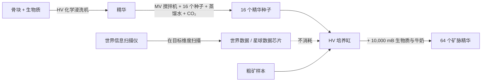

# 虚空采矿

三台机器无需挖掘即可产出矿石和流体：一台蒸汽时代的采矿机、一台由矿脉**精华**驱动的电力采矿机，以及一台在你找到流体矿藏后持续抽取的钻机。它们只产出原料，矿石处理依然重要。

## 古旧蒸汽门虚空采矿机（蒸汽）

[图鉴页](../machines/catalog/void_miner_steam_gate_aged.md)。开采"蒸汽维度"，产出粗金、粗铜、粗铁、钴和煤，每次运行消耗钻井液。流体输入仓中更热的蒸汽会提升效率，以仓中最热的流体为准：

| 仓中流体 | 物品 | 速度 | 消耗 |
|---|---:|---:|---:|
| 蒸汽 | 1× | 1× | 1× |
| 致密超临界蒸汽 | 2× | 2× | 1.5× |
| 过热蒸汽 | 3× | 3× | 2× |
| 疯狂超临界蒸汽 | 5× | 5× | 4× |

倍率位于 `config/gtna/balance/machines.json`（`voidMinerSteamGateAged`）。

## 电力虚空采矿机（EV）

[图鉴页](../machines/catalog/electric_void_miner.md)。每次运行消耗 EU 和钻井液。在机器的模式页选择模式：

- **精确：**消耗一个**精华**，开采对应矿脉。电路 1 运行三个 EV 程序（铁/铜、锡/铅、金/银）；电路 2 运行从 GregTech Leisure 移植的 40 个完整矿脉程序（主世界和下界矿脉为 LuV，末地矿脉为 ZPM）。五个星球程序（月球、火星、金星、水星、霜原）需要 Ad Astra。
- **随机：**无需精华。电路 1 抽取 EV 矿池（铁、铜、锡、铅、金、银，各 25%）；电路 2 在 ZPM 抽取完整矿池（各 2%）。两者都消耗 10,000 mB 钻井液，耗时 30 秒。

EV 时一次只运行一个操作。从 IV 起，并行仓可提供最多 1,024 并行，受能量、流体和输出空间限制。也可安装一个加速仓。

### 制作精华

**世界信息扫描仪**必须放在要扫描的维度中（主世界、下界、末地为 LV 至 IV；其他星球为 EV）。数据和星球芯片可重复使用。[培养缸](../machines/catalog/incubator.md)需要该矿脉的粗矿作为样本，因此第一份矿石仍需通过其他方式获得。[大型培养缸](../machines/catalog/large_incubator.md)可并行培养。

数值位于 `config/gtna/balance/electric_void_miner.json`：时长、EU/t、钻井液、输出上限以及各等级并行。

## 虚空流体钻机（EV）

[图鉴页](../machines/catalog/void_fluid_drilling_rig.md)。在你从天然矿藏中**实际抽取**某种流体后，持续产出该流体：

1. 用 GTCEu 流体钻机抽取矿藏，直到它产出流体。
2. 背包中带一根数据棒，用**矿藏记录仪**右键该钻机控制器。你会得到对应流体和地点、可重复使用的**矿藏数据**。
3. 把数据放入虚空钻机的输入总线，并提供 EU 和钻井液。

默认循环：400 刻，1,920 EU/t，100 mB 钻井液。每次循环产出：原油 2,000、重油 1,500、轻油 2,500、天然气 1,500（另需 100 mB 氮气）、盐水 4,000、粗油 2,000 mB。并行：EV 1、IV 2、LuV 4、ZPM 8、UV 16，之后逐级翻倍，最高 1,024。

钻机只能在矿藏所在维度工作；在同一总线中放入**远程升级**后可在其他维度工作。安装 FTB Teams 时，发现记录属于你的 FTB 队伍。程序位于 `config/gtna/balance/void_fluid_drill.json`。

## 无尽流体钻机（ZPM）

[图鉴页](../machines/catalog/infinity_fluid_drilling_rig.md)。矿脉永不枯竭的流体钻机：ZPM 时 256 倍输出，UV 时 384 倍。
