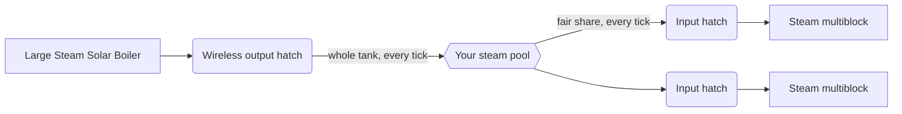

# Wireless steam network

Every player has one steam pool that lives with the world. **Output hatches** put steam into it and **input hatches** take steam out, with no pipes, at any distance and across dimensions. It is GTNA's answer to the steam pipes of the early game.

| | |
|---|---|
| **Who owns the pool** | the player who placed the hatch |
| **Range** | unlimited, every dimension |
| **Pool size** | a 64-bit number (about 9.2 × 10¹⁸ mB) |
| **Saved** | with the world (`gtna_steam_network`) |
| **Origin** | GT: Not Leisure wireless steam hatches, rebuilt for GTCEu |

## The hatches

| Hatch | Goes on | Tank | Recipe |
|---|---|---|---|
| Wireless Steam **Output** Hatch | the [Large Steam Solar Boiler](../machines/catalog/large_steam_solar_boiler.md) | 128,000,000 mB | crafting table: Bricked Bronze Casing, Hydraulic Regulators, Huge Stronze Fluid Pipes, LV Output Bus |
| Wireless Steam Output Hatch **Steel** | same | 2,147,483,647 mB | Hydraulic Manufacturing: bronze hatch + 8 Steel Drums |
| Wireless Steam **Input** Hatch | any multiblock that takes a steam hatch | 100,000 mB | crafting table: same as the output, with an LV Input Bus |
| Wireless Steam Input Hatch **Steel** | same | 2,147,483,647 mB | Hydraulic Manufacturing: bronze hatch + 8 Steel Drums |

Tank sizes and an optional per-tick limit can be changed in [`config/gtna.yaml`](../../getting-started/configuration.md#wireless-steam).

!!! warning "The output hatch only fits the Large Steam Solar Boiler"
    In GTNA 0.6.1 the Large Steam Solar Boiler is the only structure with a slot for the wireless output hatch. Single-block boilers cannot push steam into it: the hatch never accepts steam from pipes.

## How steam moves

- **Output:** each tick the hatch moves its whole tank into the pool.
- **Input:** each tick the hatch fills its free space from the pool, but takes at most a **fair share**: the balance divided by the number of input hatches that still have room. With a small pool every machine gets some steam, instead of the first one draining it all.
- Payments are exact: the pool never goes negative and a full tank never voids steam.

## Watching the network

- **`/gtna steam`** prints your balance, the steam added and used since the server started, and every hatch connected in the last 2 seconds with its position, tier and last transfer.
- **HUD:** turn on `client.wirelessSteamHud` to see the balance, the flow and a history graph on screen. Its position and graph length are in the same config section.
- **Jade** shows the hatch's tank and its last transfer when you look at it.

| Command | Permission | Effect |
|---|---|---|
| `/gtna steam` | everyone | your own network report |
| `/gtna steam <player>` | op | another player's report |
| `/gtna steam add <amount>` | op | adds steam to your pool (negative values subtract) |
| `/gtna steam set <amount>` | op | sets your pool |

## Tips

- Build the Large Steam Solar Boiler early and give it a wireless output hatch: one boiler can feed every steam multiblock of the base.
- Upgrade input hatches to Steel when a machine stalls on steam: the bronze tank holds only 100,000 mB.
- Steam belongs to the player who placed the hatch. On a server, have the same player place the hatches of a shared base.
