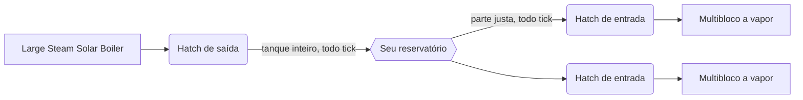

# Rede de vapor sem fio

Cada jogador tem um reservatório de vapor salvo com o mundo. **Hatches de saída** colocam vapor nele e **hatches de entrada** tiram, sem canos, a qualquer distância e entre dimensões. É a resposta do GTNA aos canos de vapor do começo do jogo.

| | |
|---|---|
| **Dono do reservatório** | o jogador que colocou o hatch |
| **Alcance** | ilimitado, em todas as dimensões |
| **Tamanho do reservatório** | número de 64 bits (cerca de 9,2 × 10¹⁸ mB) |
| **Salvo** | com o mundo (`gtna_steam_network`) |
| **Origem** | hatches de vapor sem fio do GT: Not Leisure, refeitos para o GTCEu |

## Os hatches

| Hatch | Onde vai | Tanque | Receita |
|---|---|---|---|
| Hatch de **Saída** de Vapor Wireless | o [Large Steam Solar Boiler](../machines/catalog/large_steam_solar_boiler.md) | 128.000.000 mB | bancada: Bricked Bronze Casing, Hydraulic Regulators, Huge Stronze Fluid Pipes, LV Output Bus |
| Hatch de Saída de Vapor Wireless **de Aço** | idem | 2.147.483.647 mB | Manufatura Hidráulica: hatch de bronze + 8 Steel Drums |
| Hatch de **Entrada** de Vapor Wireless | qualquer multibloco que aceite hatch de vapor | 100.000 mB | bancada: igual à saída, com LV Input Bus |
| Hatch de Entrada de Vapor Wireless **de Aço** | idem | 2.147.483.647 mB | Manufatura Hidráulica: hatch de bronze + 8 Steel Drums |

O tamanho dos tanques e um limite opcional por tick ficam no [`config/gtna.yaml`](../../getting-started/configuration.md#wireless-steam).

!!! warning "O hatch de saída só cabe no Large Steam Solar Boiler"
    Na versão 0.6.1 do GTNA, o Large Steam Solar Boiler é a única estrutura com lugar para o hatch de saída sem fio. Caldeiras de um bloco não conseguem empurrar vapor para ele: o hatch nunca aceita vapor por cano.

## Como o vapor anda

- **Saída:** a cada tick o hatch passa o tanque inteiro para o reservatório.
- **Entrada:** a cada tick o hatch enche o espaço livre a partir do reservatório, mas pega no máximo uma **parte justa**: o saldo dividido pelo número de hatches de entrada que ainda têm espaço. Com pouco vapor, todas as máquinas recebem um pouco, em vez de a primeira secar tudo.
- As contas são exatas: o reservatório nunca fica negativo e um tanque cheio nunca perde vapor.

## Acompanhando a rede

- **`/gtna steam`** mostra seu saldo, o vapor que entrou e saiu desde que o servidor abriu e cada hatch conectado nos últimos 2 segundos, com posição, tier e última transferência.
- **HUD:** ligue `client.wirelessSteamHud` para ver saldo, fluxo e um gráfico do histórico na tela. Posição e tamanho do gráfico ficam na mesma seção do config.
- O **Jade** mostra o tanque do hatch e a última transferência quando você olha para ele.

| Comando | Permissão | Efeito |
|---|---|---|
| `/gtna steam` | todos | relatório da sua rede |
| `/gtna steam <jogador>` | op | relatório de outro jogador |
| `/gtna steam add <quantidade>` | op | soma vapor ao seu reservatório (negativo subtrai) |
| `/gtna steam set <quantidade>` | op | define o seu reservatório |

## Dicas

- Faça o Large Steam Solar Boiler cedo e ponha nele um hatch de saída sem fio: uma caldeira alimenta todos os multiblocos a vapor da base.
- Troque os hatches de entrada pelos de Aço quando uma máquina parar por falta de vapor: o tanque de bronze guarda só 100.000 mB.
- O vapor é do jogador que colocou o hatch. Num servidor, deixe o mesmo jogador colocar os hatches de uma base compartilhada.
