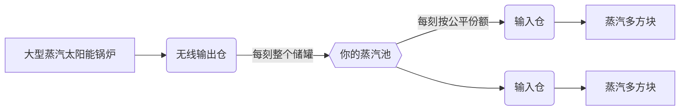

# 无线蒸汽网络

每位玩家都有一个随世界保存的蒸汽池。**输出仓**把蒸汽存入池中，**输入仓**从池中取出蒸汽，无需管道，不限距离，可跨维度。这是 GTNA 对前期蒸汽管道的解决方案。

| | |
|---|---|
| **池的所有者** | 放置该仓的玩家 |
| **范围** | 无限，所有维度 |
| **池容量** | 64 位整数（约 9.2 × 10¹⁸ mB） |
| **保存** | 随世界保存（`gtna_steam_network`） |
| **来源** | GT: Not Leisure 的无线蒸汽仓，为 GTCEu 重写 |

## 仓室

| 仓室 | 安装位置 | 储罐 | 配方 |
|---|---|---|---|
| 无线蒸汽**输出**仓 | [大型蒸汽太阳能锅炉](../machines/catalog/large_steam_solar_boiler.md) | 128,000,000 mB | 工作台：砖砌青铜外壳、液压调节器、巨型强铜流体管道、LV输出总线 |
| **钢制**无线蒸汽输出仓 | 同上 | 2,147,483,647 mB | 液压制造：青铜仓 + 8 个钢桶 |
| 无线蒸汽**输入**仓 | 任何接受蒸汽仓的多方块 | 100,000 mB | 工作台：与输出仓相同，改用 LV输入总线 |
| **钢制**无线蒸汽输入仓 | 同上 | 2,147,483,647 mB | 液压制造：青铜仓 + 8 个钢桶 |

储罐容量和可选的每刻传输上限可在 [`config/gtna.yaml`](../../getting-started/configuration.md#wireless-steam) 中修改。

!!! warning "输出仓只能装在大型蒸汽太阳能锅炉上"
    在 GTNA 0.6.1 中，大型蒸汽太阳能锅炉是唯一留有无线输出仓位置的结构。单方块锅炉无法向它输送蒸汽：该仓不接受管道输入。

## 蒸汽如何流动

- **输出：**每刻把整个储罐转入池中。
- **输入：**每刻从池中补满空余空间，但最多只取**公平份额**：余额除以仍有空间的输入仓数量。池中蒸汽较少时，每台机器都能分到一些，而不是第一台全部抽干。
- 结算精确：池永远不会变为负数，储罐满时也不会吞掉蒸汽。

## 查看网络

- **`/gtna steam`** 显示你的余额、服务器启动以来存入和消耗的蒸汽，以及最近 2 秒内连接的每个仓的位置、等级和最后一次传输。
- **HUD：**开启 `client.wirelessSteamHud`，即可在屏幕上看到余额、流量和历史曲线。位置与曲线长度在同一配置区。
- 用 **Jade** 看向仓室时会显示其储罐和最后一次传输。

| 命令 | 权限 | 作用 |
|---|---|---|
| `/gtna steam` | 所有人 | 自己的网络报告 |
| `/gtna steam <玩家>` | OP | 查看其他玩家的报告 |
| `/gtna steam add <数量>` | OP | 向自己的池添加蒸汽（负数为扣除） |
| `/gtna steam set <数量>` | OP | 设置自己的池 |

## 提示

- 尽早建造大型蒸汽太阳能锅炉并装上无线输出仓：一台锅炉就能供应整个基地的蒸汽多方块。
- 机器因缺蒸汽停工时，把输入仓升级为钢制：青铜储罐只有 100,000 mB。
- 蒸汽属于放置仓室的玩家。在服务器上，共享基地的仓室应由同一位玩家放置。
