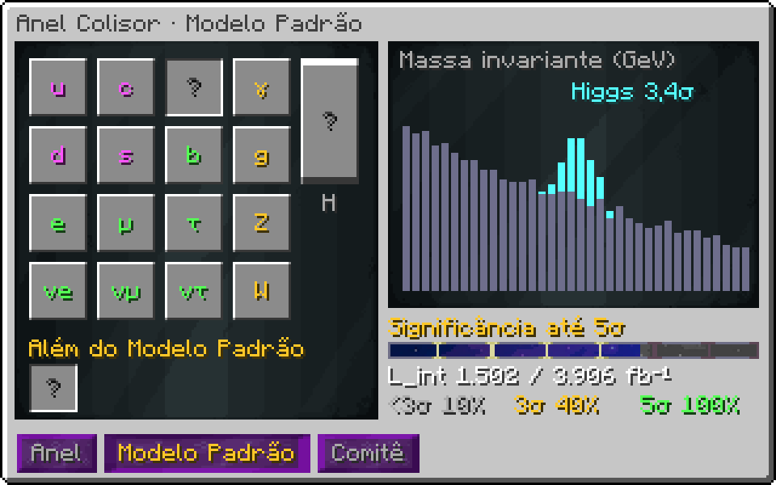
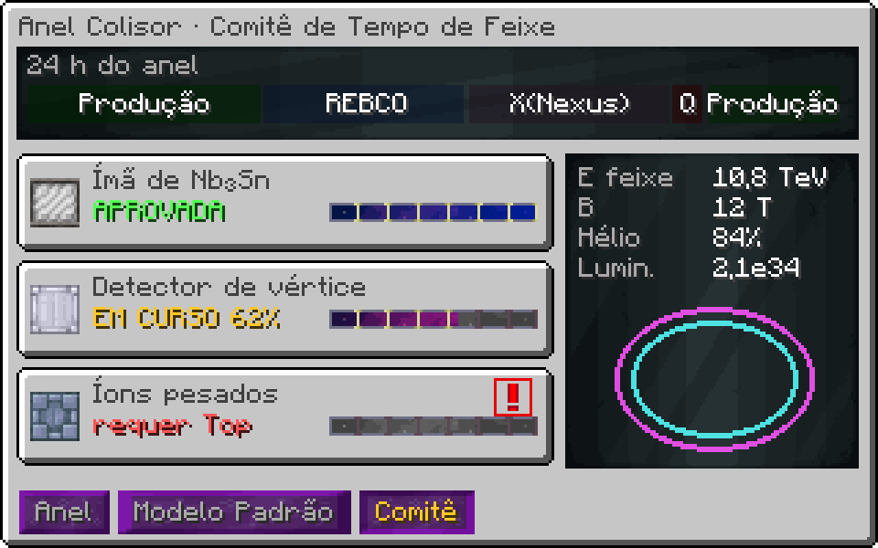

# Anel Colisor de Antimatéria (UIV)

!!! warning "Em desenvolvimento"
    Esta máquina ainda não está pronta no jogo. A ficha descreve o design aprovado; números e detalhes podem mudar no balanço.


> Ficha de design, versão 1. A física do feixe usa as fórmulas reais de aceleradores; só a escala muda.

## 1. Visão geral

- **Tipo:** produção de antimatéria e partículas exóticas por colisão de feixes.
- **Estrutura:** 137 × 127 × 155. Eixo injetor (linac), dois anéis de reforço (boosters) e o anel principal.
- **Escala:** 1 bloco = 50 m. Raio do anel principal ρ = 3000 m.
- **Entradas:** gás de hidrogênio (prótons), hélio líquido, EU, computação.
- **Saídas:** antiprótons e partículas exóticas em armadilhas de Penning.

## 2. Estágios

| Estágio | Parte da estrutura | Energia de saída | Tempo |
|---|---|---|---|
| Linac | eixo injetor | 0,2 GeV | contínuo |
| Booster 1 | anel giroscópico menor | 8 GeV | 2 s |
| Booster 2 | anel giroscópico maior | 150 GeV | 6 s |
| Anel principal | anel grande | até E_max (seção 3) | rampa de 20 s |

## 3. Energia máxima do feixe

Fórmula real de rigidez magnética:

```
p [GeV/c] = 0,3 · B [T] · ρ [m]
E_cm      = 2 · E_feixe        (feixes contrarrotativos, mesma energia)
```

| Ímã | B (T) | E_feixe máx (TeV) | E_cm (TeV) | Hélio (L/s por ímã-tier) |
|---|---|---|---|---|
| NbTi | 8,3 | 7,47 | 14,9 | 0,5 |
| Nb₃Sn | 12 | 10,8 | 21,6 | 1 |
| REBCO (HTS) | 20 | 18 | 36 | 2 |
| Neutrônio dopado | 45 | 40,5 | 81 | 4 |
| Infinity | 120 | 108 | 216 | 8 |

## 4. Luminosidade e taxa de eventos

```
L      = f_rev · n_b · N² / (4π · σx · σy)
f_rev  = c / (2π · ρ)
eventos/s = σ_processo · L
```

Com ρ = 3000 m, `f_rev = 15.915 Hz`. `n_b` (pacotes) e `N` (prótons por pacote) sobem com upgrades; `σx·σy` cai com o foco, que gasta computação.

| n_b | N | σ (µm) | L (cm⁻² s⁻¹) |
|---|---|---|---|
| 10 | 1.00e10 | 50 | 5.07e28 |
| 100 | 1.00e11 | 20 | 3.17e32 |
| 1000 | 1.00e11 | 16 | 4.95e33 |
| 2808 | 1.15e11 | 16 | 1.84e34 |

### 4.1 Processos

Cada processo só acontece acima do limiar de energia no centro de massa. A taxa é `σ · L`, convertida em itens pela GUI.

| Processo | Limiar E_cm | σ (nb) | Eventos/s com L = 1e34 | Produto |
|---|---|---|---|---|
| Antiprótons | 5,6 GeV | 1.00e6 | 1.00e7 | Antiprótons (gás) |
| Kaons | 1 GeV | 1.00e7 | 1.00e8 | Kaons → Píons, Múons |
| Hyperons (Λ, Σ) | 2,5 GeV | 2.00e6 | 2.00e7 | Hyperons → matéria estranha |
| Quarks charm | 10 GeV | 100.000 | 1.00e6 | Charm Quark |
| Quarks bottom | 40 GeV | 10.000 | 100.000 | Bottom Quark |
| Bóson de Higgs | 125 GeV | 50 | 500 | Higgs Boson |
| Quarks top | 350 GeV | 8 | 80 | Top Quark |
| Plasma de quarks e glúons | 5.000 GeV | 1 | 10 | QGP (fluido) |

## 5. Radiação síncrotron e quench

```
P_sr ∝ γ⁴ / ρ²        (prótons: pequena; modo elétron: domina)
Q_ímãs = P_sr + Q_feixe_perdido
quench se Q_ímãs > capacidade do hélio
```

Quench descarrega o feixe no **Beam Dump**, ferve o hélio do setor e exige `60 s × tier do ímã` de resfriamento antes de religar.

## 6. Armadilhas de Penning

```
capacidade = 1e12 antipartículas · 4^(tier − 1)
consumo    = 2^(tier + 20) EU/t, contínuo
sem energia: aniquilação, E = 2·m·c² do conteúdo, dano à estrutura
```

| Tier | Capacidade | Energia liberada se falhar (J) |
|---|---|---|
| 1 | 1.00e12 | 301 |
| 2 | 4.00e12 | 1.202 |
| 3 | 1.60e13 | 4.810 |
| 4 | 6.40e13 | 19.238 |
| 5 | 2.56e14 | 76.954 |

## 7. Progressão: Modelo Padrão

O Colisor evolui por **descobertas**. Cada partícula começa como uma silhueta na tabela do Modelo Padrão. Ela só vira produto da máquina quando é descoberta com significância estatística real.

### 7.1 Significância

```
S = s · L_int        B = b · L_int          (sinal e fundo acumulados, eventos)
Z = S / sqrt(B) = (s / sqrt(b)) · sqrt(L_int)
evidência: Z ≥ 3σ        descoberta: Z ≥ 5σ (critério real da física de partículas)
L_int para 5σ = 25 · b / s²
```

A GUI mostra o histograma de massa invariante com o pico crescendo sobre o fundo a cada fb⁻¹ coletado.

| Partícula | Massa (GeV) | s/√b por fb⁻¹ | L_int para 3σ (fb⁻¹) | L_int para 5σ (fb⁻¹) |
|---|---|---|---|---|
| Antipróton | 0,938 | 50 | 0,0036 | 0,01 |
| Káon | 0,494 | 30 | 0,01 | 0,0278 |
| Lambda (Λ) | 1,12 | 8 | 0,141 | 0,391 |
| Charm (J/ψ) | 3,1 | 4 | 0,562 | 1,56 |
| Bottom (Υ) | 9,46 | 1,5 | 4 | 11,1 |
| Bóson W | 80,4 | 0,6 | 25 | 69,4 |
| Bóson Z | 91,2 | 0,8 | 14,1 | 39,1 |
| Higgs | 125 | 0,08 | 1.406 | 3.906 |
| Top | 173 | 0,15 | 400 | 1.111 |
| X(Nexus) | 2.400 | 0,02 | 22.500 | 62.500 |

Antes da descoberta a partícula sai com rendimento de 10%; com evidência (3σ), 40%; descoberta, 100%. Descobrir é o upgrade.

### 7.2 Comitê de tempo de feixe

Equipamento novo (ímãs, armadilhas, detectores) vem de **propostas de experimento**. O comitê aprova uma por vez; cada proposta pede luminosidade numa energia e numa configuração, e só termina se o feixe ficar nela pelo tempo pedido. O jogador divide o dia do anel entre **corridas de produção** (antimatéria para a fábrica) e **corridas de física** (propostas).

| Proposta | Pede | Entrega |
|---|---|---|
| Teste de ímã de Nb₃Sn | 5 fb⁻¹ a ≥ 7 TeV | ímãs de Nb₃Sn |
| Detector de vértice | descobrir Charm | +30% de pureza (b ÷ 2) |
| Resfriamento estocástico | 20 fb⁻¹ em modo antipróton | antiprótons × 3 |
| Penning criogênica | 1e13 antiprótons guardados por 1 h | armadilha tier 3 |
| Ímã REBCO | descobrir W e Z | B = 20 T |
| Colisão e⁺e⁻ | descobrir Bottom | modo elétron-pósitron |
| Íons pesados | descobrir Top | plasma de quarks e glúons |
| Ímã de neutrônio | descobrir Higgs | B = 45 T |
| Busca além do Modelo Padrão | X(Nexus) a 3σ | ímãs Infinity, sem quench |

A tensão do sistema é o tempo: cada fb⁻¹ de física é antimatéria que não foi produzida.

### 7.3 Hatches novos

| Hatch | Função |
|---|---|
| Armadilha de Penning | guarda antimatéria; gasta EU contínuo, aniquila sem energia |
| Beam Dump | absorve o feixe no quench; sem ele o quench danifica o anel |
| Hatch de Hélio Criogênico | entrada de hélio líquido por setor de ímãs |
| Hatch de Detector | saída de dados das colisões para o Comitê (computação) |
| Fonte de Íons | entrada de gás no linac; define o tipo de feixe (p, e⁻, íons pesados) |


## Estado da implementação

**No código:**

- Estrutura de 155×127×137; anel e giroscópios já marcados no padrão para girar
- Física em `ColliderCore`: rigidez magnética, luminosidade, 5σ, quench, armadilhas de Penning, propostas (teste `ColliderCoreTest`)
- Hélio líquido pelos hatches, ímãs e armadilhas pela rede; partículas contidas como itens
- Render dos dois feixes contrarrotativos e do núcleo pulsando; gametest de formação, produção e física

**Falta:**

- Anel e giroscópios girando de verdade (tirar os blocos para o controlador, como a Forja dos Deuses)
- Tabela do Modelo Padrão e comitê na GUI (hoje em texto)
- Beam Dump e hatch de detector
- Receita do controlador

## Telas (mockup)

{ loading=lazy }

{ loading=lazy }

