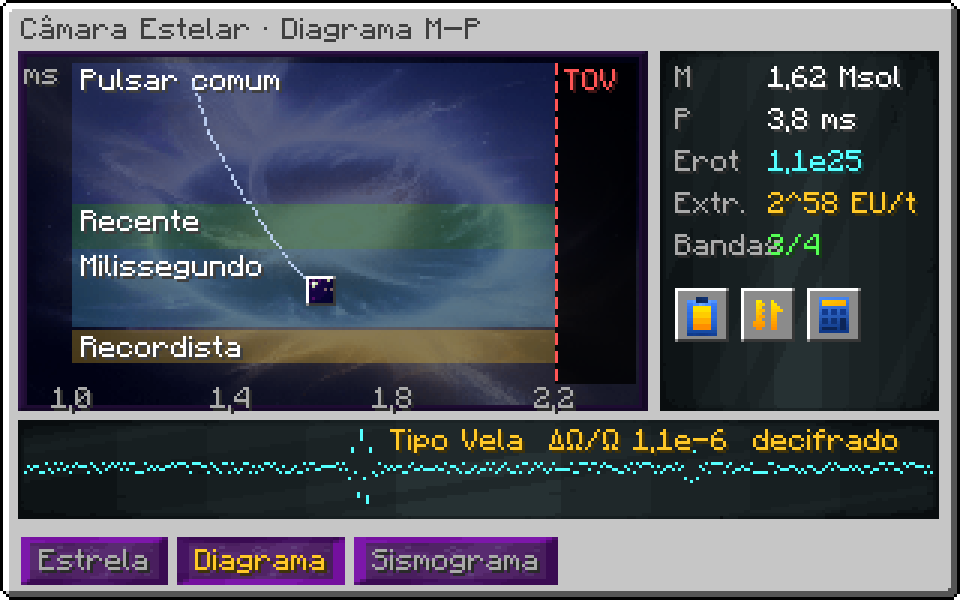

# Câmara de Contenção Estelar (MAX)

!!! warning "Em desenvolvimento"
    Esta máquina ainda não está pronta no jogo. A ficha descreve o design aprovado; números e detalhes podem mudar no balanço.


> Ficha de design, versão 1. Astrofísica real com escala de jogo `1 J = 1e-20 EU`.

## 1. Visão geral

- **Tipo:** gerador e fonte de matéria degenerada a partir de uma estrela de nêutrons presa em campos.
- **Estrutura:** esfera de 93³; casco de Radiant Naquadah, vidro de campo de plasma e **bandas de contenção** de neutrônio.
- **Saída:** EU em quantidade absurda, neutrônio, matéria degenerada; depois do colapso, energia da ergosfera.
- **Estado:** a estrela é persistente. Não há "receita"; há uma estrela com massa, rotação e crosta.

## 2. Estado da estrela

```
M  massa (M☉)         P  período de rotação (s)        R = 12 km
I  = 0,4 · M · R²     ω = 2π / P
E_rot = ½ · I · ω²     energia de rotação
```

| M (M☉) | P (ms) | E_rot (J) | E_rot (EU) |
|---|---|---|---|
| 1,2 | 33 | 2.49e42 | 2.49e22 |
| 1,4 | 1,6 | 1.24e45 | 1.24e25 |
| 1,4 | 10 | 3.17e43 | 3.17e23 |
| 1,8 | 1,6 | 1.59e45 | 1.59e25 |
| 2,1 | 1,4 | 2.42e45 | 2.42e25 |

## 3. Extração

O jogador escolhe a potência de extração `P_ext`. A rotação cai conforme a energia sai:

```
dE_rot/dt = −P_ext − P_dipolo
P_dipolo  = B²·R⁶·ω⁴ / (6c³)          perda natural (frenagem magnética)
ω_novo    = sqrt(2 · E_rot / I)
```

Quanto mais rápido a estrela gira, mais energia ela guarda, mas mais ela perde sozinha por frenagem.

## 4. Alimentação (spin-up)

Alimentar matéria aumenta a massa **e** a rotação, como um pulsar reciclado real:

```
ΔJ = ṁ · sqrt(G · M · R)       momento angular entregue pelo disco
ΔM = ṁ · (1 − 0,15)            15% sai como energia de ligação (vira EU na hora)
```

## 5. Limite de colapso

```
M_TOV = 2,2 M☉   (2,4 M☉ com o upgrade EOS)
M > M_TOV  →  colapso em buraco negro (irreversível)
a* = J · c / (G · M²)    limitado a 0,998
```

### 5.1 Modo buraco negro

Depois do colapso a máquina passa a extrair energia da ergosfera (processo de Penrose). Eficiência máxima real:

```
η(a*) = 1 − sqrt( (1 + sqrt(1 − a*²)) / 2 )
E_extraível = η · M · c²
```

| a* | η | E_extraível para 2,3 M☉ (EU) |
|---|---|---|
| 0,1 | 0,00125 | 5.16e24 |
| 0,5 | 0,0341 | 1.40e26 |
| 0,7 | 0,0742 | 3.05e26 |
| 0,9 | 0,153 | 6.28e26 |
| 0,99 | 0,245 | 1.01e27 |
| 0,998 | 0,271 | 1.11e27 |

Colapsar com rotação alta vale muito mais. O jogador decide quando "dar o salto".

## 5.2 Balanço contra os geradores atuais

A câmara só faz sentido se render mais que o Artificial Star. Números atuais do GTNA (barra = 200 ticks, antes de overclock) e proposta de nerf:

| Gerador | EU/t hoje | EU por barra/ciclo hoje | Proposta de nerf | EU/t depois |
|---|---|---|---|---|
| Artificial Star, barra de Neutrônio | 8.80e12 | 1.76e15 | ÷ 64 | 1.37e11 |
| Artificial Star, barra de Draconium | 1.41e14 | 2.81e16 | ÷ 128 | 1.10e12 |
| Artificial Star, barra Cósmica | 2.25e15 | 4.50e17 | ÷ 256 | 8.80e12 |
| Artificial Star, barra de Infinity | 3.60e16 | 7.21e18 | ÷ 512 | 7.04e13 |
| Câmara Estelar, pulsar de milissegundo | — | E_rot = 1.24e25 | — | até 1.15e18 (bandas tier 4) |
| Câmara Estelar, buraco negro a* = 0,998 | — | 1.11e27 total | — | até 4.61e18 |

Com o nerf, a melhor barra do Artificial Star fica em 2^46 EU/t. A câmara começa em 2^56 com bandas tier 1 e chega a 2^60, e um pulsar de milissegundo guarda energia para cerca de 6 dias de extração máxima antes de precisar de spin-up. O overclock do Artificial Star (até 16 OCs, 4×/4×) também precisa de teto, senão o nerf some. Proposta: no máximo 4 OCs.

## 5.3 Hatches novos

| Hatch | Função | Inspiração |
|---|---|---|
| Injetor de Massa | recebe matéria (itens/fluidos) e converte em ṁ no disco de acreção | BEC Hatch (GTNH) |
| Extrator Rotacional | saída de energia; só aceita laser ou Nexus Network, nunca dínamo comum | — |
| Sonda Sísmica | registra tremores; sem ela o sismograma não funciona | — |
| Gerador de Banda | um por banda; define o tier e a capacidade da banda | Graviton Flow Modulator (Godforge) |
| Coletor de Ejeção | barramento ME que recebe a Matéria Degenerada dos tremores | — |

## 6. Tremores estelares

```
tensão σ += k · |Δω| / ω             acumula conforme a rotação muda
tremor quando σ ≥ 1                   libera E_tremor = 1e-6 · E_rot
bandas absorvem até C_bandas; o excedente danifica o casco
```

| Bandas (tier) | C_bandas (EU) | Consumo contínuo (EU/t) |
|---|---|---|
| 1 | 1.00e16 | 4.40e12 |
| 2 | 1.00e17 | 1.76e13 |
| 3 | 1.00e18 | 7.04e13 |
| 4 | 1.00e19 | 2.81e14 |

## 7. Saídas de matéria

| Fonte | Taxa | Produto |
|---|---|---|
| Mineração da crosta | `1e-9 · P_ext` kg/s | Neutrônio (poeira) |
| Ejeção em tremor | por evento, ∝ E_tremor | Matéria Degenerada |
| Disco de acreção | 15% do ṁ | Plasma estelar |
| Modo buraco negro | com `P_ext` > 0 | Radiação Hawking condensada (traço) |

## 8. Progressão: Diagrama M–P e Sismograma

A Câmara evolui pelo **caminho que a estrela percorre**. O painel principal é um diagrama massa × período (como um diagrama HR de astrônomo) com a trajetória da estrela desenhada. Regiões do diagrama liberam comportamentos.

### 8.1 Regiões do diagrama

```
P_kepler(M) = 2π · sqrt(R³ / (G·M))     abaixo disso a estrela se desfaz (limite de quebra)
M_TOV = 2,2 M☉                           à direita disso, buraco negro
```

| M (M☉) | P_kepler (ms) |
|---|---|
| 1,2 | 0,654 |
| 1,4 | 0,606 |
| 1,6 | 0,567 |
| 1,8 | 0,534 |
| 2 | 0,507 |
| 2,2 | 0,483 |

| Região | Condição | O que libera |
|---|---|---|
| Pulsar comum | P > 30 ms | estado inicial |
| Pulsar recente | 10 ms < P < 30 ms | mineração de crosta mais rápida |
| Milissegundo reciclado | P < 10 ms, alcançado por alimentação | extração em potência máxima |
| Recordista | P < 1,4 ms (o pulsar real mais rápido gira a 716 Hz) | conquista; bandas tier 4 |
| Magnetar | campo das bandas invertido por 10 min | tremores gigantes e Matéria Degenerada em lote |
| Borda TOV | M > 2,1 M☉ | aviso permanente; prepara o modo buraco negro |
| Quebra | P < P_kepler(M) | falha catastrófica: a estrela se desfaz e a máquina recomeça |

### 8.2 Sismograma

O equipamento novo vem dos **tremores** (glitches, como os de pulsares reais). Cada tremor fica registrado com sua assinatura `ΔΩ/Ω` e o tempo de recuperação `τ`. Comparar um tremor com o catálogo decifra uma camada do interior da estrela, e cada camada decifrada libera um equipamento de contenção.

| Tipo de tremor | ΔΩ/Ω (real) | Como provocar | Decifra | Libera |
|---|---|---|---|---|
| Microtremor | 1e-9 a 1e-8 | extração constante | crosta externa | bandas tier 2 |
| Tipo Crab | 1e-8 a 1e-7 | variar a extração | crosta interna | mineração de crosta ×4 |
| Tipo Vela (gigante) | ≈ 1e-6 | spin-up rápido por alimentação | superfluido de nêutrons | bandas tier 3, previsão de tremores |
| Antitremor | < 0 (spin-up súbito) | só em magnetar | núcleo magnético | equação de estado exótica (M_TOV 2,4) |
| Tremor de colapso | divergente | cruzar a borda TOV | horizonte | coletor de ergosfera |

O sismograma é uma fita que corre na GUI. O jogador aprende a ler os padrões e provoca os tremores que faltam, usando a própria estrela.


## Estado da implementação

**No código:**

- Estrutura de 93³ convertida da sua construção; o núcleo degenerado (raio 7) some ao acender e volta ao desligar
- Física completa em `StellarCore`: rotação, alimentação, frenagem, tremores, regiões, colapso em buraco negro (teste `StellarCoreTest`)
- Energia entregue na rede Nexus do dono; bandas pagam manutenção pela rede
- Render da estrela, feixes de pulsar, linhas de campo, coroa e disco de acreção
- GUI em texto com extração ajustável e campo magnetar; gametest de formação, alimentação e núcleo
- Aba gráfica com o diagrama Massa–Período (trilha da estrela, limite TOV e curva de ruptura de Kepler)

**Falta:**

- Sismograma dos tremores desenhado — feito
- Lente gravitacional no jogo
- Sonda Sísmica — feita (sem ela tremores não são decodificados; alimenta a aba do sismograma)
- Injetor de Massa
- Receita do controlador (fica com o modpack)

## Telas (mockup)

{ loading=lazy }

