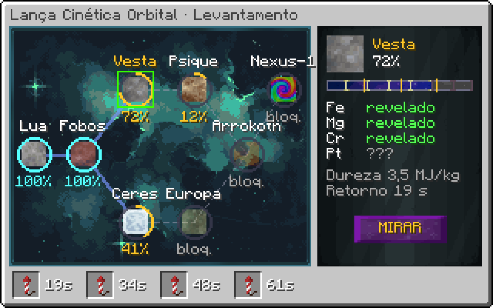
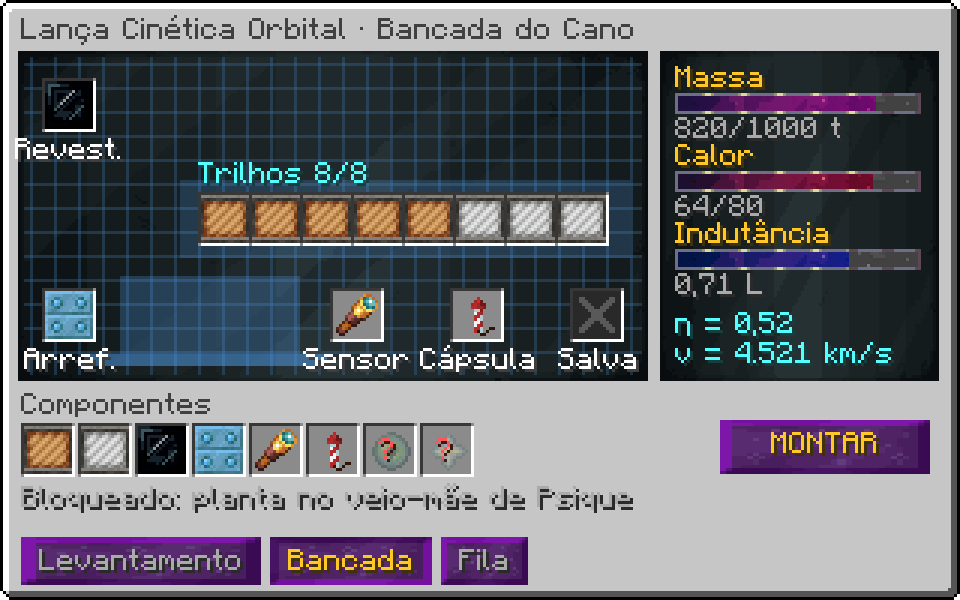

# Lança Cinética Orbital (UEV)

!!! warning "Em desenvolvimento"
    Esta máquina ainda não está pronta no jogo. A ficha descreve o design aprovado; números e detalhes podem mudar no balanço.


> Ficha de design, versão 1. Números calculados por `tools/design/endgame_specs.py`.

## 1. Visão geral

- **Tipo:** mineração por bombardeio cinético. Gerador de minério sem mina.
- **Tier:** UEV (controlador), módulos até UIV.
- **Estrutura:** 142 × 130 × 242 (torre + canhão), base com até 4 anéis de capacitores.
- **Energia:** hatches de energia ou laser carregam o banco; o tiro descarrega o banco inteiro.
- **Saída:** cápsulas de retorno com minério bruto, metal fundido ou plasma, conforme a energia do impacto.
- **Overclock:** não se aplica ao tiro; a cadência sobe com upgrades e com o banco.

## 2. Estrutura

A estrutura cresce em **anéis de capacitores** na base. O primeiro anel vem com o controlador; os outros três são construções extras liberadas por upgrade, como os anéis da Godforge.

| Componente | Anel 1 | Anel 2 | Anel 3 | Anel 4 |
|---|---|---|---|---|
| Clean Stainless Steel Casing (casco) | 101.609 | +9.000 | +11.000 | +13.000 |
| Radiant Naquadah Alloy Casing (blindagem do cano) | 52.147 | — | — | — |
| Tungstensteel Pipe Casing (barramento) | 7.963 | +1.200 | +1.500 | +1.800 |
| PTFE Inert Casing (isolamento) | 7.044 | +800 | +800 | +800 |
| Dyson Deployment Core (células de capacitor) | 803 | +803 | +1.606 | +3.212 |
| Neutronium Stable Casing (boca do cano) | 620 | — | — | — |
| Heat Vent (radiadores do cano) | 759 | +200 | +200 | +200 |

Hatches: só nos casings marcados ao redor do controlador. Exatamente um **Hatch de Projétil**, um **Hatch de Revestimento do Cano**, um **Hatch de Refrigerante**, um **Hatch de Dados Ópticos** (computação) e um **Barramento ME de Retorno**.

## 3. Física do tiro

Constantes da máquina: `1 EU = 1 kJ`, eficiência do trilho `η₀ = 0,35`.

```
E_tiro  = energia descarregada do banco (EU)
v       = sqrt(2 · η · E_tiro · 1000 / m)          [m/s]
β       = v / c
e       = η · E_tiro · 1000 / m                     [J/kg]  energia específica
M_frag  = k_frag · η · E_tiro · 1000 / H            [kg]    massa fragmentada (k_frag = 0,2)
M_ret   = M_frag · r · A                            [kg]    massa recuperada
```

`H` é a dureza do corpo (J/kg), `r` a taxa de recuperação das cápsulas (base 0,6) e `A` a precisão (seção 4).

### 3.1 Regime do impacto

A energia específica decide a forma da saída. Os limites são múltiplos da dureza do corpo:

| Regime | Condição | Saída | Bônus |
|---|---|---|---|
| Fragmentação | `e < 10·H` | minério bruto (crushed) | — |
| Fusão de impacto | `10·H ≤ e < 200·H` | metais fundidos (fluidos) | +25% de elementos raros |
| Vaporização | `200·H ≤ e < 5000·H` | gás ionizado / plasma do elemento | +60% de raros, sem subproduto de pedra |
| Relativístico | `e ≥ 5000·H` (β > 0,1) | plasma + chance de isótopos exóticos | tabela exclusiva por corpo |

### 3.2 Projéteis

| Projétil | Massa (kg) | Tier | v com 1e12 EU (km/s) | β |
|---|---|---|---|---|
| Tungstênio | 50 | 1 | 3.742 | 0,0125 |
| Tungstênio-Carbeto | 80 | 2 | 2.958 | 0,00986 |
| Ósmio-Irídio | 120 | 3 | 2.415 | 0,00805 |
| Neutrônio | 400 | 4 | 1.323 | 0,00441 |
| Matéria Degenerada | 1200 | 5 | 764 | 0,00255 |

Projétil leve chega mais rápido e vaporiza mais; projétil pesado fragmenta mais massa por tiro. O jogador escolhe pela saída que quer.

### 3.3 Corpos-alvo

| Corpo | Distância (Mm) | Dureza H (MJ/kg) | Composição | Retorno da cápsula |
|---|---|---|---|---|
| Lua | 384 | 2 | regolito: Fe, Ti, Al, He-3 (traço) | 42,7 s |
| Fobos | 78 | 1,2 | condrito carbonáceo: C, Ni, Fe, compostos orgânicos | 8,67 s |
| Vesta | 170.000 | 3,5 | basalto diferenciado: Fe, Mg, Cr, Pt | 18.889 s |
| Psique | 370.000 | 6 | núcleo metálico: Fe, Ni, Ir, Os, Au | 41.111 s |
| Ceres | 410.000 | 1,5 | gelo e argilas: H₂O, NH₃, Mg, Na₂CO₃ | 45.556 s |
| Europa | 630.000 | 2,8 | gelo salino: H₂O, MgSO₄, D₂O | 70.000 s |
| Arrokoth | 6.60e6 | 0,9 | gelos voláteis: N₂, CO, CH₄, tolinas | 733.333 s |
| Remanescente Kuiper "Nexus-1" | 7.50e6 | 9,5 | matéria exótica: Nq, Nt, Ad (alvo endgame) | 833.333 s |

`t_retorno = 2 · d / 30 km/s ÷ 600` (o tempo é comprimido 600×). As cápsulas ficam numa fila visível na GUI.

## 4. Mira e precisão

```
θ₀  = 1e-9 · u / sqrt(CWU/t ÷ 1000)        [rad]  erro de apontamento
θ_T = 2e-10 · max(0, T_cano − 300) / 100     [rad]  deriva térmica
σ   = d · (θ₀ + θ_T)                         [m]    erro no alvo
A   = max(0, 1 − σ / R_alvo)                        precisão (R_alvo = 5 km)
u   = fator de mira dos upgrades (1; ASTR 0,7; DEEP 0,35; KUIP 0,175)
```

| CWU/t | u | T do cano (K) | Lua A | Psique A | Nexus-1 A |
|---|---|---|---|---|---|
| 1000 | 1 | 300 | 1 | 0,926 | 0 |
| 16000 | 1 | 300 | 1 | 0,982 | 0,625 |
| 16000 | 0.35 | 300 | 1 | 0,994 | 0,869 |
| 16000 | 0.35 | 900 | 1 | 0,905 | 0 |
| 128000 | 0.175 | 300 | 1 | 0,999 | 0,977 |
| 1024000 | 0.175 | 300 | 1 | 1 | 0,992 |
| 1024000 | 0.175 | 1200 | 1 | 0,866 | 0 |

Alvos distantes exigem muita computação **e** cano frio. Psique e Nexus-1 só ficam viáveis com upgrades de mira (seção 7).

## 5. Cano: calor e desgaste

```
ΔT_tiro  = (1 − η) · E_tiro / C_cano          C_cano = 2e9 EU/K
Q_frio   = k_ref · vazão_refrigerante          [EU/s]
W       += E_tiro / E_desgaste(revestimento)    o revestimento falha em W = 1
```

| Revestimento | E_desgaste (EU) | Tiros de 1e12 EU |
|---|---|---|
| Tungstênio-Carbeto | 5.00e13 | 50 |
| Neutrônio | 4.00e14 | 400 |
| Grafeno-Neutrônio | 3.00e15 | 3.000 |
| Infinity | 1.00e17 | 100.000 |

Revestimento gasto falha o tiro (energia perdida, cano a +400 K). A troca é pelo hatch de revestimento, sem desmontar nada.

## 6. Banco de capacitores

```
E_max(anéis) = 4e12 · 2^(anéis − 1)  EU
carga        = limitada pela entrada (hatches/lasers)
```

| Anéis | E_max (EU) | Tempo de carga com 2^31 EU/t (s) |
|---|---|---|
| 1 | 4.00e12 | 93,1 |
| 2 | 8.00e12 | 186 |
| 3 | 1.60e13 | 373 |
| 4 | 3.20e13 | 745 |

## 7. Progressão: Levantamento Balístico

A Lança não tem árvore de upgrades nem marcos. Ela evolui de duas formas físicas: **conhecer os alvos** (levantamento) e **montar o cano** (bancada). Nenhuma moeda abstrata.

### 7.1 Levantamento de cada corpo

Cada corpo tem um levantamento `S` de 0 a 100%, que cresce com a massa recuperada dele:

```
S = 100% · (1 − exp(−M_recuperada / M_car))
```

| Limiar | O que revela |
|---|---|
| 25% | linhas principais da tabela de composição |
| 50% | linhas secundárias e a dureza exata (H) |
| 75% | elementos raros e o regime ideal de impacto |
| 100% | **veio-mãe**: saída especial do corpo + a planta de um componente da bancada |

### 7.2 Mapa orbital

Um corpo só pode ser mirado depois que seus **elementos orbitais** são conhecidos, e isso vem de levantar o corpo de onde ele é observado. A progressão é um mapa celeste que vai se acendendo, não uma árvore de compras.

| Corpo | M_car (kg) | Massa para 50% | Massa para 100%* | Liberado por |
|---|---|---|---|---|
| Lua | 1.00e6 | 693.147 | 4.61e6 | — |
| Fobos | 2.00e6 | 1.39e6 | 9.21e6 | Lua |
| Vesta | 8.00e6 | 5.55e6 | 3.68e7 | Fobos |
| Ceres | 8.00e6 | 5.55e6 | 3.68e7 | Fobos |
| Psique | 5.00e7 | 3.47e7 | 2.30e8 | Vesta |
| Europa | 5.00e7 | 3.47e7 | 2.30e8 | Ceres |
| Arrokoth | 2.00e8 | 1.39e8 | 9.21e8 | Europa |
| Nexus-1 | 1.00e9 | 6.93e8 | 4.61e9 | Psique + Arrokoth |

*100% é atingido em 99%, `M = M_car · ln 100`.

### 7.3 Bancada do cano

Os "upgrades" são **componentes físicos** encaixados numa planta do canhão. Cada componente é um item craftado; a planta dele vem de um veio-mãe. O jogador monta a combinação respeitando três orçamentos:

```
Massa da torre    Σ massa ≤ capacidade de giro (sobe com o anel de capacitores)
Calor             Σ calor ≤ capacidade dos radiadores
Indutância        Σ L_trilho ≤ L_max do banco (trilho demais não descarrega a tempo)
η = 0,35 + Σ Δη_trilho · (1 − 0,5 · L/L_max)
```

| Encaixe | Componente | Efeito | Massa (t) | Calor | Planta (veio-mãe) |
|---|---|---|---|---|---|
| Trilho ×8 | Cobre-Nióbio | Δη +0,02 | 40 | 3 | início |
| Trilho ×8 | Supercondutor UHV | Δη +0,04 | 60 | 1 | Fobos |
| Trilho ×8 | Grafeno-Neutrônio | Δη +0,07 | 140 | 2 | Psique |
| Revestimento | WC / Neutrônio / Infinity | vida útil (seção 5) | 20–200 | — | Vesta / Psique / Nexus-1 |
| Arrefecimento | Hélio / Supercondutor / Gelo de Plasma | C_cano × 2 / × 4 / × 8 | 30–90 | −10/−25/−60 | Ceres / Europa / Arrokoth |
| Sensor | Telescópio / Interferômetro / Lente gravitacional | u = 0,7 / 0,35 / 0,175 | 10–80 | 2 | Lua / Europa / Arrokoth |
| Cápsula | Ablativa / Magnética / Dobra | r = 0,75 / 0,85 / 0,95 | — | — | Ceres / Psique / Nexus-1 |
| Salva | Divisor de pulso | 2 ou 4 projéteis por descarga | 50 | 5 | Vesta |

### 7.4 Hatches novos

| Hatch | Função |
|---|---|
| Hatch de Projétil | recebe projéteis; o tipo define a massa do tiro |
| Hatch de Revestimento | troca o revestimento sem desmontar; mostra o desgaste W |
| Hatch de Cartucho de Alvo | cada cartucho guarda corpo + regime; AE2 faz a rotação |
| Barramento ME de Retorno | recebe as cápsulas; obrigatório |
| Hatch de Banco de Capacitores | entrada de laser direto no banco, carga sem limite de amperagem |

Não existe a melhor configuração: trilhos pesados exigem mais anéis de capacitor para a torre girar; arrefecimento forte ocupa o calor que a salva quádrupla precisaria.

## 9. Falhas

- **Revestimento gasto**: tiro falha, energia perdida, +400 K no cano.
- **Cano acima de 1500 K**: tiro bloqueado até esfriar; acima de 2500 K o revestimento trinca (W = 1).
- **Precisão < 0,1**: o tiro passa do alvo e não volta nada.
- **Fila de cápsulas cheia**: cápsulas excedentes se perdem.

## 10. Automação

Projéteis e revestimentos por AE2. O cartucho de alvo (item) define corpo e projétil; um AE2 com vários cartuchos faz rotação de alvos. O Barramento ME de Retorno é obrigatório.

## Estado da implementação

**No código:**

- Estrutura de 242×130×142 convertida da sua construção; base e canhão separados no padrão
- Tiro, mira, regimes, cano, banco, levantamento e bancada em `LanceCore` (teste `LanceCoreTest`)
- Banco carregado pela rede; projéteis de lingotes; cápsulas devolvem os materiais de cada corpo
- Render do clarão e do rastro de plasma; gametest de formação, tiro e retorno
- O canhão sai do mundo ao ligar e gira no render até o alvo selecionado
- Mira usa CWU real do hatch de computação óptica (sem hatch a mira fica cega)
- Aba gráfica com o mapa orbital (corpos, alvo e CWU)

**Falta:**

- Bancada desenhada na GUI
- Clarão do tiro acompanhando a rotação do canhão
- Hatches de revestimento e cartucho
- Receita do controlador

## Telas (mockup)

{ loading=lazy }

{ loading=lazy }

