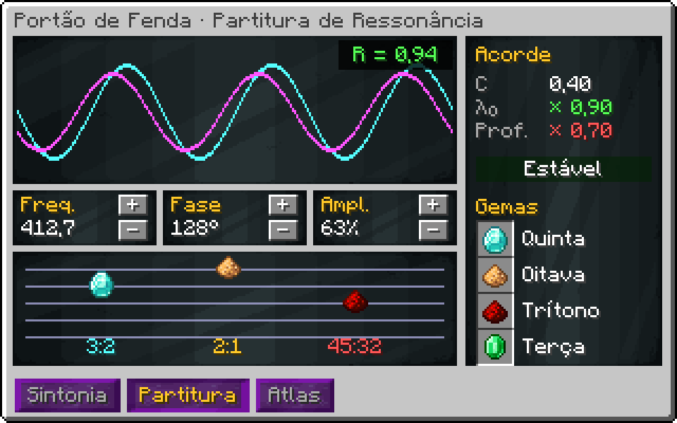
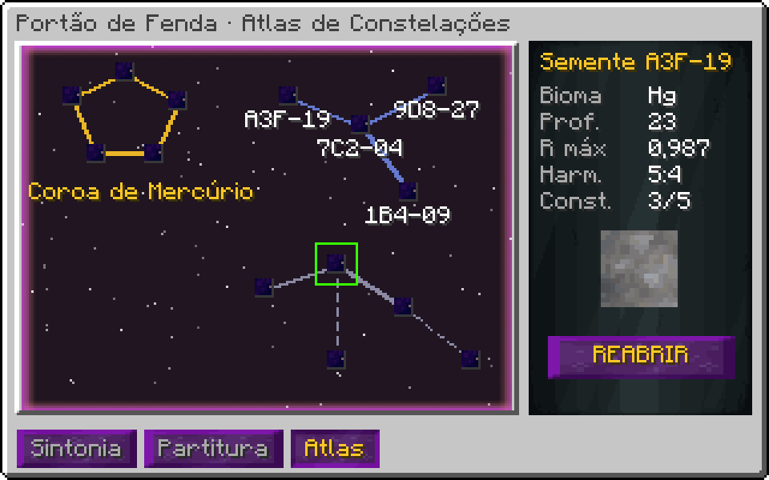

# Portão de Fenda Dimensional (UIV)

!!! warning "Em desenvolvimento"
    Esta máquina ainda não está pronta no jogo. A ficha descreve o design aprovado; números e detalhes podem mudar no balanço.


> Ficha de design, versão 1.

## 1. Visão geral

- **Tipo:** exploração de dimensões procedurais. Cada semente é um lugar com saída própria.
- **Estrutura:** anel vertical 126 × 126 × 54 com 8 espinhos; cada espinho é um **Pilone de Âncora**.
- **Energia:** wireless EU (como a Godforge) mais **matéria exótica** para estabilidade.
- **Ciclo:** sintonizar → estabilizar → aprofundar → extrair → fechar ou perder a fenda.

## 2. Sintonia

Cada semente esconde um ótimo `(f*, φ*, A*)`. O jogador ajusta frequência `f` (1–1000 THz), fase `φ` (0–360°) e amplitude `A` (0–100%).

```
R = exp( −((f − f*)/σf)² − (Δφ/σφ)² − ((A − A*)/σA)² )      ressonância, 0..1
σf = 40 THz · 0,8^sondas    σφ = 30° · 0,8^sondas    σA = 15% · 0,8^sondas
```

Cada **Sonda de Fenda** lançada estreita as tolerâncias (σ) daquela semente em 20%. A GUI mostra um padrão de interferência que fica mais nítido com R.

| Sondas | σf (THz) | σφ (°) | σA (%) | Erro para R ≥ 0,9 em f |
|---|---|---|---|---|
| 0 | 40 | 30 | 15 | ±13 THz |
| 2 | 25,6 | 19,2 | 9,6 | ±8,31 THz |
| 4 | 16,4 | 12,3 | 6,14 | ±5,32 THz |
| 6 | 10,5 | 7,86 | 3,93 | ±3,4 THz |
| 8 | 6,71 | 5,03 | 2,52 | ±2,18 THz |
| 10 | 4,29 | 3,22 | 1,61 | ±1,39 THz |

## 3. Estabilidade

```
dS/dt = κ · ṁ_exótica − λ₀ · (1 − R) · (1 + D/10) − λ_P · (8 − pilones_ativos)
κ = 2 %/L    λ₀ = 1,5 %/s    λ_P = 0,4 %/s
```

`S` vai de 0 a 100. `D` é a profundidade (seção 4). Em `S = 0` a fenda colapsa.

| R | D | Pilones | Matéria exótica para manter S (L/s) |
|---|---|---|---|
| 0.5 | 1 | 8 | 0,413 |
| 0.9 | 1 | 8 | 0,0825 |
| 0.9 | 10 | 8 | 0,15 |
| 0.98 | 10 | 8 | 0,03 |
| 0.98 | 30 | 8 | 0,06 |
| 0.98 | 30 | 6 | 0,46 |
| 0.995 | 60 | 8 | 0,0263 |

## 4. Profundidade e saída

```
D sobe 1 por âncora de profundidade inserida (item consumível), máximo pelo upgrade
saída/s = B_bioma · R² · D^1,5 · (S/100)
```

| D | Multiplicador D^1,5 | Tabela liberada |
|---|---|---|
| 1 | 1 | superfície |
| 5 | 11,2 | subsolo |
| 10 | 31,6 | manto |
| 20 | 89,4 | núcleo |
| 40 | 253 | fronteira |
| 80 | 716 | vazio entre dimensões |

### 4.1 Biomas (sorteados pela semente)

| Bioma | Peso | Saída base | Regra própria |
|---|---|---|---|
| Planície cristalina | 30 | gemas, sílica, Ti | — |
| Oceano de mercúrio | 20 | Hg, Au, Tl | R decai 2× mais rápido |
| Mundo-forja | 15 | metais fundidos, magma | aquece os pilones: +calor |
| Floresta de esporos | 15 | biomassa, enzimas, DNA alienígena | saída para a linha de bio |
| Abismo de antimatéria | 8 | traços de antimatéria | ressonância < 0,95 causa aniquilação |
| Relíquia de civilização | 7 | circuitos e ligas desconhecidas | só aparece com D ≥ 20 |
| Vazio | 5 | Matéria de Fenda pura | só com D ≥ 40 |

## 5. Eventos

- **Ressonância em cascata**: R ≥ 0,98 por 60 s seguidos → chance de 5%/min de **Singularidade de Fenda** (item raro, usado no upgrade final).
- **Colapso**: S = 0 → perde as âncoras de profundidade e a fenda fecha. A semente continua anotada.
- **Inversão**: R < 0,2 por 10 s → a fenda inverte e consome matéria exótica em dobro até fechar.

## 6. Progressão: Partitura de Ressonância

O Portão evolui pelo que o jogador **ouve** nas fendas. Quando uma fenda fica com R ≥ 0,9 por 30 s, ela deixa gravar um **harmônico**: uma razão de frequências `p:q`. Os harmônicos são guardados numa partitura de 5 linhas; o acorde montado nela muda o comportamento do Portão.

### 6.1 Harmônicos

A consonância de um intervalo vem da teoria musical real (intervalos de razões simples soam mais estáveis):

```
consonância(p:q) = 1 / log₂(p · q)
```

| Intervalo | Razão | Consonância | Onde aparece |
|---|---|---|---|
| Oitava | 2:1 | 1 | qualquer fenda |
| Quinta | 3:2 | 0,387 | planície cristalina |
| Quarta | 4:3 | 0,279 | floresta de esporos |
| Terça maior | 5:4 | 0,231 | oceano de mercúrio |
| Sexta menor | 8:5 | 0,188 | mundo-forja |
| Sétima menor | 9:5 | 0,182 | relíquia de civilização |
| Trítono | 45:32 | 0,0953 | abismo de antimatéria |
| Segunda menor | 16:15 | 0,126 | vazio |

### 6.2 Acordes

O acorde ativo é a soma dos harmônicos na partitura. Consonância alta estabiliza; dissonância aprofunda.

```
C = média das consonâncias do acorde
λ₀_efetivo = λ₀ · (1,3 − C)                  acorde consonante gasta menos matéria exótica
D_max_efetivo = D_max · max(0,5; 1 + 3 · (0,3 − C))   acorde dissonante desce mais fundo
```

| Acorde | C | λ₀ (×) | D_max (×) | Leitura |
|---|---|---|---|---|
| Quinta + Oitava | 0,693 | 0,607 | 0,5 | estável e raso |
| Tríade maior | 0,309 | 0,991 | 0,973 | estável e raso |
| Quarta + Quinta | 0,333 | 0,967 | 0,901 | estável e raso |
| Trítono + Segunda | 0,111 | 1,19 | 1,57 | instável e fundo |
| Sexta + Sétima | 0,185 | 1,12 | 1,35 | instável e fundo |

A partitura é o "loadout" do Portão. Acordes dissonantes são a forma de chegar ao Vazio, mas pedem pilones e matéria exótica de sobra.

### 6.3 Atlas de constelações

No lugar de marcos, cada semente aberta vira uma estrela no **Atlas**. Sementes próximas ficam ligadas:

```
distância(a, b) = sqrt( (Δf*/100 THz)² + (Δφ*/36°)² + (ΔA*/10%)² )
ligadas se distância < 1
```

Grupos de estrelas ligadas formam **constelações**. Completar uma constelação (abrir todas as sementes dela) dá um efeito permanente: um harmônico raro, um pilone extra ou a trava de fase daquela região. O Atlas é compartilhado entre jogadores do mesmo time.

### 6.4 Hatches novos

| Hatch | Função |
|---|---|
| Núcleo de Pilone | um em cada espinho; sem ele o pilone não conta |
| Hatch de Matéria Exótica | entrada da estabilidade (L/s) |
| Lançador de Sondas | consome Sondas de Fenda e estreita a sintonia |
| Cofre de Harmônicos | guarda as gemas de harmônico gravadas |
| Hatch de Sintonia | recebe f, φ e A por cover de dados ou computador |

## 8. Automação

A sintonia aceita valores por cover de dados ou computador (OpenComputers/CC). Uma rotina pode varrer f e φ procurando o máximo de R, como os scripts de automação da Godforge.

## Estado da implementação

**No código:**

- Estrutura de 126×126×54 convertida da sua construção
- Sintonia, estabilidade, profundidade, harmônicos, partitura e atlas em `RiftCore` (teste `RiftCoreTest`)
- Botões de sintonia na GUI; SpaceTime estabiliza; sondas e âncoras pelos barramentos; saída por bioma
- Render do horizonte de eventos com a cor do bioma; gametest de formação e estabilidade

**Falta:**

- Atlas de constelações desenhado na GUI
- Núcleos de pilone nos espinhos
- Uso da Singularidade de Fenda
- Receita do controlador

## Telas (mockup)

{ loading=lazy }

{ loading=lazy }

