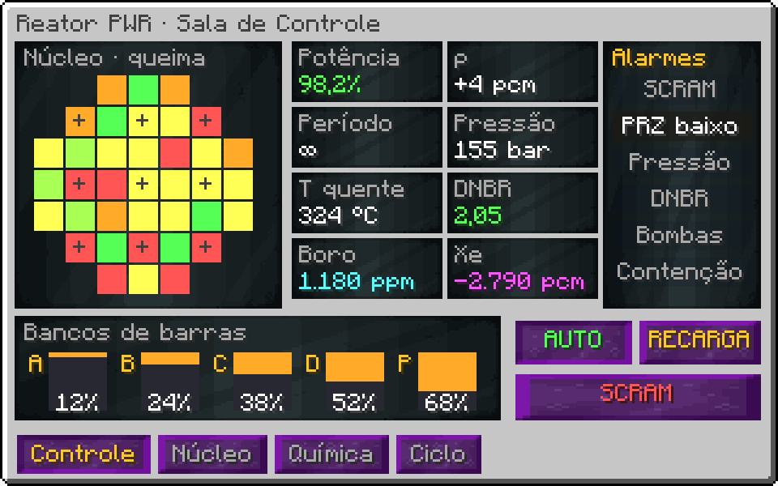

# Reator de Água Pressurizada (IV)

!!! warning "Em desenvolvimento"
    Esta máquina ainda não está pronta no jogo. A ficha descreve o design aprovado; números e detalhes podem mudar no balanço.


> Ficha de design, versão 2 (opção A escolhida). Tabelas calculadas por `tools/design/pwr_spec.py`. A física é a de um PWR real, com escala de tempo e de potência de jogo. Os números finais de balanço ficam com o modpack.

## 1. Visão geral

- **Tipo:** gerador térmico. O reator produz **Vapor de Alta Pressão**; turbinas separadas convertem em EU.
- **Tier:** IV. Todos os blocos e componentes são da era IV (tungstênio-aço, Inconel 625, Hastelloy-N, carbeto de boro, PBI).
- **Potência nominal:** 131.072 EU/t térmicos (16 A IV). Vapor: 262.144 L/t.
- **Estrutura:** contenção ≈ 47 × 48 × 47 + torre de resfriamento de 66 blocos.
- **Filosofia:** complexo de projetar, simples de manter. Tudo que exige atenção contínua tem um modo automático configurável uma vez (setpoint, programa de boro, campanha de recarga). O jogador projeta a usina; não fica de babá.

## 2. Estrutura e materiais

| Parte | Bloco (era IV) | Função |
|---|---|---|
| Contenção externa | High Strength Concrete | barreira final; precisa estar completa para ligar |
| Liner da contenção | PBI Radiation Resistant Mechanical Enclosure | estanqueidade; vazamento aqui = zona radioativa |
| Janelas de inspeção | Tungsten Borosilicate Glass | anel no nível do piso de operação |
| Blindagem primária | Radiation Absorbent Casing | cavidade do reator |
| Vaso de pressão e tampa | Robust Tungstensteel Machine Casing | aguenta 155 bar |
| Barras de controle (CRDM) | Boron Carbide Ceramic Radiation Resistant Cube | 5 bancos de barras, movidos pela GUI |
| Canais de combustível | Fission Reactor Casing | cada canal recebe um conjunto combustível |
| Geradores de vapor (4) | Inconel 625 Casing | troca de calor primário → secundário |
| Tubulação primária | Inconel 625 Pipe Casing | pernas quente, fria e de cruzamento |
| Bombas do primário (4) | Tungstensteel Gearbox + IV Machine Hull | vazão do primário; gastam EU |
| Pressurizador | Hastelloy-N 75 Casing | controla a pressão (aquecedores e spray) |
| Linha de surto/spray | High Pressure Pipe Casing | liga pressurizador e perna quente |
| Fundo do canal de recarga | Zirconia Ceramic Mechanical Block | resistente a água borada |
| Piso de operação | Grate Machine Casing | — |
| Ponte rolante polar | Tungstensteel Pipe Casing + listras | executa a recarga |
| Torre de resfriamento | High Strength Concrete | rejeita o calor do secundário |

### 2.1 Hatches

| Hatch | Qtd. | Uso |
|---|---|---|
| Hatch de Conjuntos Combustíveis | 1 | entrada de conjuntos novos e saída dos gastos (para a piscina) |
| Entrada de Água de Alimentação | 1–4 | água desmineralizada do secundário |
| Saída de Vapor de Alta Pressão | 1–4 | para as turbinas |
| Entrada de Ácido Bórico | 1 | controle químico de reatividade |
| Entrada/Saída de Água do Primário | 1 + 1 | reposição e purga (sai contaminada se houver falha de vareta) |
| Energia (IV) | 1–4 | bombas, aquecedores do pressurizador, ponte rolante |
| Dados / Redstone | até 4 | telemetria e comandos (seção 12) |

## 3. Combustível

O núcleo tem **37 canais**. Cada canal recebe um **Conjunto Combustível** (item) com enriquecimento `e` e queima `B`.

```
k∞(e, B) = k₀(e) − 0,006 · B          k₀(e) = 0,92 + 0,075 · e     (e em %, B em GWd/t)
k_núcleo = média dos k∞ · 0,97        (fuga de nêutrons)
B_max(e) = queima em que o conjunto sozinho deixa de manter o núcleo crítico
```

| Conjunto | e (%) | k₀ | B_max (GWd/t) | Ciclos de 1/3 do núcleo |
|---|---|---|---|---|
| LEU-3 | 3 | 1,15 | 19 | 1,51 |
| LEU-4 | 4 | 1,22 | 31,5 | 2,5 |
| LEU-4,5 | 4,5 | 1,26 | 37,8 | 3 |
| LEU-5 | 5 | 1,29 | 44 | 3,5 |

Variantes: **Conjunto com Gadolínia** (Gd₂O₃ como absorvedor queimável: −3000 pcm no início, some até 15 GWd/t; deixa o boro baixo no começo do ciclo) e, no LuV, **MOX** (Pu reciclado do PUREX).

Queima por tick: `dB/dt = P_canal / massa_U`. Com o núcleo a 100%, um conjunto LEU-4,5 sai em cerca de 3 ciclos. Um ciclo nominal dura 6 horas de jogo (ajustável no balanço).

## 4. Reatividade

```
ρ = (k − 1)/k                                  em pcm (1 pcm = 1e-5)
ρ_total = ρ_comb + ρ_barras + ρ_boro + ρ_Doppler + ρ_mod + ρ_Xe + ρ_Sm
ρ_barras  = −8000 pcm · f(x)        f(x) = x − sin(2πx)/(2π)   (curva S real de valor integral)
ρ_boro    = -10 pcm/ppm · C_B
ρ_Doppler = -2.5 pcm/K · (T_comb − 565 K)
ρ_mod     = -40 pcm/K · (T_mod − 565 K)
```

Os dois coeficientes de temperatura são negativos: o reator se autorregula. Subir a potência esquenta o combustível e a água, que tiram reatividade. Isso deixa o controle automático estável.

### 4.1 Valor das barras

| Inserção x | f(x) | ρ_barras (pcm) |
|---|---|---|
| 0% | 0 | 0 |
| 10% | 0,00645 | -51,6 |
| 25% | 0,0908 | -727 |
| 50% | 0,5 | -4.000 |
| 75% | 0,909 | -7.273 |
| 90% | 0,994 | -7.948 |
| 100% | 1 | -8.000 |

As barras valem pouco nas pontas e muito no meio, como num reator real. Ajuste fino se faz com as barras na faixa de 20–40%.

## 5. Cinética

Cinética pontual com um grupo de nêutrons atrasados: `β = 650 pcm`, `Λ = 2e-05 s`, `λ = 0.08 /s`.

```
dn/dt = (ρ − β)/Λ · n + λ·C
dC/dt = β/Λ · n − λ·C
período estável τ ≈ (β − ρ) / (λ · ρ)
```

| ρ (pcm) | Período τ | Tempo para dobrar a potência | Situação |
|---|---|---|---|
| 10 | 800 s | 555 s | normal |
| 50 | 150 s | 104 s | normal |
| 100 | 68,8 s | 47,7 s | normal |
| 200 | 28,1 s | 19,5 s | alarme de período |
| 300 | 14,6 s | 10,1 s | alarme de período |
| 500 | 3,75 s | 2,6 s | SCRAM por período curto |
| 640 | 0,195 s | 0,135 s | SCRAM por período curto |

Acima de β (650 pcm) o reator fica **pronto-crítico**: a potência dispara em milissegundos. O SCRAM automático por período curto (< 10 s) existe para isso nunca acontecer em operação normal.

## 6. Xenônio e samário

Equações reais do I-135 → Xe-135, com o tempo comprimido (**1 hora real = 1 minuto de jogo**):

```
dI/dt = γ_I·Σf·φ − λ_I·I
dX/dt = γ_X·Σf·φ + λ_I·I − λ_X·X − σ_X·φ·X
meias-vidas reais: I-135 = 6,57 h, Xe-135 = 9,14 h
ρ_Xe = −2800 pcm · X / X_eq(100%)
```

| Minutos após desligar | Xe / Xe_eq | ρ_Xe (pcm) | Pode religar com as barras todas fora? |
|---|---|---|---|
| 0 | 1 | -2.800 | sim |
| 2 | 1,43 | -4.013 | sim |
| 5 | 1,78 | -4.979 | não |
| 8 | 1,88 | -5.265 | não |
| 11 | 1,84 | -5.140 | não |
| 15 | 1,66 | -4.635 | não |
| 20 | 1,36 | -3.802 | sim |
| 30 | 0,805 | -2.254 | sim |
| 45 | 0,314 | -880 | sim |
| 60 | 0,112 | -315 | sim |

Depois de desligar, o xenônio **sobe** por ~10 minutos antes de cair (poço de xenônio). Religar nessa janela exige excesso de reatividade (combustível novo) ou esperar. O modo automático conhece o poço e mostra na GUI quanto tempo falta para poder religar.

## 7. Boro

A concentração de boro compensa a queima ao longo do ciclo. O programa de boro automático segue a curva abaixo; o jogador só garante ácido bórico e água desmineralizada.

```
C_B(B) = ρ_excesso(B) / 10        ρ_excesso = ρ_comb(B) − 1000 pcm de margem para as barras
```

| Queima média (GWd/t) | k_núcleo | ρ_comb (pcm) | Boro crítico (ppm) |
|---|---|---|---|
| 0 | 1,22 | 18.018 | 1.702 |
| 5 | 1,19 | 16.014 | 1.501 |
| 10 | 1,16 | 13.910 | 1.291 |
| 15 | 1,13 | 11.698 | 1.070 |
| 20 | 1,1 | 9.369 | 837 |
| 25 | 1,07 | 6.914 | 591 |
| 30 | 1,05 | 4.322 | 332 |

Mudar o boro é lento (diluição pela vazão de reposição), por isso as barras cuidam das mudanças rápidas e o boro das lentas.

## 8. Termo-hidráulica

### 8.1 Primário

```
P_th = n · P_nom
ṁ_prim = P_th / (c_p · ΔT)          ΔT nominal 33 K (292 → 325 °C), 155 bar
T_comb = T_mod + P_canal · R_th
DNBR = q_crítico(vazão, pressão) / q_local     precisa ficar > 1,3
```

| Potência | Vazão do primário | DNBR | Estado |
|---|---|---|---|
| 100% | 100% | 2,1 | ok |
| 100% | 75% | 1,67 | ok |
| 100% | 50% | 1,21 | SCRAM por DNBR |
| 60% | 50% | 2,01 | ok |
| 110% | 100% | 1,91 | ok |
| 100% | 25% | 0,693 | SCRAM por DNBR |

Perder bombas com o reator em potência é a falha clássica do PWR. Com 3 de 4 bombas o reator cai sozinho para 70%; com 2, SCRAM.

### 8.2 Pressurizador

```
pressão sobe  → spray (água fria da perna fria) condensa vapor
pressão desce → aquecedores elétricos (EU) ferve mais água
alívio a 172 bar: válvula abre e despeja vapor no tanque de alívio (perde água do primário)
```

### 8.3 Secundário e torre

```
vapor = 2 L por EU térmico
capacidade da torre Q_torre = 4096 EU/t por bloco de altura útil
P_max = Q_torre / (1 − η_turbina)        η_turbina = 0,33
reposição de água da torre = 1,8% da água de circulação (evaporação)
```

| Altura útil da torre | Q_torre (EU/t) | P_th máxima (EU/t) | % do nominal |
|---|---|---|---|
| 10 | 40.960 | 61.134 | 46,6% |
| 15 | 61.440 | 91.701 | 70% |
| 21 | 86.016 | 128.382 | 97,9% |
| 25 | 102.400 | 152.836 | 117% |

Torre menor que o necessário limita a potência. A altura útil é contada pela estrutura (a torre pode ser construída mais alta).

## 9. Bombas e energia própria

| Consumidor | Consumo | Observação |
|---|---|---|
| Bombas do primário (4) | 229 EU/t cada | 0,7% de P_th, como numa usina real |
| Aquecedores do pressurizador | até 2048 EU/t | só quando a pressão cai |
| Ponte rolante | 512 EU/t | só durante a recarga |
| Remoção de calor residual | 1024 EU/t | após desligar, até o calor de decaimento cair |

Sem energia as bombas perdem vazão pela inércia do volante: `vazão(t) = 1 / (1 + t/10 s)`. O SCRAM acontece antes do DNBR cair.

## 10. Calor de decaimento

Fórmula de Way–Wigner (real). Depois do SCRAM o núcleo continua gerando calor e precisa de remoção de calor residual:

```
P_d / P₀ = 0,066 · [ t^−0,2 − (t + T_op)^−0,2 ]
```

| Tempo após o SCRAM | P_d / P₀ | Calor (EU/t, a partir do nominal) |
|---|---|---|
| 1 s | 6,39% | 8.377 |
| 10 s | 3,96% | 5.184 |
| 1 min | 2,7% | 3.541 |
| 10 min | 1,63% | 2.133 |
| 1 h | 1,07% | 1.408 |
| 1 dia | 0,471% | 617 |
| 1 mês | 0,138% | 181 |

O mesmo calor vale para os conjuntos gastos: eles vão para a **Piscina de Combustível Usado** (multibloco auxiliar) e só podem ir para o reprocessamento depois que o calor cair abaixo de um limite.

## 11. Proteção e falhas

### 11.1 SCRAM automático

| Sinal | Limite |
|---|---|
| Fluxo alto | 109% do nominal |
| Período curto | < 10 s |
| Pressão baixa | < 130 bar |
| Pressão alta | > 166 bar |
| Vazão baixa | < 90% com P > 30% |
| DNBR baixo | < 1,3 |
| T_quente alta | > 340 °C |
| Perda de energia | bombas sem EU |
| Contenção aberta | qualquer bloco faltando |

### 11.2 Segurança passiva

- **Acumuladores:** tanques de água borada pressurizados com N₂ injetam sozinhos quando a pressão cai abaixo de 45 bar.
- **Injeção de segurança:** bombas de alta e baixa pressão (consomem EU e água borada).
- **Contenção:** segura vapor e radioatividade enquanto estiver completa.

### 11.3 Danos em degraus

| Degrau | Causa | Efeito | Recuperação |
|---|---|---|---|
| 1. Falha de varetas | T_comb alto, DNBR < 1 por > 5 s | água do primário sai **contaminada** | linha de limpeza: resina de troca iônica + evaporador |
| 2. Dano ao núcleo | perda de refrigeração com P_d alto | conjuntos viram **Destroços de Núcleo** | recarga completa; destroços vão para reprocessamento especial |
| 3. Fusão | dano ao núcleo sem injeção de segurança | **cório** no fundo do vaso; estrutura desmonta | remoção do cório (item muito pesado) e reconstrução do vaso |
| 4. Liberação | fusão com contenção incompleta | zona radioativa ao redor | só limpeza; sem explosão nuclear |

## 11.4 Distribuição de potência no núcleo

O núcleo não esquenta por igual. A GUI mostra o mapa de potência por canal e duas grandezas reais de operação:

```
F_q = potência do canal mais quente / potência média      limite 2,5
AO  = (P_topo − P_base) / (P_topo + P_base)              offset axial, alvo −5% a +5%
```

- **Padrão de carregamento:** o jogador escolhe onde vai cada conjunto. Conjuntos novos no centro deixam F_q alto; o padrão de baixa fuga (novos intercalados, gastos na borda) é o que as usinas reais usam e rende mais queima por ciclo. O modo automático sugere um padrão.
- **Oscilação de xenônio:** em núcleos grandes o xenônio pode oscilar entre topo e base com período real de ~15–30 h (15–30 min de jogo). O AO mostra a oscilação e o PID amortece com o banco de barras parcial (banco P).
- **Inclinação de quadrante:** um conjunto errado num quadrante desequilibra a potência. Acima de 2% de inclinação a potência máxima cai.

| F_q | Margem de potência | Efeito |
|---|---|---|
| 1,8 | 100% | normal |
| 2,2 | 100% | normal |
| 2,5 | 100% | normal |
| 2,8 | 89,3% | potência limitada automaticamente |
| 3,2 | 78,1% | potência limitada automaticamente |

## 11.5 Química do primário

| Parâmetro | Faixa | Como se controla | Fora da faixa |
|---|---|---|---|
| Boro | 0–2000 ppm | ácido bórico / diluição | reatividade errada |
| Lítio (⁷LiOH) | 2–3,5 ppm | hatch de química | pH baixo: corrosão e **crud** nas varetas |
| pH a 300 °C | 7,0–7,4 | relação Li/B (coordenada automaticamente) | crud: depósito que muda o AO (anomalia CIPS) |
| Oxigênio | < 5 ppb | hidrogênio dissolvido | corrosão sob tensão no Inconel |
| Atividade (I-131) | baixa | resina de troca iônica | sinal de vareta furada; pico de iodo após SCRAM |

O lítio-7 é enriquecido de propósito (o ⁶Li vira trítio). Isso liga o reator a uma linha química de separação de isótopos de lítio.

## 11.6 Geradores de vapor e transientes

- **Tubos do gerador:** cada gerador tem 3.388 tubos (número real de um gerador Westinghouse 51). A corrosão trinca tubos com o tempo; tubo trincado vaza primário para o secundário. Na parada, o jogador **tampona** tubos: cada 1% tamponado tira 0,4% da potência máxima daquele loop.
- **Rejeição de carga:** se as turbinas param de puxar vapor, o **despejo de vapor** manda o excesso para o condensador da torre por até 40% da potência; acima disso, SCRAM por pressão alta no secundário.
- **Pico de iodo:** depois de um SCRAM a atividade do primário sobe por algumas horas; a purga leva água contaminada para a limpeza.

## 12. Automação

Configura-se uma vez:

- **Modo potência:** setpoint de potência (% ou EU/t). Um PID move as barras; o programa de boro segue a seção 7.
- **Modo seguir carga:** a potência segue a demanda de vapor das turbinas (pelo nível do tanque de vapor).
- **Campanha de recarga:** com o hatch de conjuntos abastecido, um botão (ou sinal de redstone) desliga, troca 1/3 do núcleo em padrão de embaralhamento, manda os gastos para a piscina e religa depois do poço de xenônio.
- **Saídas:** cover/hatch de dados expõe potência, ρ, T, pressão, DNBR, Xe, boro, queima por canal e alarmes. OpenComputers e CC leem tudo.

Fica manual de propósito: limpar contaminação e consertar danos. Operar bem nunca exige intervenção.

## 13. Ciclo do combustível (cadeia de produção)

### 13.1 Enriquecimento (fórmula real de SWU)

```
V(x) = (2x − 1) · ln(x / (1 − x))
SWU por kg de produto = V(x_p) + T·V(x_t) − F·V(x_f)       x_f = 0,711%, x_t = 0,25%
```

| Produto | Alimentação UF₆ natural (kg/kg) | SWU por kg |
|---|---|---|
| LEU-3 | 5,97 | 3,81 |
| LEU-4 | 8,13 | 5,83 |
| LEU-4,5 | 9,22 | 6,87 |
| LEU-5 | 10,3 | 7,92 |

A **Cascata de Centrífugas** (multibloco auxiliar) entrega SWU por segundo conforme o número de centrífugas; mais estágios dão enriquecimento maior.

### 13.2 Etapas

| Etapa | Processo real | Entrada → Saída |
|---|---|---|
| Lixiviação | ácido sulfúrico | minério de urânio → yellowcake (U₃O₈) |
| Conversão | HF + F₂ | U₃O₈ → UF₆ |
| Enriquecimento | centrífugas | UF₆ natural → UF₆ enriquecido + UF₆ empobrecido |
| Reconversão | processo ADU | UF₆ → pó de UO₂ |
| Pastilhas | prensagem + sinterização a 1700 °C (EBF) | UO₂ → pastilhas |
| Revestimento | tubos de Zircaloy-4 (Zr, Sn, Fe, Cr) | pastilhas → varetas |
| Montagem | grades espaçadoras de Inconel 718, bocais de inox | varetas → Conjunto Combustível |

### 13.3 Combustível gasto (45 GWd/t)

| Fração | % em massa | Destino |
|---|---|---|
| Urânio (0,8% U-235) | 93,4 | volta para a conversão (urânio reprocessado) |
| Plutônio | 1,2 | MOX no LuV |
| Actinídeos menores (Np, Am, Cm) | 0,1 | linha de transmutação (futuro) |
| Gases (Kr, Xe) | 0,6 | separação criogênica: xenônio é útil |
| Metais do grupo da platina (Ru, Rh, Pd) | 0,5 | subproduto valioso |
| Césio e estrôncio | 0,6 | fontes de calor / RTG |
| Demais produtos de fissão | 3,6 | vitrificação em vidro borossilicato |

O reprocessamento **PUREX** (dissolução em HNO₃, extração com TBP em querosene) é a linha que separa essas frações.

## 14. Multiblocos auxiliares

| Multibloco | Tier | Papel |
|---|---|---|
| Cascata de Centrífugas | EV–IV | enriquecimento (SWU) |
| Fábrica de Combustível | IV | pastilhas → varetas → conjuntos |
| Piscina de Combustível Usado | IV | resfria conjuntos gastos (calor de decaimento) |
| Planta PUREX | IV–LuV | reprocessamento |
| Vitrificador | IV | rejeito em vidro borossilicato |

## Tela (mockup)

{ loading=lazy }
